---

## **3.0 Completion of System Design Diagrams**

### **3.1 Activity Diagrams (Complete Set)**

**Figure 3.17: Activity Diagram - Register User**

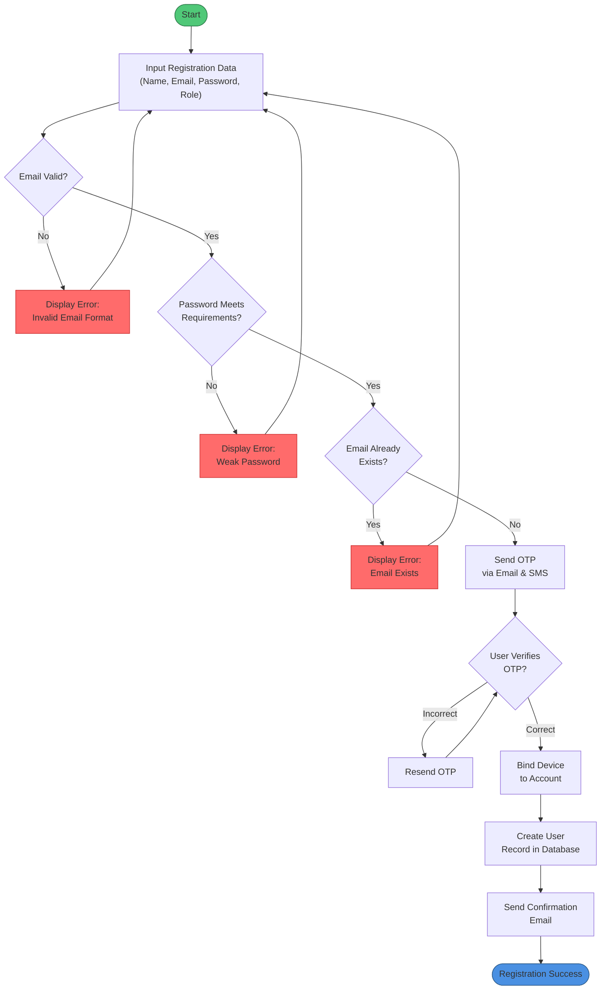

**Figure 3.18: Activity Diagram - Locate Nearest Center**

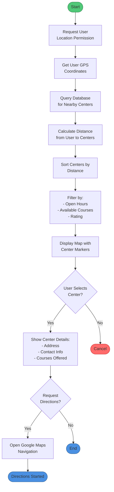

**Figure 3.19: Activity Diagram - Respond to Student Inquiries**

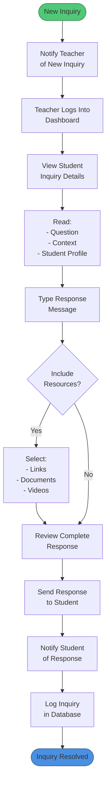

**Figure 3.20: Activity Diagram - Upload Assignment**

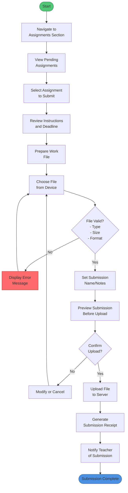

**Figure 3.21: Activity Diagram - Send Reports to Parents**

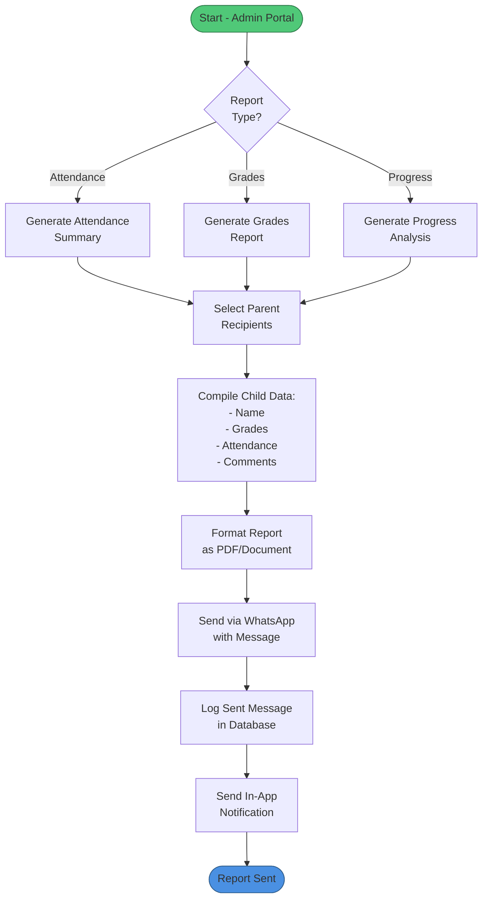

**Figure 3.22: Activity Diagram - Upload Grades**

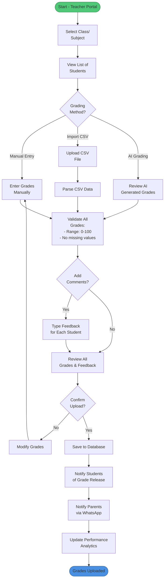

**Figure 3.23: Activity Diagram - View Analytics Dashboard**

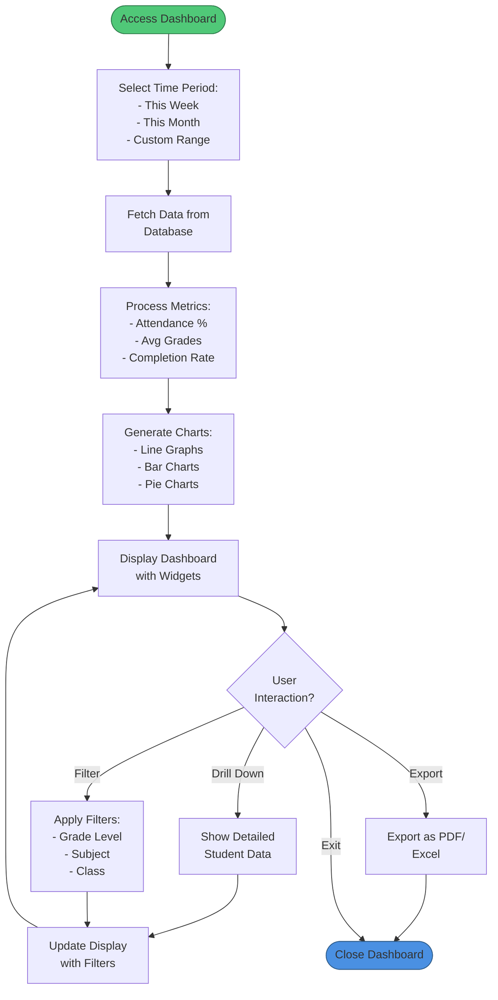

**Figure 3.24: Activity Diagram - Create Quiz**

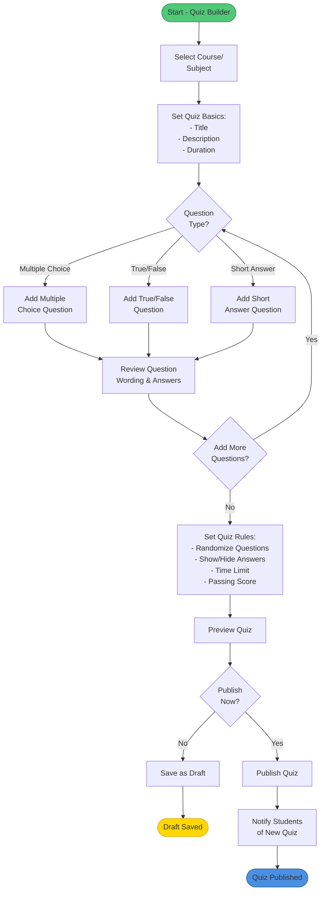

**Figure 3.25: Activity Diagram - Take Quiz**

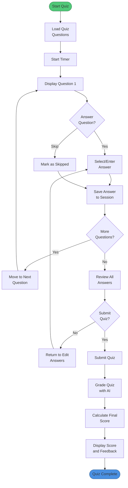

**Figure 3.26: Activity Diagram - View Student Distribution**

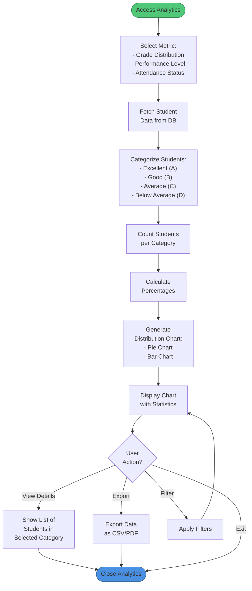

**Figure 3.27: Activity Diagram - View Activity Timeline**

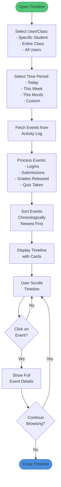

**Figure 3.28: Activity Diagram - Contact Support**

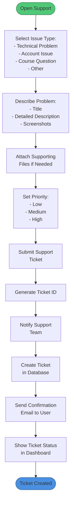

**Figure 3.29: Activity Diagram - Monitor Attendance**

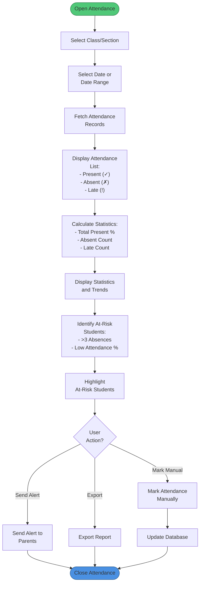

**Figure 3.30: Activity Diagram - View Detailed Reports**

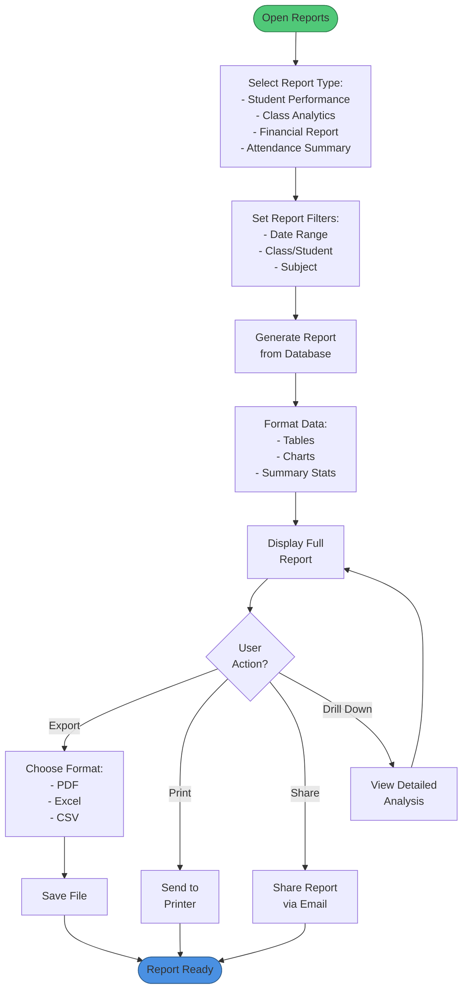

**Figure 3.31: Activity Diagram - View Bought Sessions and Books**

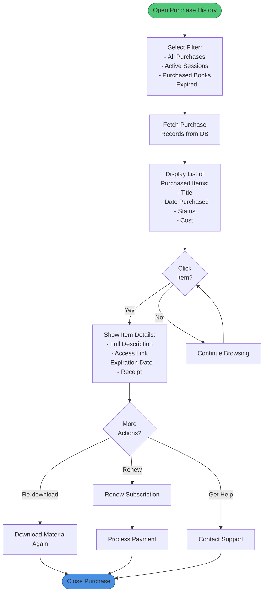

**Figure 3.32: Activity Diagram - View Quiz Grades**

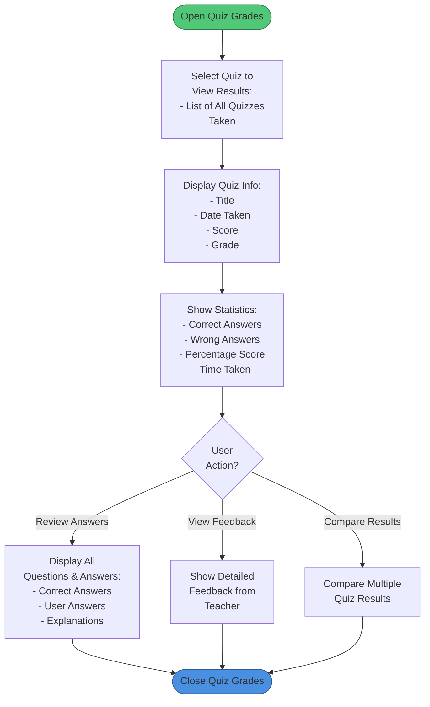

**Figure 3.33: Activity Diagram - View Child Statistics**

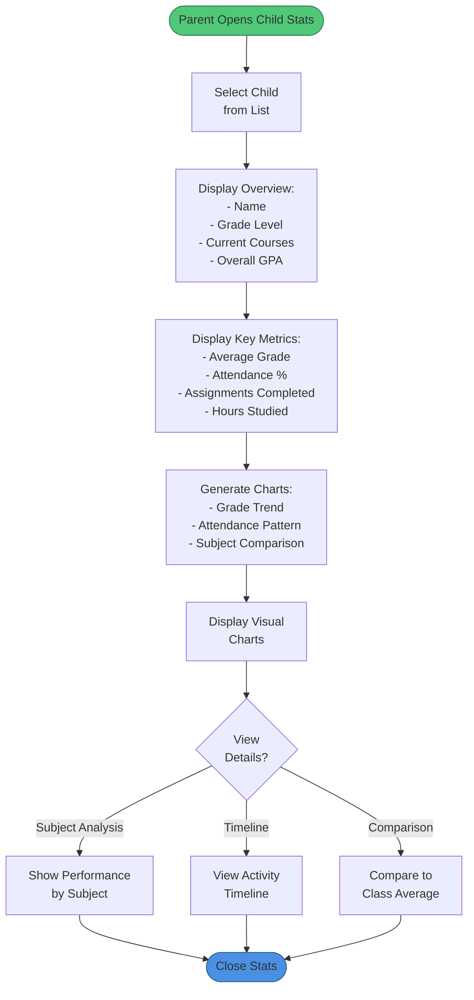

**Figure 3.34: Activity Diagram - Solve Assignment**

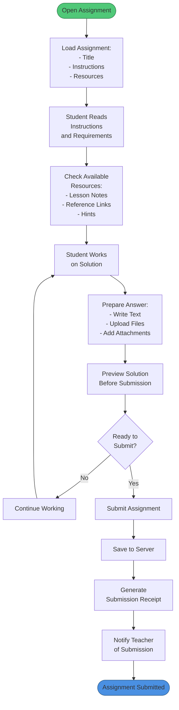

**Figure 3.35: Activity Diagram - View Classes**

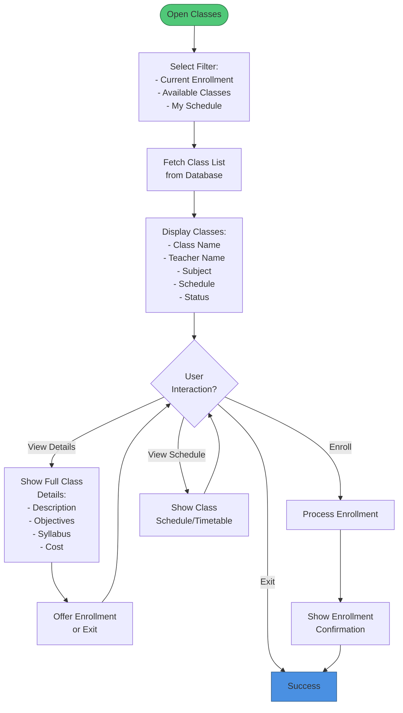

**Figure 3.36: Activity Diagram - Logout**

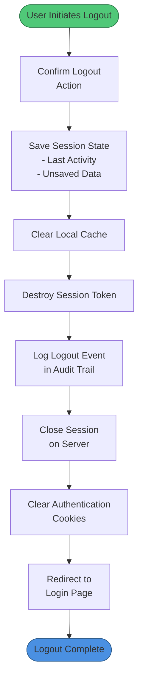

**Figure 3.37: Activity Diagram - Upload New Class**

```mermaid
graph TD
    Start([Teacher Opens Class Upload]) --> FillClassInfo["Fill Class Information:<br/>- Class Name<br/>- Subject<br/>- Grade Level<br/>- Description"]
    FillClassInfo --> SetSchedule["Set Class Schedule:<br/>- Days of Week<br/>- Start Time<br/>- Duration"]
    SetSchedule --> AddContent["Add Class Content:<br/>- Select Lessons<br/>- Upload Materials<br/>- Add Resources"]
    AddContent --> ConfigureAccess["Configure Access:<br/>- Price (if paid)<br/>- Max Students<br/>- Enrollment Type"]
    ConfigureAccess --> SetEnrollmentRules["Set Enrollment Rules:<br/>- Open/Closed<br/>- Prerequisites<br/>- Requirements"]
    SetEnrollmentRules --> ReviewAll["Review All<br/>Class Details"]
    ReviewAll --> ConfirmPublish{Publish<br/>Now?}
    ConfirmPublish -->|No| SaveDraft["Save as Draft"]
    SaveDraft --> DraftConfirm["Show Draft<br/>Confirmation"]
    ConfirmPublish -->|Yes| PublishClass["Publish Class"]
    PublishClass --> SaveToDatabase["Save to Database"]
    SaveToDatabase --> NotifyStudents["Notify Potential<br/>Students"]
    NotifyStudents --> Success([Class Published])
    DraftConfirm --> Success
    
    style Start fill:#50C878,stroke:#2D7A4A
    style Success fill:#4A90E2,stroke:#2E5C8A
```

### **3.2 State Diagrams (Essential User States)**

**Figure 3.38: State Diagram - User Login States**

```mermaid
stateDiagram-v2
    [*] --> LoggedOut: App Start
    LoggedOut --> EnteringCredentials: Click Login
    EnteringCredentials --> ValidatingCreds: Submit
    ValidatingCreds --> InvalidCreds: Creds Wrong
    InvalidCreds --> EnteringCredentials: Retry
    ValidatingCreds --> OTPSent: Creds Valid
    OTPSent --> EnteringOTP: Display OTP Input
    EnteringOTP --> VerifyingOTP: Submit OTP
    VerifyingOTP --> InvalidOTP: OTP Wrong
    InvalidOTP --> EnteringOTP: Retry
    VerifyingOTP --> CheckingDevice: OTP Valid
    CheckingDevice --> DeviceRecognized: Device Known
    DeviceRecognized --> SessionCreated: Create Session
    CheckingDevice --> UnknownDevice: Device New
    UnknownDevice --> AdditionalVerification: Request Extra Auth
    AdditionalVerification --> SessionCreated
    SessionCreated --> LoggedIn: Session Valid
    LoggedIn --> ActiveSession: User Interacting
    ActiveSession --> IdleSession: No Activity
    IdleSession --> LoggedOut: Session Timeout
    LoggedIn --> LoggedOut: User Logout
    ActiveSession --> LoggedOut: Session Revoked
```

**Figure 3.39: State Diagram - Assignment Submission States**

```mermaid
stateDiagram-v2
    [*] --> NotStarted: Assignment Assigned
    NotStarted --> InProgress: Student Views
    InProgress --> InProgress: Editing
    InProgress --> Submitted: Student Submits
    InProgress --> PartiallyCompleted: Timeout Close
    PartiallyCompleted --> InProgress: Resume
    PartiallyCompleted --> Cancelled: Abandon
    Submitted --> PendingGrading: Submission Valid
    PendingGrading --> AIGrading: AI Grades
    AIGrading --> AwaitingReview: Graded by AI
    AwaitingReview --> TeacherReviewing: Teacher Reviews
    TeacherReviewing --> Graded: Teacher Completes
    Graded --> NotificationSent: Notify Student
    NotificationSent --> [*]
    Cancelled --> [*]
```

**Figure 3.40: State Diagram - Quiz Taking States**

```mermaid
stateDiagram-v2
    [*] --> QuizAvailable: Quiz Published
    QuizAvailable --> NotStarted: Student Accesses
    NotStarted --> InProgress: Student Begins
    InProgress --> AnsweringQuestions: Load Q1
    AnsweringQuestions --> AnsweringQuestions: Answer Q & Next
    AnsweringQuestions --> ReviewingAnswers: All Questions Done
    ReviewingAnswers --> ConfirmingSubmission: User Reviews
    ConfirmingSubmission --> QuizSubmitted: Submit Quiz
    InProgress --> TimedOut: Time Expired
    TimedOut --> AutoSubmitted: Auto Submit
    AutoSubmitted --> Grading
    QuizSubmitted --> Grading: Grade Quiz
    Grading --> Graded: Score Calculated
    Graded --> ResultsAvailable: Results Released
    ResultsAvailable --> [*]
```

**Figure 3.41: State Diagram - Course Enrollment States**

```mermaid
stateDiagram-v2
    [*] --> CourseAvailable: Course Published
    CourseAvailable --> ViewingCourse: Student Browses
    ViewingCourse --> Enrolled: Student Enrolls
    ViewingCourse --> [*]: Exit
    Enrolled --> Active: Course Started
    Active --> InProgress: Student Learning
    InProgress --> InProgress: Complete Lessons
    InProgress --> Paused: Student Pauses
    Paused --> InProgress: Student Resumes
    InProgress --> Completed: Complete Course
    InProgress --> Dropped: Student Drops
    Completed --> CertificateIssued: Issue Certificate
    CertificateIssued --> [*]
    Dropped --> [*]
```

**Figure 3.42: State Diagram - Grade Release States**

```mermaid
stateDiagram-v2
    [*] --> GradeEntered: Teacher Enters Grade
    GradeEntered --> UnderReview: Awaiting Approval
    UnderReview --> AdminReviewing: Admin Checks
    AdminReviewing --> Approved: Admin Approves
    AdminReviewing --> Rejected: Admin Rejects
    Rejected --> GradeEntered: Revise
    Approved --> Releasing: Prepare Release
    Releasing --> Released: Published to Student
    Released --> NotificationSent: Notify Parent
    NotificationSent --> [*]
```

### **3.3 Sequence Diagram - System Interactions**

**Figure 3.43: Sequence Diagram - Complete Login Flow**

```mermaid
sequenceDiagram
    actor Student
    participant Mobile as Mobile App
    participant Gateway as API Gateway
    participant AuthService as Auth Service
    participant DB as Database
    participant OTPService as OTP Service
    participant DeviceService as Device Service

    Student->>Mobile: Enter Email & Password
    Mobile->>Gateway: POST /login
    Gateway->>AuthService: Validate Credentials
    AuthService->>DB: Query User
    DB-->>AuthService: User Found
    AuthService->>DB: Verify Password Hash
    DB-->>AuthService: Password Valid
    AuthService->>OTPService: Generate OTP
    OTPService->>DB: Store OTP (temp)
    OTPService-->>Mobile: Send OTP via SMS/Email
    Student->>Mobile: Enter OTP
    Mobile->>Gateway: POST /verify-otp
    Gateway->>AuthService: Verify OTP Code
    AuthService->>DB: Check OTP
    DB-->>AuthService: OTP Valid
    Mobile->>DeviceService: Get Device Info
    DeviceService->>DB: Retrieve Device Binding
    DB-->>DeviceService: Device Data
    DeviceService-->>AuthService: Device Verified
    AuthService->>DB: Create Session Token
    DB-->>AuthService: Token Generated
    AuthService-->>Mobile: Return JWT Token
    Mobile->>Gateway: Load Dashboard (with token)
    Gateway->>DB: Fetch User Profile
    DB-->>Mobile: Return Profile Data
    Mobile-->>Student: Display Dashboard
```

### **3.4 Class Diagram**

**Figure 3.44: Class Diagram - System Architecture**

```mermaid
classDiagram
    class User {
        -id: Long
        -email: String
        -passwordHash: String
        -fullName: String
        -phone: String
        -roleId: Long
        -createdAt: Timestamp
        +login(): Boolean
        +logout(): void
        +updateProfile(): void
        +changePassword(): void
    }
    
    class Student {
        -studentId: Long
        -enrolledCourses: List
        -attendance: Float
        -averageGrade: Float
        +viewCourses(): List
        +submitAssignment(): void
        +takeQuiz(): void
        +viewGrades(): List
    }
    
    class Teacher {
        -teacherId: Long
        -managedCourses: List
        -students: List
        +createCourse(): void
        +uploadMaterial(): void
        +gradeAssignment(): void
        +createQuiz(): void
        +viewAnalytics(): Map
    }
    
    class Parent {
        -parentId: Long
        -linkedStudents: List
        +viewChildGrades(): List
        +viewAttendance(): List
        +contactTeacher(): void
    }
    
    class Course {
        -courseId: Long
        -title: String
        -description: String
        -teacherId: Long
        -price: Decimal
        -duration: Int
        +addLesson(): void
        +publish(): void
        +updateContent(): void
    }
    
    class Lesson {
        -lessonId: Long
        -courseId: Long
        -title: String
        -content: String
        -videoUrl: String
        +addResource(): void
        +markComplete(): void
    }
    
    class Assignment {
        -assignmentId: Long
        -lessonId: Long
        -title: String
        -description: String
        -dueDate: Date
        +submit(): void
        +grade(): void
    }
    
    class Quiz {
        -quizId: Long
        -courseId: Long
        -title: String
        -questions: List
        -duration: Int
        +addQuestion(): void
        +generateAIQuestions(): void
        +grade(): void
    }
    
    class Grade {
        -gradeId: Long
        -studentId: Long
        -assignmentId: Long
        -score: Float
        -feedback: String
        -gradedBy: Long
        -gradedAt: Timestamp
    }
    
    class Attendance {
        -attendanceId: Long
        -studentId: Long
        -sessionId: Long
        -status: String
        -date: Date
        -recordedAt: Timestamp
    }
    
    class Device {
        -deviceId: Long
        -userId: Long
        -deviceHash: String
        -ipAddress: String
        -lastUsed: Timestamp
        +bindDevice(): void
        +validateDevice(): Boolean
    }
    
    User <|-- Student
    User <|-- Teacher
    User <|-- Parent
    Student "1" -- "*" Course : enrolls
    Teacher "1" -- "*" Course : teaches
    Course "1" -- "*" Lesson : contains
    Lesson "1" -- "*" Assignment : has
    Course "1" -- "*" Quiz : includes
    Student "1" -- "*" Grade : receives
    Student "1" -- "*" Attendance : has
    User "1" -- "*" Device : owns
```

### **3.5 Entity Relationship Diagram (ERD)**

**Figure 3.45: ER Diagram - Database Schema**

```mermaid
erDiagram
    USERS ||--o{ STUDENTS : creates
    USERS ||--o{ TEACHERS : creates
    USERS ||--o{ PARENTS : creates
    USERS ||--o{ DEVICES : binds
    USERS ||--o{ SESSIONS : initiates
    
    STUDENTS ||--o{ ENROLLMENTS : has
    STUDENTS ||--o{ GRADES : receives
    STUDENTS ||--o{ ATTENDANCE : has
    STUDENTS ||--o{ QUIZ_ATTEMPTS : takes
    STUDENTS ||--o{ ASSIGNMENTS_SUBMITTED : submits
    
    TEACHERS ||--o{ COURSES : creates
    TEACHERS ||--o{ GRADES : assigns
    TEACHERS ||--o{ QUIZ_QUESTIONS : creates
    TEACHERS ||--o{ SUPPORT_TICKETS : resolves
    
    PARENTS ||--o{ STUDENTS : monitors
    PARENTS ||--o{ NOTIFICATIONS : receives
    
    COURSES ||--o{ SESSIONS : organizes
    COURSES ||--o{ LESSONS : contains
    COURSES ||--o{ QUIZZES : includes
    COURSES ||--o{ ASSIGNMENTS : has
    COURSES ||--o{ ENROLLMENTS : offers
    
    LESSONS ||--o{ SESSION_ITEMS : structures
    LESSONS ||--o{ ASSIGNMENTS : includes
    
    QUIZZES ||--o{ QUIZ_QUESTIONS : contains
    QUIZZES ||--o{ QUIZ_ATTEMPTS : tests
    
    ASSIGNMENTS ||--o{ GRADES : grades
    ASSIGNMENTS ||--o{ ASSIGNMENTS_SUBMITTED : tracks
    
    QUIZ_ATTEMPTS ||--o{ QUIZ_ANSWERS : records
    QUIZ_ATTEMPTS ||--o{ GRADES : generates
    
    SESSIONS ||--o{ ATTENDANCE : records
    SESSIONS ||--o{ SESSION_ITEMS : contains
```

### **3.6 Block Diagram - System Architecture**

**Figure 3.46: Block Diagram - MentorX System Architecture**

```mermaid
graph TB
    subgraph Client["Client Layer"]
        Web["Web Application<br/>React/Next.js"]
        Mobile["Mobile App<br/>Flutter"]
        Admin["Admin Console"]
    end
    
    subgraph API["API Gateway & Services"]
        Gateway["API Gateway<br/>Kong/AWS Gateway"]
        AuthService["Authentication<br/>Service"]
        UserService["User Management<br/>Service"]
        CourseService["Course Management<br/>Service"]
        GradeService["Grading Service"]
        NotificationService["Notification<br/>Service"]
    end
    
    subgraph AI["AI & ML Services"]
        ChatBot["RAG Chatbot<br/>LLM + Embeddings"]
        PredictionModel["Student Performance<br/>Predictor"]
        Recommender["Lesson<br/>Recommender"]
        QuestionGenerator["AI Question<br/>Generator"]
    end
    
    subgraph Data["Data Layer"]
        MainDB["PostgreSQL<br/>Primary Database"]
        Cache["Redis<br/>Cache"]
        FileStore["S3/Cloud Storage<br/>Media Files"]
        VectorDB["Vector DB<br/>Embeddings"]
    end
    
    subgraph Infra["Infrastructure & Monitoring"]
        DockerK8s["Docker & Kubernetes<br/>Orchestration"]
        Monitoring["Monitoring<br/>Prometheus/ELK"]
        Logging["Centralized Logging<br/>ELK Stack"]
        Security["Security<br/>OAuth2/JWT"]
    end
    
    Web -->|HTTPS| Gateway
    Mobile -->|HTTPS| Gateway
    Admin -->|HTTPS| Gateway
    
    Gateway --> AuthService
    Gateway --> UserService
    Gateway --> CourseService
    Gateway --> GradeService
    Gateway --> NotificationService
    
    CourseService --> AI
    GradeService --> AI
    UserService --> AI
    
    AuthService --> MainDB
    UserService --> MainDB
    CourseService --> MainDB
    GradeService --> MainDB
    
    AuthService --> Cache
    CourseService --> Cache
    
    CourseService --> FileStore
    Recommender --> FileStore
    ChatBot --> VectorDB
    
    Gateway --> Security
    AuthService --> Security
    Monitoring --> Infra
    Logging --> Infra
```

Now I'll create the rest of the comprehensive sections. Let me continue with sections 4.0 onwards:
