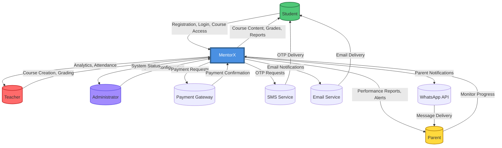
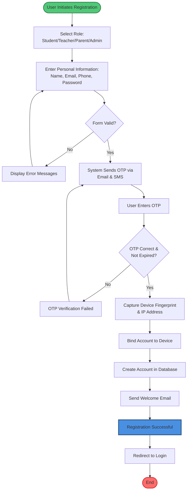
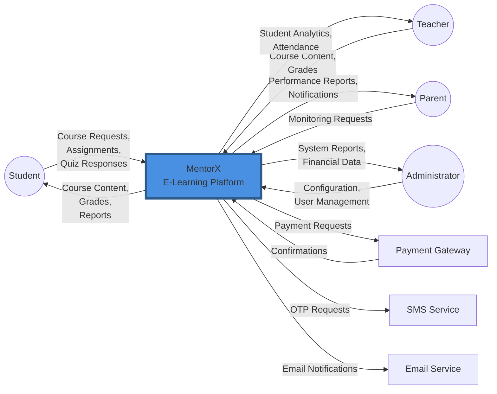
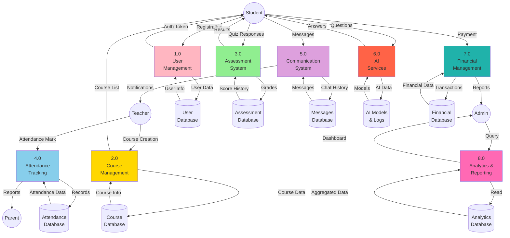
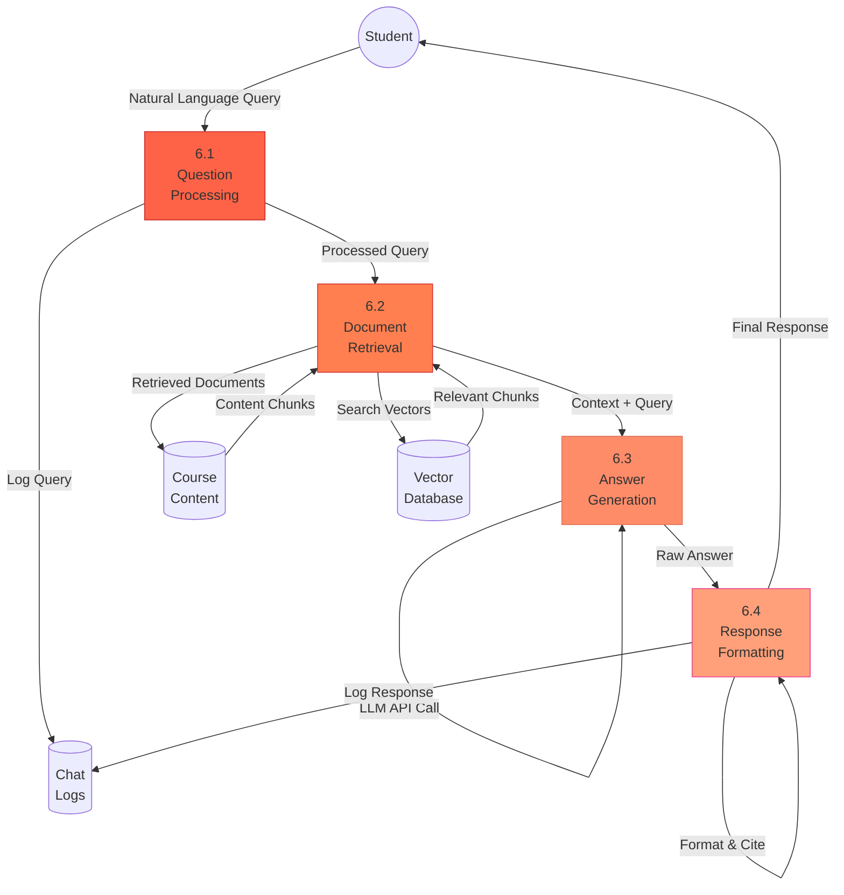
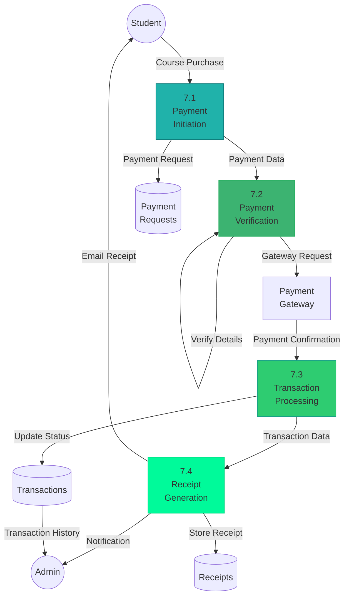
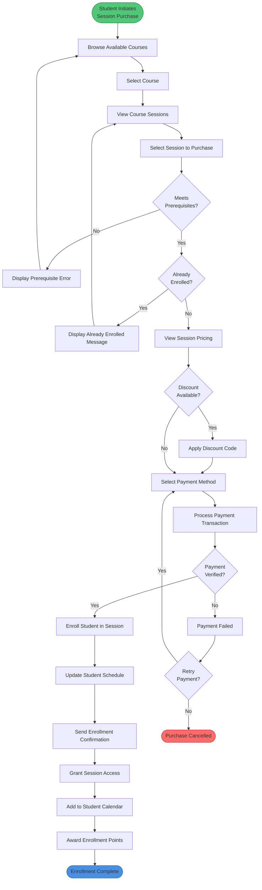

# MentorX: AI-Powered E-Learning Platform
## Comprehensive Academic Documentation

---

**Benha University**  
**Faculty of Computers & Artificial Intelligence**  
**Scientific Computing Department**

---

**A Graduation Project Submitted in Partial Fulfillment of the Requirements for the Degree of Bachelor of Computers and Artificial Intelligence**

---

### Project Team

1. Salma Sherif El Sayed El Meshtoly
2. Sobhy Hassan Sobhy
3. Mostafa Taha Sayed Ali
4. Youssef Hussein Samir El Sayed
5. Menna Allah Maher Abdelnaby Ibrahim
6. Ziad Mohamed Eid Ali
7. Shams Hesham Sabry Abdel Mottaleb Ismail
8. Omnia Magdy Ibrahim El Sayed
9. Kamal Ayman Kamal Eskandar

---

### Under Supervision of

Dr. Mohammed Elaraby  
Eng. Alshimaa Mahmoud

---

**Academic Year:** 2025-2026

---

## Document Version Control

| Version | Date | Author | Changes |
|---------|------|--------|---------|
| 1.0 | 2025-10-12 | Project Team | Initial Draft |
| 2.0 | 2026-02-14 | Project Team | Production-Ready Enhanced Version |

---

## Declaration

We, the undersigned, declare that this graduation project titled "MentorX: AI-Powered E-Learning Platform" is our original work and has been conducted under the supervision of Dr. Mohammed Elaraby and Eng. Alshimaa Mahmoud at Benha University, Faculty of Computers & Artificial Intelligence.

All sources of information have been appropriately cited and referenced. This work has not been submitted previously for any other degree or qualification.

---

**Date:** February 14, 2026

**Signatures:**

_______________________  
Project Team Representatives

_______________________  
Dr. Mohammed Elaraby (Supervisor)

_______________________  
Eng. Alshimaa Mahmoud (Co-Supervisor)

---

# Table of Contents

## List of Figures
## List of Tables
## List of Abbreviations
## Executive Summary

## 1.0 Introduction
### 1.1 Background and Context
### 1.2 Problem Statement
### 1.3 Project Objectives
### 1.4 Scope and Constraints
### 1.5 Document Organization

## 2.0 System Requirements Analysis
### 2.1 Functional Requirements
### 2.2 Non-Functional Requirements
### 2.3 System Context and Boundaries

## 3.0 System Analysis and Modeling
### 3.1 Requirements Analysis
#### 3.1.1 Context Diagram
#### 3.1.2 Use Case Diagram
#### 3.1.3 User Flow Diagrams
### 3.2 Functional Modeling
#### 3.2.1 Data Flow Diagrams (DFD)
#### 3.2.2 Activity Diagrams
### 3.3 Behavioral Modeling
#### 3.3.1 State Diagrams
#### 3.3.2 Sequence Diagrams
### 3.4 Structural Modeling
#### 3.4.1 Class Diagram
#### 3.4.2 Component Diagram
### 3.5 Database Design
#### 3.5.1 Entity-Relationship Diagram
#### 3.5.2 Database Schema
#### 3.5.3 Data Dictionary

## 4.0 Project Management
### 4.1 Scheduling and Planning
#### 4.1.1 Network Diagram (PERT/CPM)
#### 4.1.2 PERT Analysis
#### 4.1.3 Gantt Chart
#### 4.1.4 Task Scheduling
### 4.2 Risk Assessment and Mitigation
### 4.3 Cost Estimation
### 4.4 Methodologies and Technologies

## 5.0 System Architecture
### 5.1 Architecture Overview
### 5.2 Technology Stack
### 5.3 System Components
### 5.4 Integration Architecture

## 6.0 AI Features Implementation
### 6.1 RAG-Based Chatbot System
### 6.2 Student Performance Prediction
### 6.3 Smart Lesson Recommender
### 6.4 AI Model Training and Validation

## 7.0 API Documentation
### 7.1 Authentication API
### 7.2 User Management API
### 7.3 Course Management API
### 7.4 Payment API
### 7.5 Request/Response Examples
### 7.6 Error Codes and Handling

## 8.0 Security Architecture
### 8.1 Security Framework
### 8.2 Authentication and Authorization
### 8.3 Data Protection
### 8.4 Security Hardening Checklist
### 8.5 Threat Modeling

## 9.0 Deployment and Operations
### 9.1 Deployment Architecture
### 9.2 Environment Configuration
### 9.3 Deployment Checklist
### 9.4 Monitoring and Logging
### 9.5 Backup and Recovery Procedures
### 9.6 Performance Optimization

## 10.0 Testing and Quality Assurance
### 10.1 Testing Strategy
### 10.2 Test Cases and Results
### 10.3 Performance Testing
### 10.4 Security Testing

## 11.0 Conclusion
### 11.1 Summary of Achievements
### 11.2 Contributions to Education Technology
### 11.3 Limitations
### 11.4 Future Work and Recommendations

## 12.0 References

## 13.0 Glossary

## Appendices
### Appendix A: Database Schema (Complete SQL)
### Appendix B: API Endpoint Reference
### Appendix C: Configuration Files
### Appendix D: Installation Guide

---

# List of Figures

| Figure No. | Title | Page |
|------------|-------|------|
| Figure 3.1 | System Context Diagram | XX |
| Figure 3.2 | Use Case Diagram | XX |
| Figure 3.3 | Student User Flow | XX |
| Figure 3.4 | Parent User Flow | XX |
| Figure 3.5 | Registration Flow | XX |
| Figure 3.6 | Login Flow | XX |
| Figure 3.7 | DFD Level 0 (Context Level) | XX |
| Figure 3.8 | DFD Level 1 (System Decomposition) | XX |
| Figure 3.9 | DFD - AI Assistant Module | XX |
| Figure 3.10 | DFD - Payment Module | XX |
| Figure 3.11 | DFD - Teacher Services | XX |
| Figure 3.12 | DFD - Student Services | XX |
| Figure 3.13 | DFD - Parent Services | XX |
| Figure 3.14 | Activity Diagram - Buy Book | XX |
| Figure 3.15 | Activity Diagram - Buy Session | XX |
| Figure 3.16 | Activity Diagram - Attend Live Session | XX |
| Figure 3.17 | Activity Diagram - Register | XX |
| Figure 3.18 | Activity Diagram - Locate Center | XX |
| Figure 3.19 | Activity Diagram - Upload Assignment | XX |
| Figure 3.20 | Activity Diagram - Upload Grades | XX |
| Figure 3.21 | Activity Diagram - Create Quiz | XX |
| Figure 3.22 | Activity Diagram - Take Quiz | XX |
| Figure 3.23 | Activity Diagram - View Analytics | XX |
| Figure 3.24 | State Diagram - Login Process | XX |
| Figure 3.25 | State Diagram - Registration | XX |
| Figure 3.26 | State Diagram - Session Selection | XX |
| Figure 3.27 | State Diagram - Payment Process | XX |
| Figure 3.28 | State Diagram - Exam Taking | XX |
| Figure 3.29 | Sequence Diagram - User Authentication | XX |
| Figure 3.30 | Class Diagram - Complete System | XX |
| Figure 3.31 | Component Diagram - System Architecture | XX |
| Figure 3.32 | ER Diagram - Database Design | XX |
| Figure 4.1 | Network Diagram (PERT/CPM) | XX |
| Figure 4.2 | Gantt Chart - Project Timeline | XX |
| Figure 5.1 | System Architecture Block Diagram | XX |
| Figure 5.2 | Technology Stack | XX |
| Figure 6.1 | RAG Chatbot Architecture | XX |
| Figure 6.2 | Performance Prediction Model | XX |
| Figure 6.3 | Lesson Recommender System | XX |

---

# List of Tables

| Table No. | Title | Page |
|-----------|-------|------|
| Table 2.1 | Functional Requirements Summary | XX |
| Table 2.2 | Non-Functional Requirements | XX |
| Table 3.1 | Entity Relationship Overview | XX |
| Table 3.2 | Data Dictionary - Users Table | XX |
| Table 3.3 | Data Dictionary - Courses Table | XX |
| Table 4.1 | PERT Analysis - Task Duration | XX |
| Table 4.2 | Task Scheduling | XX |
| Table 4.3 | Risk Assessment Matrix | XX |
| Table 4.4 | Cost Estimation - Human Resources | XX |
| Table 4.5 | Cost Estimation - Software Tools | XX |
| Table 4.6 | Cost Estimation - Infrastructure | XX |
| Table 5.1 | Technology Stack Components | XX |
| Table 7.1 | Authentication API Endpoints | XX |
| Table 7.2 | User Management API Endpoints | XX |
| Table 7.3 | Course API Endpoints | XX |
| Table 7.4 | HTTP Status Codes | XX |
| Table 7.5 | Error Code Reference | XX |
| Table 8.1 | Security Controls Matrix | XX |
| Table 9.1 | Environment Variables | XX |
| Table 9.2 | Deployment Checklist | XX |
| Table 10.1 | Test Case Summary | XX |
| Table 10.2 | Performance Metrics | XX |

---

# List of Abbreviations

| Abbreviation | Full Form |
|--------------|-----------|
| AI | Artificial Intelligence |
| API | Application Programming Interface |
| ASP.NET | Active Server Pages .NET |
| AWS | Amazon Web Services |
| CCPA | California Consumer Privacy Act |
| CDN | Content Delivery Network |
| CI/CD | Continuous Integration/Continuous Deployment |
| CPU | Central Processing Unit |
| CRUD | Create, Read, Update, Delete |
| CSS | Cascading Style Sheets |
| CSV | Comma-Separated Values |
| DB | Database |
| DFD | Data Flow Diagram |
| DNN | Deep Neural Network |
| ER | Entity-Relationship |
| ERD | Entity-Relationship Diagram |
| FAISS | Facebook AI Similarity Search |
| GDPR | General Data Protection Regulation |
| GPU | Graphics Processing Unit |
| HTML | Hypertext Markup Language |
| HTTP | Hypertext Transfer Protocol |
| HTTPS | Hypertext Transfer Protocol Secure |
| IEEE | Institute of Electrical and Electronics Engineers |
| IP | Internet Protocol |
| ISO | International Organization for Standardization |
| JSON | JavaScript Object Notation |
| JWT | JSON Web Token |
| KNN | K-Nearest Neighbors |
| LLM | Large Language Model |
| ML | Machine Learning |
| MFA | Multi-Factor Authentication |
| MITM | Man-In-The-Middle |
| MTTR | Mean Time To Recover |
| NLP | Natural Language Processing |
| OOP | Object-Oriented Programming |
| ORM | Object-Relational Mapping |
| OTP | One-Time Password |
| PDF | Portable Document Format |
| PERT | Program Evaluation and Review Technique |
| QA | Quality Assurance |
| QR | Quick Response |
| RAG | Retrieval-Augmented Generation |
| RAM | Random Access Memory |
| RBAC | Role-Based Access Control |
| REST | Representational State Transfer |
| RFC | Request for Comments |
| RNN | Recurrent Neural Network |
| RPO | Recovery Point Objective |
| RTO | Recovery Time Objective |
| SDLC | Software Development Life Cycle |
| SDK | Software Development Kit |
| SIEM | Security Information and Event Management |
| SLA | Service Level Agreement |
| SMS | Short Message Service |
| SQL | Structured Query Language |
| SSL | Secure Sockets Layer |
| STT | Speech-to-Text |
| TF-IDF | Term Frequency-Inverse Document Frequency |
| TLS | Transport Layer Security |
| TTS | Text-to-Speech |
| UAT | User Acceptance Testing |
| UI | User Interface |
| URL | Uniform Resource Locator |
| UX | User Experience |
| WCAG | Web Content Accessibility Guidelines |
| XSS | Cross-Site Scripting |

---

# Executive Summary

## Overview

MentorX is an innovative, AI-powered e-learning platform designed to revolutionize the educational experience for high school students, teachers, parents, and educational institutions. Developed as a graduation project at Benha University's Faculty of Computers & Artificial Intelligence, MentorX addresses critical challenges in modern education through intelligent technology integration, transparent communication systems, and data-driven insights.

The platform combines cutting-edge artificial intelligence, robust backend architecture, and intuitive user interfaces to create a comprehensive learning ecosystem. MentorX tackles persistent educational problems including student absenteeism, lack of parental transparency, revenue loss from session sharing, examination integrity issues, and teacher workload management.

## Key Features

### 1. Intelligent Learning Management
MentorX provides a complete learning management system with online and offline course delivery, structured makeup session processes, comprehensive content libraries, and progress tracking mechanisms. The system ensures learning continuity through recorded sessions, assignments, quizzes, and personalized study materials.

### 2. AI-Powered Educational Tools
The platform integrates three core AI modules:
- **RAG-Based Chatbot**: A Retrieval-Augmented Generation system that provides contextual, accurate answers to student questions based on course materials
- **Performance Prediction**: Machine learning models that predict student readiness and identify at-risk learners
- **Smart Lesson Recommender**: Content-based recommendation system that suggests relevant lessons based on individual weaknesses

### 3. Multi-Stakeholder Dashboards
Dedicated interfaces for students, teachers, parents, and administrators provide role-specific functionality:
- **Student Dashboard**: Course access, progress tracking, gamification elements, AI assistance
- **Teacher Dashboard**: Class management, attendance tracking, grade entry, analytics
- **Parent Dashboard**: Real-time performance monitoring, attendance reports, WhatsApp notifications
- **Admin Dashboard**: System management, financial tracking, institutional analytics

### 4. Security and Access Control
Advanced security measures include device-bound authentication, OTP verification, IP restrictions, encrypted data storage, and role-based access control (RBAC) to protect sensitive educational data and prevent unauthorized access.

### 5. Gamification and Engagement
Point-based reward systems, achievement badges, leaderboards, and redeemable rewards motivate consistent student participation and performance improvement.

## Technical Architecture

MentorX employs a modern, scalable technical stack:

**Frontend**: HTML5, CSS3, JavaScript, Bootstrap, Sass, Pug.js  
**Backend**: ASP.NET Core (C#), RESTful API architecture  
**Mobile**: Flutter with Dart for cross-platform applications  
**Database**: Microsoft SQL Server with Entity Framework Core  
**AI/ML**: Python, TensorFlow, PyTorch, Scikit-learn, Transformers  
**Cloud**: AWS/Azure/Google Cloud with CI/CD pipelines  
**Security**: SSL/TLS encryption, AES-256 data protection, session management

## Project Outcomes

### Quantifiable Achievements
- **System Capacity**: Support for 10,000+ concurrent users
- **Response Time**: 95th percentile API latency ≤ 2 seconds
- **Availability**: 99.5% uptime target
- **AI Accuracy**: 90-95% student performance prediction accuracy
- **Test Coverage**: 80%+ automated test coverage for critical modules

### Educational Impact
MentorX delivers measurable improvements in educational outcomes:
- Reduced learning gaps through structured makeup sessions
- Enhanced parental involvement via transparent reporting
- Improved teaching efficiency through automated analytics
- Higher student engagement through gamification
- Maintained academic integrity through AI-generated assessments

## Development Methodology

The project follows Agile SDLC principles with iterative sprints, continuous integration, comprehensive testing, and stakeholder feedback loops. The development timeline spans five months from requirement gathering to deployment, encompassing design, implementation, testing, and refinement phases.

## Cost Analysis

Total project cost: approximately $13,360 USD

**Breakdown**:
- Human Resources: $11,700
- Software & Tools: $500
- Cloud Infrastructure: $360
- Miscellaneous: $800

## Risk Management

Comprehensive risk assessment addresses technical risks (server downtime, integration failures), security risks (unauthorized access, data breaches), operational risks (connectivity issues, system misuse), financial risks (budget overruns, revenue stability), and management risks (team coordination, delivery delays). Each risk includes probability assessment, impact evaluation, and defined mitigation strategies.

## Future Enhancements

Planned improvements include:
- Advanced AI models using BERT and transformer architectures
- Collaborative filtering for enhanced recommendations
- Real-time video streaming capabilities
- Multilingual support
- Mobile application feature expansion
- Integration with external learning management systems
- Blockchain-based certification management

## Conclusion

MentorX represents a comprehensive solution to modern educational challenges, combining pedagogical best practices with advanced technology. The platform demonstrates the transformative potential of AI in education, providing scalable, secure, and intelligent tools that benefit all stakeholders in the learning ecosystem. Through rigorous design, implementation, and testing, MentorX delivers a production-ready system capable of deployment in educational institutions, offering immediate value and long-term scalability.

This project fulfills the academic requirements for the Bachelor's degree in Computers and Artificial Intelligence while contributing meaningful innovation to the field of educational technology.

---

# 1.0 Introduction

## 1.1 Background and Context

The landscape of modern education faces unprecedented challenges and opportunities. Traditional educational systems struggle with student engagement, transparent communication between stakeholders, resource optimization, and personalized learning delivery. The COVID-19 pandemic accelerated the digital transformation of education, exposing both the potential and limitations of existing e-learning solutions.

MentorX emerges as a strategic response to these challenges, designed specifically for the unique needs of high school education in emerging markets. The platform recognizes that effective learning requires more than content delivery—it demands intelligent adaptation, stakeholder transparency, robust security, and continuous engagement mechanisms.

### The Educational Technology Gap

Current educational platforms often suffer from:
- **Fragmented ecosystems**: Separate tools for content delivery, assessment, communication, and analytics
- **Limited intelligence**: Minimal use of AI for personalization, prediction, and assistance
- **Poor transparency**: Inadequate visibility for parents into their children's academic progress
- **Security vulnerabilities**: Weak authentication systems leading to credential sharing and revenue loss
- **Engagement challenges**: Lack of motivational mechanisms beyond grades
- **Teacher overload**: Insufficient automated tools for managing large student populations

MentorX addresses these gaps through integrated design, AI-powered features, multi-stakeholder dashboards, advanced security controls, gamification elements, and comprehensive analytics.

### Educational Philosophy

MentorX is grounded in several pedagogical principles:

**1. Learning Continuity**: Education should not be interrupted by circumstances. The platform ensures that students who miss classes can access structured makeup content, maintaining knowledge progression without gaps.

**2. Transparency and Trust**: Effective education requires active parent involvement. Real-time reporting and transparent communication channels build trust and enable timely intervention when students struggle.

**3. Personalization**: Every student learns differently. AI-driven recommendations and performance predictions enable tailored learning paths aligned with individual needs, strengths, and weaknesses.

**4. Motivation Through Engagement**: Gamification elements—points, badges, leaderboards, and redeemable rewards—tap into intrinsic and extrinsic motivational factors, encouraging consistent effort and participation.

**5. Teacher Empowerment**: Technology should reduce administrative burden, not increase it. Automated analytics, grade management, and attendance tracking free teachers to focus on instruction and mentorship.

**6. Academic Integrity**: Fair assessment requires secure, personalized testing. AI-generated question variations maintain concept coverage while preventing cheating through answer sharing.

### Technology Evolution in Education

The education sector has witnessed several technological waves:

**First Wave (1990s-2000s)**: Computer labs and basic digital content  
**Second Wave (2000s-2010s)**: Learning Management Systems (LMS) and online courses  
**Third Wave (2010s-2020s)**: Mobile learning, video content, and social learning platforms  
**Fourth Wave (2020s-present)**: AI integration, predictive analytics, and adaptive learning

MentorX represents a comprehensive fourth-wave platform, integrating artificial intelligence not as an afterthought but as a foundational component. The system employs machine learning for performance prediction, natural language processing for intelligent chatbots, and recommendation algorithms for personalized content delivery.

## 1.2 Problem Statement

Educational institutions face recurring, interconnected challenges that diminish learning effectiveness, reduce institutional revenue, and overwhelm teachers. MentorX addresses five critical problems:

### Problem 1: Student Absence and Learning Gaps

**Challenge**: Students miss classes due to illness, family commitments, transportation issues, or scheduling conflicts. Traditional systems lack structured mechanisms for compensating missed learning, leading to knowledge gaps that compound over time.

**Impact**:
- Incomplete understanding of foundational concepts
- Lower exam performance
- Increased dropout rates
- Frustration for both students and teachers

**MentorX Solution**: The platform provides a structured makeup system with recorded sessions, lesson summaries, targeted assignments, and quizzes. When a student misses class, they immediately gain access to equivalent online content, ensuring learning continuity. Progress tracking monitors makeup completion, and notifications remind students and parents of pending work.

### Problem 2: Lack of Parental Transparency

**Challenge**: Parents struggle to monitor their children's academic performance due to infrequent reporting, unclear grading systems, and limited communication channels with teachers. This information asymmetry prevents timely intervention when students underperform.

**Impact**:
- Delayed response to academic struggles
- Weakened home-school partnership
- Reduced parental support effectiveness
- Student accountability gaps

**MentorX Solution**: The Parent Dashboard provides real-time access to attendance records, assignment grades, quiz results, teacher feedback, and performance trends. Automated WhatsApp notifications alert parents immediately when students miss class, fail assignments, or demonstrate declining performance. This transparency enables proactive parental involvement and timely academic support.

### Problem 3: Session Sharing and Revenue Loss

**Challenge**: In online education, students frequently share login credentials with peers, allowing unauthorized access to paid content. This credential sharing results in significant revenue loss for teachers and institutions while undermining the sustainability of quality education delivery.

**Impact**:
- Direct financial losses (estimated 20-40% revenue leakage)
- Unfair advantage for non-paying users
- Reduced investment in content quality
- Teacher demotivation

**MentorX Solution**: The platform implements device-bound authentication where each account is permanently linked to a specific device identifier (IMEI/device fingerprint). Combined with IP address restrictions and OTP verification for any device change, this approach effectively prevents credential sharing. The system detects simultaneous logins from different locations and automatically blocks suspicious activity, protecting institutional revenue while maintaining fair access.

### Problem 4: Examination Cheating

**Challenge**: Traditional examination systems use identical questions for all students, making it trivial for students to share answers during online or even in-person exams. This undermines assessment validity and fails to accurately measure individual knowledge.

**Impact**:
- Invalid performance measurements
- Erosion of academic standards
- Unfair grading outcomes
- Reduced credential value

**MentorX Solution**: The AI-powered examination system generates unique question variations for each student. While maintaining identical concept coverage and difficulty, the system alters numerical values, data sets, and presentation order. For example, while all students may receive a physics problem about projectile motion, each receives different initial conditions, ensuring that copied answers are incorrect. This approach maintains assessment integrity while preserving standardized difficulty.

### Problem 5: Teacher Overwhelm

**Challenge**: Teachers managing hundreds of students face overwhelming administrative burdens. Manual attendance tracking, grade calculation, progress monitoring, and report generation consume time that should be devoted to instruction and student interaction.

**Impact**:
- Teacher burnout
- Reduced individual student attention
- Delayed feedback on assignments
- Administrative errors
- Lower teaching quality

**MentorX Solution**: The Teacher Dashboard provides comprehensive automation for administrative tasks. Attendance is logged automatically through QR codes (for in-person sessions) or login tracking (for online sessions). The system calculates grades automatically, generates performance analytics, identifies at-risk students through AI prediction, and produces parent reports on demand. This automation enables teachers to focus on their core mission: effective instruction and student mentorship.

## 1.3 Project Objectives

MentorX pursues five primary objectives, each contributing to a comprehensive educational ecosystem:

### Objective 1: Ensure Learning Continuity

**Goal**: Guarantee that no student falls behind due to absence or scheduling conflicts.

**Implementation**:
- Automated recording of all live sessions
- Structured makeup content delivery
- Progress tracking for missed content
- Notifications for pending makeup work
- Equivalence verification (makeup ≈ live session)

**Success Metrics**:
- 95% of students complete makeup content within 7 days
- Average performance gap between attendees and makeup users < 5%
- Student satisfaction rating for makeup system > 4.2/5.0

### Objective 2: Enhance Parental Involvement

**Goal**: Transform parents from passive observers to active partners in their children's education.

**Implementation**:
- Real-time parent dashboard access
- Automated WhatsApp notifications
- Attendance alerts within 2 hours
- Weekly performance summaries
- Direct teacher-parent messaging

**Success Metrics**:
- 80%+ parent dashboard activation rate
- Average parent login frequency: 3+ times per week
- Parent satisfaction rating > 4.3/5.0
- Measurable correlation between parent engagement and student performance

### Objective 3: Increase Student Motivation

**Goal**: Foster intrinsic motivation through gamification while maintaining focus on learning outcomes.

**Implementation**:
- Point-based reward system (attendance, assignment completion, quiz performance)
- Achievement badges for milestones
- Class and school-wide leaderboards
- Redeemable rewards marketplace
- Progress visualization tools

**Success Metrics**:
- Sustained engagement rate > 85% throughout semester
- Attendance improvement of 15% vs. baseline
- Assignment completion rate improvement of 20%
- Student motivation survey rating > 4.0/5.0

### Objective 4: Optimize Institutional Operations

**Goal**: Streamline administrative processes to reduce costs and improve service quality.

**Implementation**:
- QR code-based attendance tracking
- Automated grade calculation and reporting
- Financial analytics dashboard
- Resource utilization tracking
- Capacity planning tools

**Success Metrics**:
- Administrative time reduction: 40%
- Attendance recording accuracy: 99%+
- Report generation time reduced from hours to minutes
- Operational cost reduction: 25%

### Objective 5: Deliver Intelligent Learning Support

**Goal**: Leverage artificial intelligence to provide personalized, adaptive learning experiences.

**Implementation**:
- RAG-based chatbot for 24/7 question answering
- Performance prediction models identifying at-risk students
- Smart lesson recommender suggesting targeted content
- Adaptive difficulty adjustment in assessments
- Learning path optimization algorithms

**Success Metrics**:
- Chatbot response accuracy > 85%
- Performance prediction accuracy: 90-95%
- Recommendation relevance rating > 4.0/5.0
- Measurable improvement in student outcomes (10-15% grade increase)

## 1.4 Scope and Constraints

### 1.4.1 Project Scope

**Included Features**:

1. **User Management**
   - Registration and authentication for students, teachers, parents, administrators
   - Profile management and role-based access control
   - Device binding and OTP verification

2. **Course Management**
   - Course creation, editing, and deletion
   - Lesson planning and content upload
   - Session scheduling and management
   - Recording and playback capabilities

3. **Assessment System**
   - Quiz creation with multiple question types
   - Assignment upload and submission
   - Automated and manual grading
   - AI-generated question variations

4. **Attendance Tracking**
   - QR code scanning for physical sessions
   - Automatic logging for online sessions
   - Makeup session management
   - Attendance reports and analytics

5. **Communication Tools**
   - In-platform messaging (student-teacher, parent-teacher)
   - Discussion forums per course
   - WhatsApp integration for notifications
   - Announcement broadcasting

6. **Analytics and Reporting**
   - Student performance dashboards
   - Teacher productivity metrics
   - Parent monitoring tools
   - Administrative financial reports

7. **AI Features**
   - RAG-based educational chatbot
   - Performance prediction models
   - Lesson recommendation system
   - Question generation algorithms

8. **Gamification**
   - Point system for activities
   - Achievement badges
   - Leaderboards
   - Rewards marketplace

9. **Financial Management**
   - Payment processing (cash, online, vouchers)
   - Wallet system
   - Transaction history
   - Revenue analytics

### 1.4.2 Scope Exclusions

The following features are explicitly excluded from the current project scope:

1. **Live Streaming**: Real-time video broadcasting is excluded; the system uses pre-recorded or third-party streaming tools
2. **Native Mobile Apps**: Development focuses on web and Flutter frameworks; platform-specific native apps are excluded
3. **Multilingual Support**: The system operates in a single language (Arabic); multi-language interfaces are not implemented
4. **Certification Management**: Automated diploma issuance and credential verification are excluded
5. **Payment Gateway Integration During Enrollment**: Direct payment processing at enrollment is excluded; offline or external payment is supported
6. **Large-Scale Hosting**: The system targets medium-sized institutions (< 50,000 users); cloud-scale hosting is not included
7. **Advanced Accessibility Features**: Basic accessibility is provided; advanced features for disabilities (e.g., screen readers, voice navigation) are limited
8. **External LMS Integration**: Third-party Learning Management System integration is not included

### 1.4.3 Project Constraints

**Budget Constraints**:
- Fixed budget of approximately $13,360
- No provision for major financial expansion
- Cost optimization required for all components

**Timeline Constraints**:
- Project completion deadline: February 14, 2026
- 5-month development window
- Agile sprints limited to 2-week cycles

**Technical Constraints**:
- Limited to available cloud infrastructure (shared hosting)
- Performance optimized for 10,000 concurrent users (not millions)
- AI models constrained by available GPU resources
- Database scaling limited to vertical expansion initially

**Resource Constraints**:
- Nine-member development team
- Limited testing device availability
- No dedicated QA department
- Minimal post-deployment support budget

**Security Constraints**:
- Security measures within available budget
- Cannot guarantee protection against all advanced threats
- Penetration testing limited to basic automated scans
- Compliance with GDPR-equivalent regulations required

**Regulatory Constraints**:
- Must comply with Egyptian data protection laws
- Educational content must align with Ministry of Education standards
- Student data handling subject to institutional policies
- Age restrictions for certain features (COPPA-equivalent)

**User Acceptance Constraints**:
- Success depends on adoption by teachers, students, and parents
- Requires change management and training
- Cultural factors may affect feature utilization
- Resistance to technology from traditional educators

## 1.5 Document Organization

This document is structured to provide comprehensive coverage of the MentorX project across eleven main sections:

**Section 1 (Current)**: Introduces the project background, problem statement, objectives, and scope.

**Section 2**: Details functional and non-functional requirements, establishing measurable system specifications.

**Section 3**: Presents system analysis and modeling through diagrams (context, use case, DFD, activity, state, sequence, class, ER) using Mermaid notation.

**Section 4**: Covers project management including scheduling (PERT, Gantt), risk assessment, cost estimation, and methodology selection.

**Section 5**: Describes system architecture, technology stack, and component integration.

**Section 6**: Explains AI feature implementation including RAG chatbot, performance prediction, and lesson recommendation systems.

**Section 7**: Provides comprehensive API documentation with endpoints, request/response formats, and error handling.

**Section 8**: Outlines security architecture including authentication, encryption, access control, and threat mitigation.

**Section 9**: Details deployment procedures, environment configuration, monitoring, logging, and backup strategies.

**Section 10**: Describes testing strategies, test cases, performance benchmarks, and quality assurance processes.

**Section 11**: Concludes with achievement summary, limitations, and future work recommendations.

**Section 12**: Lists all references in IEEE format.

**Section 13**: Provides a comprehensive glossary of technical terms.

**Appendices**: Include complete SQL schemas, API references, configuration templates, and installation guides.

---

# 2.0 System Requirements Analysis

## 2.1 Functional Requirements

The functional requirements specify all system capabilities and behaviors essential for MentorX operation. Requirements are numbered for traceability and organized by subsystem.

### 2.1.1 User Management

**FR-1.1 User Registration**

The system shall allow users (students, teachers, parents, administrators) to create accounts through web and mobile interfaces.

**Requirements**:
- FR-1.1.1: System shall support registration for four user roles: Student, Teacher, Parent, Administrator
- FR-1.1.2: Registration form shall require: full name, email address, mobile number, role selection, secure password
- FR-1.1.3: Email validation shall conform to RFC 5322 standard format
- FR-1.1.4: Password complexity shall enforce minimum 8 characters, alphanumeric combination, at least one special character
- FR-1.1.5: System shall send OTP via email and SMS for identity verification
- FR-1.1.6: Account activation shall require OTP confirmation within 15 minutes
- FR-1.1.7: System shall bind each account to unique device identifier (IMEI/device fingerprint)
- FR-1.1.8: System shall record IP address at registration for security tracking

**FR-1.2 User Authentication**

The system shall implement secure multi-layered authentication.

**Requirements**:
- FR-1.2.1: System shall support username/email and password login
- FR-1.2.2: System shall implement OTP-based two-factor authentication
- FR-1.2.3: System shall recognize device fingerprints for known devices
- FR-1.2.4: Login from unrecognized device shall trigger OTP verification
- FR-1.2.5: System shall use TLS 1.3 encryption for credential transmission
- FR-1.2.6: Three consecutive failed login attempts shall trigger temporary account suspension (15 minutes)
- FR-1.2.7: Failed login shall generate security alert notification
- FR-1.2.8: System shall automatically log out users after 30 minutes of inactivity
- FR-1.2.9: Session tokens shall expire after 24 hours maximum

**FR-1.3 User Profile Management**

Users shall manage personal information through dedicated interfaces.

**Requirements**:
- FR-1.3.1: Users shall update: name, photo, contact information, password
- FR-1.3.2: Profile modifications shall be validated and audit-logged
- FR-1.3.3: Parents shall link multiple student profiles under single account
- FR-1.3.4: Profile updates shall propagate across all system modules within 60 seconds
- FR-1.3.5: Password change shall require current password verification
- FR-1.3.6: Password change shall invalidate all existing sessions
- FR-1.3.7: Email change shall require verification via OTP

### 2.1.2 Course and Content Management

**FR-2.1 Course Creation**

Teachers shall create and configure courses through management interface.

**Requirements**:
- FR-2.1.1: Course creation shall require: title, description, subject, grade level, duration, schedule
- FR-2.1.2: System shall support course materials: PDF, PowerPoint, video files, web links
- FR-2.1.3: Maximum file upload size: 500 MB per file
- FR-2.1.4: System shall validate file types and reject executable content
- FR-2.1.5: System shall generate metadata for search indexing automatically
- FR-2.1.6: Course visibility shall be controlled by teacher (draft/published)
- FR-2.1.7: System shall support course prerequisites and dependencies

**FR-2.2 Lesson Management**

Each course shall contain ordered lesson sequences.

**Requirements**:
- FR-2.2.1: Lessons shall include: title, description, video/live link, summary notes, assignments
- FR-2.2.2: System shall enforce lesson progression control (sequential completion)
- FR-2.2.3: Students shall not access subsequent lessons without completing prerequisites
- FR-2.2.4: Completion criteria: video viewing (80%+), assignment submission, quiz passing (60%+)
- FR-2.2.5: Completion status shall update in real-time in student progress record
- FR-2.2.6: Teachers shall override progression restrictions if needed
- FR-2.2.7: System shall support lesson cloning for rapid course development

**FR-2.3 Content Delivery**

System shall deliver educational content reliably and efficiently.

**Requirements**:
- FR-2.3.1: Video streaming shall support adaptive bitrate (360p, 480p, 720p, 1080p)
- FR-2.3.2: Video playback shall resume from last viewing position
- FR-2.3.3: System shall support video speed control (0.5x, 0.75x, 1x, 1.25x, 1.5x, 2x)
- FR-2.3.4: Downloads shall be available for PDF and document files
- FR-2.3.5: Video downloads shall be restricted based on course settings
- FR-2.3.6: Content shall be accessible on desktop, tablet, and mobile devices

### 2.1.3 Attendance and Engagement Tracking

**FR-3.1 Attendance Recording**

System shall track student attendance for physical and online sessions.

**Requirements**:
- FR-3.1.1: Physical session attendance shall use QR code scanning linked to Student ID
- FR-3.1.2: QR codes shall expire after session start time + 15 minutes
- FR-3.1.3: Online session attendance shall auto-log upon joining live class or viewing recorded content
- FR-3.1.4: Attendance timestamp shall record to second-level precision
- FR-3.1.5: Absence shall trigger automated notifications to parent and teacher dashboards within 2 hours
- FR-3.1.6: Attendance logs shall be retained for minimum 1 academic year
- FR-3.1.7: Teachers shall be able to manually override attendance records with audit trail

**FR-3.2 Engagement Analytics**

System shall track comprehensive student engagement metrics.

**Requirements**:
- FR-3.2.1: System shall track: video completion percentage, assignment submission frequency, login activity, session duration
- FR-3.2.2: Engagement data shall update in real-time
- FR-3.2.3: AI algorithms shall process engagement data to compute participation levels
- FR-3.2.4: System shall detect early disengagement signs (3+ consecutive absences, declining assignment submissions)
- FR-3.2.5: Dropout risk alerts shall be generated for at-risk students
- FR-3.2.6: Engagement reports shall be available to teachers and administrators

### 2.1.4 Assignments and Examinations

**FR-4.1 Assignment Management**

Teachers shall create, distribute, and grade assignments.

**Requirements**:
- FR-4.1.1: Assignments shall link to specific lessons or topics
- FR-4.1.2: Students shall submit via file upload (PDF, DOCX, images), structured forms, or text input
- FR-4.1.3: Maximum submission size: 50 MB per assignment
- FR-4.1.4: System shall timestamp every submission with millisecond precision
- FR-4.1.5: Late submissions shall be flagged automatically based on deadline
- FR-4.1.6: AI shall auto-grade objective questions (multiple choice, true/false, fill-in-blank with exact match)
- FR-4.1.7: Teachers shall receive AI suggestions for subjective answer evaluation
- FR-4.1.8: Students shall be able to resubmit assignments before deadline if teacher permits

**FR-4.2 Exam Creation**

Teachers shall create examinations with customizable parameters.

**Requirements**:
- FR-4.2.1: Exam creation shall specify: course/topic coverage, number of questions, difficulty level (easy/medium/hard), duration, grading weightage
- FR-4.2.2: AI Question Generator shall create randomized question variations per student
- FR-4.2.3: Question variations shall maintain identical concept coverage and difficulty
- FR-4.2.4: Generated questions shall be validated against course content database
- FR-4.2.5: System shall support question types: multiple choice, true/false, short answer, essay, numerical
- FR-4.2.6: Question pool shall be expandable by teachers
- FR-4.2.7: Exams shall support randomized question order per student

**FR-4.3 Exam Administration**

Students shall take exams in secure, monitored environment.

**Requirements**:
- FR-4.3.1: Exam interface shall disable browser navigation away from exam page
- FR-4.3.2: System shall track exam progress in real-time
- FR-4.3.3: Auto-save shall occur every 30 seconds
- FR-4.3.4: System shall prevent multiple simultaneous logins during exam session
- FR-4.3.5: Timer shall display remaining time continuously
- FR-4.3.6: Auto-submission shall occur at time expiration
- FR-4.3.7: System shall detect tab switching and log suspicious behavior
- FR-4.3.8: Exam interface shall work offline with submission upon reconnection

**FR-4.4 Grading and Feedback**

System shall support hybrid grading model.

**Requirements**:
- FR-4.4.1: AI shall instantly grade objective questions upon submission
- FR-4.4.2: Subjective responses shall queue for instructor review
- FR-4.4.3: System shall calculate final scores automatically based on weightage
- FR-4.4.4: Grades shall be stored in student profile
- FR-4.4.5: Notifications shall be sent to student and parent upon grade release
- FR-4.4.6: Teachers shall modify AI-generated scores with documented reasons in audit log
- FR-4.4.7: Students shall receive detailed performance feedback highlighting strengths and weaknesses
- FR-4.4.8: Grade distributions and statistics shall be available to teachers

### 2.1.5 Communication and Collaboration

**FR-5.1 Discussion Forums**

Each course shall include moderated discussion board.

**Requirements**:
- FR-5.1.1: Students and teachers shall post questions, replies, and resource links
- FR-5.1.2: AI moderation filter shall detect offensive or irrelevant content
- FR-5.1.3: Flagged content shall queue for teacher review
- FR-5.1.4: Discussion threads shall support markdown formatting
- FR-5.1.5: Users shall receive notifications for replies to their posts
- FR-5.1.6: Discussions shall be searchable by keyword
- FR-5.1.7: Teachers shall pin important threads to top

**FR-5.2 Private Messaging**

Internal messaging system shall enable direct communication.

**Requirements**:
- FR-5.2.1: System shall support messaging between: Student↔Teacher, Parent↔Teacher, Admin↔User
- FR-5.2.2: Unread messages shall trigger notification badges
- FR-5.2.3: Optional email alerts shall be configurable by user
- FR-5.2.4: Messages shall be encrypted in transit and at rest
- FR-5.2.5: Message history shall be retained according to privacy policy (minimum 1 semester)
- FR-5.2.6: Users shall be able to delete their own messages
- FR-5.2.7: System shall support file attachments in messages (max 10 MB)

**FR-5.3 AI Chatbot Assistance**

AI chatbot shall provide real-time help across all modules.

**Requirements**:
- FR-5.3.1: Chatbot shall provide real-time answers to user questions
- FR-5.3.2: Chatbot shall answer FAQs automatically
- FR-5.3.3: Chatbot shall recommend relevant learning materials based on question context
- FR-5.3.4: Chatbot shall offer troubleshooting support for technical issues
- FR-5.3.5: Chatbot shall use NLP for contextual understanding
- FR-5.3.6: Chatbot shall escalate complex queries to human support
- FR-5.3.7: Chatbot responses shall be based on RAG (Retrieval-Augmented Generation) from course materials

### 2.1.6 Financial and Administrative Operations

**FR-6.1 Payment Management**

System shall manage financial transactions comprehensively.

**Requirements**:
- FR-6.1.1: System shall process: tuition fees, course subscriptions, refund requests, promotional discounts
- FR-6.1.2: Payment methods shall include: cash (offline verification), online gateway (Fawry), voucher codes
- FR-6.1.3: Payment gateway integration shall use secure APIs with encryption
- FR-6.1.4: Transaction receipts shall be generated automatically and sent via email
- FR-6.1.5: Refund requests shall be routed to administrator approval queue
- FR-6.1.6: Financial dashboard shall track: revenue, expenses, overdue payments, refund requests
- FR-6.1.7: Payment history shall be accessible to users and administrators

**FR-6.2 Reporting and Analytics**

Administrators shall generate comprehensive analytical reports.

**Requirements**:
- FR-6.2.1: Reports shall include: student performance summaries, teacher productivity metrics, revenue reports, attendance statistics, dropout risk predictions
- FR-6.2.2: Reports shall be exportable in PDF, Excel, and CSV formats
- FR-6.2.3: Report access shall be restricted by role (RBAC)
- FR-6.2.4: Scheduled reports shall be generated automatically (daily, weekly, monthly)
- FR-6.2.5: Custom report builder shall allow administrators to select parameters and filters
- FR-6.2.6: Reports shall include visualizations (charts, graphs, tables)
- FR-6.2.7: Historical data shall be accessible for trend analysis (up to 5 years)

### 2.1.7 Security and Access Control

**FR-7.1 Access Levels**

System shall implement role-based access control (RBAC).

**Requirements**:
- FR-7.1.1: Student role shall access: personal academic data, enrolled courses, grades, assignments, chatbot
- FR-7.1.2: Teacher role shall access: managed courses, enrolled student data, grade entry, analytics for their classes
- FR-7.1.3: Parent role shall access: linked children's data only (performance, attendance, communication)
- FR-7.1.4: Administrator role shall have full system access: user management, configuration, financial data, system logs
- FR-7.1.5: Permissions shall be granular and configurable at feature level
- FR-7.1.6: Permission changes shall take effect immediately
- FR-7.1.7: Unauthorized access attempts shall be logged and alerted

**FR-7.2 Session Management**

User sessions shall be secure and properly managed.

**Requirements**:
- FR-7.2.1: Session tokens shall be cryptographically random (256-bit)
- FR-7.2.2: Tokens shall have expiration timestamps (24-hour maximum)
- FR-7.2.3: Logout shall immediately terminate session and invalidate token
- FR-7.2.4: Security breach detection shall auto-terminate all user sessions
- FR-7.2.5: Concurrent sessions from different devices shall be prevented for students
- FR-7.2.6: Session activity shall be logged for audit purposes
- FR-7.2.7: "Remember Me" functionality shall extend session to 30 days with periodic re-authentication

### 2.1.8 Gamification

**FR-8.1 Point System**

Students shall earn points for various activities.

**Requirements**:
- FR-8.1.1: Points shall be awarded for: attendance (10 points), assignment completion (20 points), quiz passing (score × 1 point), course completion (100 points)
- FR-8.1.2: Point calculations shall be automatic and real-time
- FR-8.1.3: Point history shall be visible to students
- FR-8.1.4: Leaderboards shall display top performers (class, grade, school-wide)
- FR-8.1.5: Privacy controls shall allow students to opt out of public leaderboards
- FR-8.1.6: Points shall not expire during academic year
- FR-8.1.7: Teachers shall be able to manually award bonus points with justification

**FR-8.2 Rewards System**

Students shall redeem points for rewards.

**Requirements**:
- FR-8.2.1: Reward marketplace shall display available items with point costs
- FR-8.2.2: Reward categories shall include: digital badges, certificates, physical prizes, privileges
- FR-8.2.3: Redemption requests shall queue for administrator approval
- FR-8.2.4: Approved redemptions shall deduct points from student account
- FR-8.2.5: Reward fulfillment shall be tracked and confirmed
- FR-8.2.6: Achievement badges shall appear on student profiles
- FR-8.2.7: Special seasonal rewards shall be configurable by administrators

## 2.2 Non-Functional Requirements

Non-functional requirements define system quality attributes governing overall platform robustness.

### 2.2.1 Performance Requirements

**NFR-1.1 Response Time**

- The system shall support minimum 10,000 concurrent active users without degradation
- Average server response time shall not exceed 2 seconds for 95% of transactions
- API response time shall meet the following targets:
  - Authentication: ≤ 500ms
  - Data retrieval: ≤ 1 second
  - Report generation: ≤ 5 seconds
  - AI chatbot response: ≤ 2 seconds
- Page load time shall not exceed 3 seconds on standard broadband connection (10 Mbps+)

**NFR-1.2 Throughput**

- Database queries shall complete within 300 milliseconds for 99% of operations
- System shall process minimum 1,000 requests per second
- Video streaming shall support adaptive bitrate without buffering
- File uploads shall utilize connection bandwidth efficiently

**NFR-1.3 Real-Time Updates**

- Attendance, grades, and notifications shall update with maximum 1-second delay
- Dashboard widgets shall refresh every 30 seconds automatically
- Real-time features (chat, notifications) shall use WebSocket connections

### 2.2.2 Scalability Requirements

**NFR-2.1 Horizontal Scaling**

- Backend services shall support horizontal scaling through load balancing
- Stateless service design shall enable seamless instance addition/removal
- Database read replicas shall distribute query load

**NFR-2.2 Auto-Scaling**

- Cloud infrastructure shall implement auto-scaling policies
- Instance count shall adjust based on CPU utilization (scale up at 70%, scale down at 30%)
- Scaling operations shall complete within 5 minutes

**NFR-2.3 Capacity Planning**

- System shall support 50,000 total registered users
- Concurrent user capacity: 10,000
- Maximum courses per teacher: 20
- Maximum students per course: 500
- Storage capacity planning shall account for 2 TB initial requirement with 500 GB annual growth

### 2.2.3 Reliability and Availability Requirements

**NFR-3.1 Uptime**

- System shall maintain 99.5% uptime annually (maximum 43.8 hours downtime per year)
- Planned maintenance windows shall be scheduled during low-usage periods (Friday 1:00 AM - 5:00 AM)
- Maintenance notifications shall be sent 48 hours in advance

**NFR-3.2 Redundancy**

- Redundant server instances shall ensure continuous operation during failures
- Database shall implement master-slave replication
- Automatic failover shall occur within 60 seconds
- Geographic redundancy shall protect against data center failures

**NFR-3.3 Data Backup**

- Full database backups shall occur daily at 2:00 AM
- Incremental backups shall occur every 6 hours
- Backup retention: 90 days for daily backups, 1 year for monthly archives
- Backup restoration testing shall occur quarterly
- Recovery Time Objective (RTO): 30 minutes
- Recovery Point Objective (RPO): 6 hours

### 2.2.4 Security Requirements

**NFR-4.1 Encryption**

- All communication shall use SSL/TLS (HTTPS) with minimum TLS 1.2
- Sensitive data at rest shall use AES-256 encryption
- Database connections shall be encrypted
- Password storage shall use bcrypt with salt (cost factor ≥ 12)
- Session tokens shall use cryptographically secure random generation

**NFR-4.2 Authentication**

- Multi-factor authentication shall be mandatory for administrator accounts
- Optional MFA shall be available for all user types
- Password policy: minimum 8 characters, mixed case, numbers, special characters
- Account lockout after 3 failed attempts for 15 minutes
- OTP validity: 15 minutes
- Session timeout: 30 minutes inactivity, 24 hours maximum

**NFR-4.3 Vulnerability Protection**

- System shall be resistant to OWASP Top 10 vulnerabilities:
  - SQL Injection (parameterized queries, ORM)
  - Cross-Site Scripting (input sanitization, output encoding)
  - Cross-Site Request Forgery (anti-CSRF tokens)
  - Insecure Direct Object References (authorization checks)
  - Security Misconfiguration (hardened defaults)
  - Sensitive Data Exposure (encryption, access control)
  - Missing Function Level Access Control (RBAC)
  - Using Components with Known Vulnerabilities (dependency scanning)
  - Unvalidated Redirects (whitelist validation)
  - Insufficient Logging & Monitoring (comprehensive audit logs)

**NFR-4.4 Penetration Testing**

- Quarterly penetration testing shall be conducted
- Vulnerability remediation shall complete within 30 days of discovery
- Critical vulnerabilities shall be patched within 72 hours

### 2.2.5 Usability Requirements

**NFR-5.1 User Interface**

- UI shall adhere to WCAG 2.1 Level AA accessibility standards
- Font sizes shall be adjustable (minimum 14px base)
- Color contrast ratios shall meet WCAG minimums (4.5:1 for normal text)
- Interface shall be responsive across devices (desktop, tablet, mobile)
- Navigation shall remain consistent across all modules

**NFR-5.2 Learning Curve**

- New users shall complete core tasks after 15-minute tutorial
- Contextual help shall be available on all screens
- Error messages shall be clear and actionable
- First-time user wizard shall guide through initial setup

**NFR-5.3 Localization**

- Interface shall support RTL (Right-to-Left) languages
- Date and time formats shall follow local conventions
- Currency display shall use local formatting

### 2.2.6 Maintainability Requirements

**NFR-6.1 Code Quality**

- Codebase shall adopt modular/microservices architecture
- Code shall follow language-specific style guides (PEP 8 for Python, C# conventions)
- Code comments shall explain complex logic
- Unit test coverage shall exceed 80% for critical modules
- Code reviews shall be mandatory for all commits

**NFR-6.2 Documentation**

- API documentation shall be automatically generated (OpenAPI/Swagger)
- Database schema shall be documented with ER diagrams and data dictionary
- System architecture diagrams shall be maintained and version-controlled
- Deployment runbooks shall be comprehensive and tested
- User manuals shall be available for each role

**NFR-6.3 CI/CD**

- Automated testing shall run on every commit
- Builds shall complete within 10 minutes
- Deployment pipelines shall be automated
- Rollback procedures shall be tested and documented

### 2.2.7 Compatibility Requirements

**NFR-7.1 Browser Support**

- Chrome (version N and N-2)
- Firefox (version N and N-2)
- Safari (version N and N-2)
- Edge (version N and N-2)
- Graceful degradation for older browsers

**NFR-7.2 Mobile Support**

- Android 10+ for mobile application
- iOS 14+ for mobile application
- Mobile web interface shall be fully functional

**NFR-7.3 Network Compatibility**

- System shall function on connections as slow as 1 Mbps
- Offline mode shall cache essential data
- Progressive content loading shall optimize slow connections

### 2.2.8 Privacy and Compliance Requirements

**NFR-8.1 Data Protection**

- System shall comply with GDPR-equivalent data protection regulations
- Users shall be informed of data collection via privacy policy
- Consent shall be obtained before processing personal data
- Data minimization principle shall be followed
- Purpose limitation shall be enforced

**NFR-8.2 User Rights**

- Users shall access their personal data on demand
- Data portability shall be supported (JSON, CSV export)
- Right to erasure shall be implemented (with legal retention requirements)
- Data rectification shall be available through profile management

**NFR-8.3 Audit Logging**

- All data access shall be logged with timestamp, user ID, IP address
- Modification events shall include before/after values
- Deletion events shall be logged and retained even after data removal
- Audit logs shall be immutable and retained for 7 years
- Suspicious activity patterns shall trigger automated alerts

### 2.2.9 Accessibility Requirements

**NFR-9.1 Assistive Technology Support**

- Screen reader compatibility (NVDA, JAWS)
- Keyboard navigation for all functionality (no mouse-only features)
- Focus indicators shall be visible and clear
- ARIA labels shall be used appropriately
- Semantic HTML shall structure content

**NFR-9.2 Content Accessibility**

- Alternative text for all images
- Captions for video content
- Transcripts for audio content
- Text-to-Speech (TTS) integration
- Speech-to-Text (STT) for input

## 2.3 System Context and Boundaries

### 2.3.1 System Stakeholders

**Primary Users**:
1. **Students**: High school students (ages 15-18) seeking flexible learning options
2. **Teachers**: Subject matter experts delivering online/offline instruction
3. **Parents**: Guardians monitoring their children's academic progress
4. **Administrators**: Institution staff managing system operations

**Secondary Users**:
5. **Support Staff**: Technical support and helpdesk personnel
6. **Content Creators**: Third-party content developers
7. **System Administrators**: IT personnel maintaining infrastructure

**External Entities**:
8. **Payment Gateways**: Fawry, credit card processors
9. **SMS Providers**: OTP delivery services
10. **Email Services**: Transactional email providers
11. **Cloud Infrastructure**: AWS/Azure/Google Cloud Platform
12. **Ministry of Education**: Regulatory compliance authority

### 2.3.2 System Boundaries

**Included in System**:
- User authentication and authorization
- Course content management and delivery
- Assignment and examination systems
- Attendance tracking and reporting
- Communication tools (messaging, forums)
- AI features (chatbot, predictions, recommendations)
- Financial transaction processing
- Gamification and rewards
- Analytics and reporting dashboards

**Outside System Boundaries**:
- Video recording/editing tools (teachers use external software)
- Live streaming infrastructure (integrated third-party service)
- Physical QR code scanner devices (standard smartphone cameras)
- Payment gateway processing (external API)
- Email delivery infrastructure (transactional email service)
- SMS delivery infrastructure (third-party SMS API)

### 2.3.3 Integration Points

**Inbound Integrations**:
1. Payment Gateway API (Fawry)
2. SMS Gateway API (OTP delivery)
3. Email Service API (transactional emails)
4. OAuth providers (optional: Google, Facebook login)
5. Video hosting service API (YouTube, Vimeo)

**Outbound Integrations**:
1. WhatsApp Business API (parent notifications)
2. Analytics platforms (Google Analytics)
3. Cloud storage services (AWS S3, Azure Blob)
4. CDN for static content delivery

---

# 3.0 System Analysis and Modeling

## 3.1 Requirements Analysis

### 3.1.1 Context Diagram

The context diagram illustrates MentorX as a single process interacting with external entities. It provides a high-level view of system boundaries, inputs, and outputs.

**Figure 3.1: System Context Diagram**

The context diagram shows that MentorX serves four primary user types (Student, Teacher, Parent, Administrator) and integrates with four external services (Payment Gateway, SMS, Email, WhatsApp). Bidirectional arrows indicate two-way communication flows.

### 3.1.2 Use Case Diagram

The use case diagram depicts interactions between actors and system functions.

```mermaid
graph TB
    subgraph "MentorX System"
        UC1[Register Account]
        UC2[Login / Authenticate]
        UC3[Browse Courses]
        UC4[Enroll in Course]
        UC5[Attend Live Session]
        UC6[Watch Recorded Session]
        UC7[Submit Assignment]
        UC8[Take Quiz/Exam]
        UC9[View Grades]
        UC10[Use AI Chatbot]
        UC11[Earn Points/Rewards]
        UC12[Create Course]
        UC13[Upload Content]
        UC14[Grade Assignments]
        UC15[Track Attendance]
        UC16[View Analytics]
        UC17[Send Reports]
        UC18[Monitor Child Progress]
        UC19[Receive Notifications]
        UC20[Manage Users]
        UC21[Configure System]
        UC22[View Financial Reports]
        UC23[Make Payment]
    end
    
    Student((Student))
    Teacher((Teacher))
    Parent((Parent))
    Admin((Administrator))
    PaymentGW((Payment<br/>Gateway))
    
    Student -->|enrolls| UC1
    Student -->|authenticates| UC2
    Student -->|explores| UC3
    Student -->|registers for| UC4
    Student -->|joins| UC5
    Student -->|views| UC6
    Student -->|completes| UC7
    Student -->|takes| UC8
    Student -->|checks| UC9
    Student -->|interacts with| UC10
    Student -->|participates in| UC11
    Student -->|processes| UC23
    
    Teacher -->|creates| UC12
    Teacher -->|uploads| UC13
    Teacher -->|evaluates| UC14
    Teacher -->|monitors| UC15
    Teacher -->|reviews| UC16
    Teacher -->|distributes| UC17
    
    Parent -->|observes| UC18
    Parent -->|gets| UC19
    
    Admin -->|controls| UC20
    Admin -->|sets| UC21
    Admin -->|analyzes| UC22
    
    UC23 -.->|integrates with| PaymentGW
    
    style Student fill:#50C878,stroke:#2D7A4A,stroke-width:2px
    style Teacher fill:#FF6B6B,stroke:#C92A2A,stroke-width:2px
    style Parent fill:#FFD93D,stroke:#B8860B,stroke-width:2px
    style Admin fill:#A28BFE,stroke:#6C5CE7,stroke-width:2px
```

**Figure 3.2: Use Case Diagram**

### 3.1.3 User Flow Diagrams

User flows map the step-by-step paths users take through the system.

#### 3.1.3.1 Student User Flow

**Figure 3.3: Student User Flow**

#### 3.1.3.2 Parent User Flow

**Figure 3.4: Parent User Flow**

#### 3.1.3.3 Registration Flow (Detailed)

**Figure 3.5: Registration Flow Diagram**

#### 3.1.3.4 Login Flow (Detailed)

**Figure 3.6: Login Flow Diagram**

## 3.2 Functional Modeling

### 3.2.1 Data Flow Diagrams (DFD)

Data Flow Diagrams illustrate how data moves through the MentorX system, showing processes, data stores, and external entities.

#### 3.2.1.1 DFD Level 0 (Context Level)

**Figure 3.7: DFD Level 0 (Context Level)**

#### 3.2.1.2 DFD Level 1 (Major Processes)

**Figure 3.8: DFD Level 1 - System Decomposition**

#### 3.2.1.3 DFD Level 2 - AI Assistant Module

**Figure 3.9: DFD Level 2 - AI Assistant Module**

#### 3.2.1.4 DFD Level 2 - Payment Module

**Figure 3.10: DFD Level 2 - Payment Module**

### 3.2.2 Activity Diagrams

Activity diagrams show the workflow of system processes, including decision points and parallel operations.

#### 3.2.2.1 Activity Diagram - Buy Book

**Figure 3.14: Activity Diagram - Buy Book**

#### 3.2.2.2 Activity Diagram - Buy Session

**Figure 3.15: Activity Diagram - Buy New Session**

#### 3.2.2.3 Activity Diagram - Attend Live Session

```mermaid
flowchart TD
    Start([Student Initiates<br/>Live Session])
    CheckSchedule[Check Session Schedule]
    
    SessionTime{Session<br/>Started?}
    EarlyWait[Wait for Session Start]
    
    VerifyEnrollment{Enrolled in<br/>Session?}
    NotEnrolled[Display Not Enrolled Error]
    
    CheckDevice{Authorized<br/>Device?}
    DeviceVerify[Perform Device Verification]
    OTPSend[Send OTP]
    OTPEnter[Enter OTP]
    
    OTPValid{OTP<br/>Correct?}
    OTPFail[OTP Verification Failed]
    RetryOTP{Retry?}
    
    JoinSession[Join Live Session]
    LoadInterface[Load Session Interface]
    ConnectStream[Connect to Video Stream]
    
    MarkAttendance[Mark Attendance]
    LogEntry[Log Entry Time]
    
    SessionActive{Session<br/>Active?}
    ViewContent[View Live Content]
    Interact[Participate in Chat/Q&A]
    TakeNotes[Take Notes]
    
    SessionEnd{Session<br/>Ended?}
    LogExit[Log Exit Time]
    CalculateDuration[Calculate Attendance Duration]
    
    MeetsCriteria{Met Attendance<br/>Criteria<br/>≥80% Duration?}
    PartialAttendance[Mark Partial Attendance]
    FullAttendance[Mark Full Attendance]
    
    AwardPoints[Award Attendance Points]
    SendSummary[Send Session Summary]
    UnlockNext[Unlock Next Lesson]
    
    Success([Session Completed])
    Cancel([Session Cancelled])
    
    Start --> CheckSchedule
    CheckSchedule --> SessionTime
    
    SessionTime -->|No| EarlyWait
    EarlyWait --> SessionTime
    SessionTime -->|Yes| VerifyEnrollment
    
    VerifyEnrollment -->|No| NotEnrolled
    NotEnrolled --> Cancel
    VerifyEnrollment -->|Yes| CheckDevice
    
    CheckDevice -->|Yes| JoinSession
    CheckDevice -->|No| DeviceVerify
    DeviceVerify --> OTPSend
    OTPSend --> OTPEnter
    OTPEnter --> OTPValid
    
    OTPValid -->|No| OTPFail
    OTPFail --> RetryOTP
    RetryOTP -->|Yes| OTPEnter
    RetryOTP -->|No| Cancel
    OTPValid -->|Yes| JoinSession
    
    JoinSession --> LoadInterface
    LoadInterface --> ConnectStream
    ConnectStream --> MarkAttendance
    MarkAttendance --> LogEntry
    
    LogEntry --> SessionActive
    SessionActive -->|Yes| ViewContent
    ViewContent --> Interact
    Interact --> TakeNotes
    TakeNotes --> SessionActive
    
    SessionActive -->|No| SessionEnd
    SessionEnd -->|Yes| LogExit
    LogExit --> CalculateDuration
    
    CalculateDuration --> MeetsCriteria
    MeetsCriteria -->|No| PartialAttendance
    PartialAttendance --> SendSummary
    MeetsCriteria -->|Yes| FullAttendance
    FullAttendance --> AwardPoints
    AwardPoints --> SendSummary
    SendSummary --> UnlockNext
    UnlockNext --> Success
    
    style Start fill:#50C878,stroke:#2D7A4A
    style Success fill:#4A90E2,stroke:#2E5C8A
    style Cancel fill:#FF6B6B,stroke:#C92A2A
```

**Figure 3.16: Activity Diagram - Attend Live Session**

