  -----------------------------------------------------------------------------------------------------------------------------------------------------
                          {width="1.2409722222222221in"
   الجديد](./assets/media/image2.jpeg){width="1.0208333333333333in"                                      height="1.0583333333333333in"}
                  height="0.8590277777777777in"}*f*                                       
  ------------------------------------------------------------------ -------------------- -------------------------------------------------------------
                        ***Benha University***                                                ***Faculty of Computers & Artificial Intelligence***

  -----------------------------------------------------------------------------------------------------------------------------------------------------

***Mentor X***

***A senior project submitted in partial fulfillment of the requirements
for the*** ***degree of Bachelor of Computers and Artificial
Intelligence.***

***Scientific Computing Department,***

***Project Team***

1.  ***Salma Sherif El Sayed El Meshtoly***

2.  ***Sobhy Hassan Sobhy***

3.  ***Mostafa Taha Sayed Ali***

4.  ***Youssef Hussein Samir El Sayed***

5.  ***Menna Allah Maher Abdelnaby Ibrahim***

6.  ***Ziad Mohamed Eid Ali***

7.  ***Shams Hesham Sabry Abdel Mottaleb Ismail***

8.  ***Omnia Magdy Ibrahim El Sayed***

9.  ***Kamal Ayman Kamal Eskandar***

***Under Supervision of***

***Dr. Mohammed Elaraby Eng. Alshimaa Mahmoud***

*Table of Contents*

+-----------------------------------------------------------+-----------+
| *Contents*                                                | *Page*    |
+===========================================================+:=========:+
| Declaration                                               | **-**     |
+-----------------------------------------------------------+-----------+
| - *INTRODUCTION*                                          | **6**     |
+-----------------------------------------------------------+-----------+
| - *PROS AND CONS OF THE MENTORX APPROACH*                 | **7**     |
+-----------------------------------------------------------+-----------+
| - *PROBLEMS AND SOLUTIONS*                                | **9**     |
+-----------------------------------------------------------+-----------+
| - *OBJECTIVES*                                            | **11**    |
+-----------------------------------------------------------+-----------+
| *Chapter[1]{dir="rtl"}: Project Management*               | ***13***  |
+-----------------------------------------------------------+-----------+
| 1.  *Requirements Analysis*                               | ***13***  |
+-----------------------------------------------------------+-----------+
| 1.  *Context Diagram*                                     | ***13***  |
+-----------------------------------------------------------+-----------+
| 2.  *Use Case Diagram*                                    | ***14***  |
+-----------------------------------------------------------+-----------+
| 3.  *User Flow Diagram*                                   | ***16***  |
+-----------------------------------------------------------+-----------+
| 2.  *Functional Modeling*                                 | ***-***   |
+-----------------------------------------------------------+-----------+
| 1.  *DFD Level 0 / Context Level*                         | ***21***  |
+-----------------------------------------------------------+-----------+
| 2.  *DFD Level 1--2*                                      | ***26***  |
+-----------------------------------------------------------+-----------+
| 3.  *Activity Diagram*                                    | ***27***  |
+-----------------------------------------------------------+-----------+
| 3.  *Behavioral Modeling*                                 | ***-***   |
+-----------------------------------------------------------+-----------+
| 1.  *State Diagram*                                       | ***51***  |
+-----------------------------------------------------------+-----------+
| 2.  *Sequence Diagram*                                    | ***61***  |
+-----------------------------------------------------------+-----------+
| 4.  *Structural Modeling*                                 | ***-***   |
+-----------------------------------------------------------+-----------+
| 1.  *Class Diagram*                                       | ***63***  |
+-----------------------------------------------------------+-----------+
| 2.  *Block Diagram*                                       | ***65***  |
+-----------------------------------------------------------+-----------+
| 5.  *Scheduling & Planning*                               | ***-***   |
+-----------------------------------------------------------+-----------+
| 1.  *Network Diagram*                                     | ***66***  |
+-----------------------------------------------------------+-----------+
| 2.  *PERT Equation*                                       | ***67***  |
+-----------------------------------------------------------+-----------+
| 3.  *Gantt Chart*                                         | ***69***  |
+-----------------------------------------------------------+-----------+
| 4.  *Task Scheduling*                                     | ***71***  |
+-----------------------------------------------------------+-----------+
| 6.  *Database Design*                                     | ***-***   |
+-----------------------------------------------------------+-----------+
| 1.  *Database (ERD, Mapping, Schema)*                     | ***73***  |
+-----------------------------------------------------------+-----------+
| 7.  *Methodologies, Technologies*                         | ***81***  |
+-----------------------------------------------------------+-----------+
| 8.  *Risk Assessment.*                                    | ***89***  |
+-----------------------------------------------------------+-----------+
| 2.  *System requirements*                                 | ***97***  |
+-----------------------------------------------------------+-----------+
| 1.  *Functional*                                          | ***98***  |
+-----------------------------------------------------------+-----------+
| *2.2 Non Functional*                                      | ***106*** |
+-----------------------------------------------------------+-----------+
| 3.  *Scope of the Project*                                | ***109*** |
+-----------------------------------------------------------+-----------+
| 1.  *Scope Exclusions and Constraints*                    | ***118*** |
+-----------------------------------------------------------+-----------+
| 4.  *AI Report*                                           | ***120*** |
+-----------------------------------------------------------+-----------+

[]{dir="rtl"}

*List of Figures*

**Figure 1 : Context Diagram** 13

**Figure 2 : Use Case Chart** 14

**Figure 3 DFD(AI Asisit) Diagram** 15

**Figure 4 : DFD(Payment) Diagram** 16

**Figure 5 DFD(Teacher Login) Diagram** 16

**Figure 6 : DFD(Teacher Services) Diagram** 17

**Figure 7 : DFD (Student Login Diagram)Diagram** 18

**Figure 8: DFD (Parent Login Diagram)Diagram** 18

**Figure 9: DFD 1 Diagram** 20

**Figure 10 :** **buy Book Activity Diagram** 20

**Figure 11 : buy New Session Activity Diagram** 21

**Figure 12 :** **Attend live session Activity Diagram** 22

**Figure 13 :** **Register Activity Diagram** 23

**Figure 14 :** **Locate Nearest CenterActivity Diagram** 24

**Figure 15 :Respond to Student Inquiries Diagram** 25

**Figure 16 :** **Upload New Assignment Diagram** 26

**Figure 17 :** **Send Reports to Parents Diagram** 27

**Figure 18 :** **Upload Grades Diagram** 28

**Figure 19 :** **View Sales and Profit Analytics Diagram** 29

**Figure 20 :** **View Student Grades Report Diagram** 30

**Figure 21 :** **Create New Quiz Diagram** 31

**Figure 22 :** **View Student Distribution Diagram** 32

**Figure 23 :** **View Activity Timeline Diagram** 33

**Figure 24 :** **Contact Support Diagram** 34

**Figure 25 :** **Monitor Attendance Diagram** 35

**Figure 26 :** **View Detailed Report Diagram** 36

**Figure 27 :** **View Bought sessions &books Diagram** 37

**Figure 28 :** **View Quiz Grades Diagram** 40

**Figure 29 :** **View Child Statistics Diagram** 41

**Figure 30 :** **Take Quiz Diagram** 42

**Figure 31 :** **Solve Ass Diagram** 43

**Figure 32 : ViewClasses Diagram** 44

**Figure 34 : logout Diagram** 45\
**Figure 35 :** **Upload New Class Diagram** 46

**Figure 35 : Mapping** 59

**Figure 36: Development Lifecycle** [68]{dir="rtl"}

**Figure 37: Tools** [68]{dir="rtl"}

**Figure 38: Functional** [94]{dir="rtl"}

**Figure 39: Non Functional** [106]{dir="rtl"}

1.  ***Introduction***

> ***MentorX** is designed as a strategic solution to enhance the
> learning experience and address the common challenges faced in modern
> education. The platform emphasizes active engagement, transparency,
> and intelligent support to create a more effective and motivating
> environment for students, parents, and teachers.*
>
> *One of the major challenges in education is student absence and the
> difficulty of managing makeup sessions. MentorX tackles this by
> providing an online system with structured makeup processes, ensuring
> that students do not miss valuable learning opportunities. Similarly,
> the lack of parent transparency is addressed through regular WhatsApp
> reports and a dedicated dashboard that provides real-time access to
> attendance, grades, and teacher notes.*
>
> *Revenue loss caused by session sharing is another significant issue.
> MentorX prevents this by implementing device-bound accounts, single IP
> restrictions, and OTP verification, ensuring both fairness for
> educators and sustainability for institutions. In addition, the
> widespread issue of exam cheating is mitigated by using AI-generated
> exam questions that vary in numbers and data, offering personalized
> assessments that maintain academic integrity.*
>
> *Finally**, the platform recognizes the overwhelming burden on
> teachers who manage large numbers of students**. MentorX provides a
> comprehensive teacher dashboard with complete student analytics,
> enabling educators to monitor progress efficiently and focus on
> individualized support.*
>
> *Through these innovations, MentorX not only solves recurring
> educational problems but also introduces long-term improvements in
> student engagement, parent involvement, institutional management, and
> overall learning outcomes.\*

2.  ***PROS AND CONS OF THE MENTORX APPROACH***

***1. Pros of the MentorX Approach***

*The MentorX platform presents a wide range of benefits that make the
educational process more dynamic, transparent, and efficient. A key
advantage lies in **ensuring learning continuity**: students who miss
classes can access structured makeup sessions online, minimizing
learning gaps and maximizing knowledge retention.*

*Another important strength is **parental involvement**. By integrating
WhatsApp reports and a parent dashboard, MentorX creates transparency,
allowing parents to track attendance, grades, and teacher feedback. This
level of communication builds trust and strengthens the student support
system.*

*MentorX also contributes to **academic integrity and fairness**.
Through AI-generated exam questions that vary in numbers and data, the
system reduces the likelihood of cheating while still ensuring that all
students are assessed on the same core content.*

*From an institutional perspective, MentorX safeguards against **revenue
loss and misuse** by restricting accounts to a single device and IP
address, with OTP verification for extra security. This not only
protects teachers' efforts but also enhances the sustainability of
educational centers.*

*Finally, the platform directly supports teachers by offering a
**comprehensive analytics dashboard**. This system reduces the burden of
tracking large groups of students manually and allows educators to focus
on providing more personalized learning support. In essence, MentorX
combines technology, transparency, and intelligent tools to foster a
supportive, motivating, and efficient learning environment.*

***2. Cons of the MentorX Approach***

*Despite its many advantages, the MentorX approach is not without its
challenges. One of the main limitations is its **dependence on
technology**. Since the system relies on online platforms, device-based
restrictions, and AI-powered tools, any technical issue such as poor
connectivity, device limitations, or software errors could interrupt the
learning process.*

*Another drawback lies in **resource requirements**. Implementing
dashboards, AI-driven assessments, and secure access systems may demand
financial investment, as well as training for both teachers and parents
to use the platform effectively. Smaller institutions may face barriers
in adopting such systems.*

*There is also the potential issue of **student adaptability**. While
gamification and online learning tools are engaging for many, some
students may struggle with the transition from traditional methods,
leading to unequal participation or varying levels of comfort with the
system.*

*Finally, ensuring **data security and privacy** is an ongoing
challenge. With the integration of parent dashboards, online exams, and
student performance tracking, institutions must ensure that sensitive
educational data is protected against misuse or breaches.*

3.  ***PROBLEMS AND SOLUTIONS***

*The education sector faces a variety of recurring challenges that
affect students, parents, and teachers alike. MentorX was designed to
address these issues systematically by providing clear,
technology-driven solutions that enhance the overall learning
environment. Below, we outline the major problems and the corresponding
solutions offered by MentorX.*

***1. Student Absence and Makeup Sessions***

***Problem:**\
Students often miss classes due to personal, health, or scheduling
reasons. In traditional educational systems, there is no structured way
to compensate for these missed lessons, leaving gaps in understanding
and hindering academic progress.*

***Solution:**\
MentorX provides an **online session system** with a structured makeup
process. This ensures that students who miss classes can access recorded
sessions, summaries, assignments, and quizzes. In doing so, it minimizes
learning gaps and guarantees that no student is left behind.*

***2. Lack of Parent Transparency***

***Problem:**\
Parents struggle to monitor their children's academic performance due to
the absence of a clear reporting system. This lack of visibility leads
to weak communication between parents and instructors, making it
difficult to intervene when students underperform.*

***Solution:**\
MentorX introduces a **parent dashboard** supported by WhatsApp updates.
This system provides instant access to attendance records, grades,
teacher feedback, and performance summaries. By keeping parents
informed, MentorX strengthens parental involvement and ensures better
academic support for students.*

***3. Session Sharing and Revenue Loss***

***Problem:**\
In online education, students often share access to paid sessions with
peers. This not only reduces institutional revenue but also wastes
teacher effort and disrupts the fairness of the learning process.*

***Solution:**\
MentorX employs a **security-focused account system**. Each student
account is restricted to a single device and IP address, verified
through OTP (One-Time Password). These measures prevent unauthorized
sharing and secure the financial sustainability of educational
institutions.*

***4. Exam Cheating***

***Problem:**\
Traditional exams often use identical question sets for all students,
making it easy for learners to share answers. This practice undermines
academic integrity and fails to provide an accurate assessment of
student performance.*

***Solution:**\
MentorX integrates **AI-generated question banks**. These ensure that
while the core concepts remain the same, the numerical values and data
points vary from one student to another. As a result, every student
receives a personalized exam, minimizing cheating opportunities and
enhancing the credibility of assessments.*

***5. Teacher Overwhelm***

***Problem:**\
Teachers are responsible for managing hundreds of students, making it
nearly impossible to monitor individual performance consistently. This
leads to oversight, inefficiencies, and teacher burnout.*

***Solution:**\
MentorX offers a **comprehensive teacher dashboard** with complete
student analytics. This platform enables instructors to track
attendance, grades, and participation in real time. With automated
reports and intelligent analytics, teachers can focus on personalized
guidance instead of administrative overload.*

4.  ***OBJECTIVES***

*The primary objectives of MentorX revolve around transforming the
learning process into a more accessible, transparent, and engaging
experience for all stakeholders---students, parents, teachers, and
institutions. By integrating technology and intelligent tools, MentorX
aims to resolve persistent challenges in education and create
sustainable long-term improvements. The following key objectives define
the vision and mission of the platform:*

***1. Enhancing the Learning Experience***

> *One of the foremost objectives of MentorX is to ensure that students
> never miss a learning opportunity, regardless of whether they attend
> in person or online. The platform provides recorded sessions, lesson
> summaries, assignments, and quizzes. These resources allow learners to
> revise material at their own pace, reinforce understanding, and bridge
> any gaps caused by absence. This approach ensures continuity in
> learning and promotes independent study skills.*

***2. Improving Parent Involvement***

> *Parental engagement is a critical factor in student success. MentorX
> addresses the lack of transparency between institutions and families
> by offering **regular reports and real-time notifications**. Parents
> receive updates on attendance, grades, assignments, and teacher
> feedback through WhatsApp and a dedicated parent dashboard. This
> system ensures that parents remain active partners in their children's
> education and can provide timely support when needed.*

***3. Increasing Student Motivation through Gamification***

> *Motivation is a cornerstone of effective learning. MentorX
> incorporates **gamification elements** such as points, rewards, and
> badges, encouraging students to stay engaged and consistent in their
> academic efforts. By linking rewards to both attendance and
> performance, the platform fosters healthy competition,
> self-motivation, and a sense of achievement among learners.*

***4. Integrated Center Management***

> *Beyond the student and parent experience, MentorX also focuses on
> improving operational efficiency for educational institutions. The
> system introduces **integrated management tools**, including QR
> code--based attendance tracking. This not only reduces errors and time
> consumption but also enhances reliability in administrative processes,
> making center operations more seamless and effective.*

***5. Intelligent Learning Support with AI***

> *The integration of **artificial intelligence** is a distinctive
> feature of MentorX. The platform includes an AI-powered assistant that
> functions as a virtual tutor, providing personalized academic support.
> This assistant can explain difficult topics, generate additional
> practice questions, suggest customized study plans, and even predict
> exam results. By offering adaptive learning paths, the AI component
> ensures that each student receives tailored guidance aligned with
> their individual needs and pace.*

***2. Time Management***

1)  ***Requirements Analysis***

    (a) ***Context diagram***

> *A **context diagram** illustrates the overall system as a single
> process and shows how it interacts with external entities such as
> users, organizations, or other systems. It provides a high-level view
> of the system's boundaries, inputs, and outputs.*

![**Figure []{dir="rtl"}29 : Context
Diagram**](./assets/media/image4.jpeg){alt="A diagram of a system AI-generated content may be incorrect."
width="6.196038932633421in" height="4.1875in"}

**Figure []{dir="rtl"}29 : Context Diagram**

a)  ***Use Case diagram***

*A use case diagram depicts the interactions between **users (actors)**
and a **system**, showing the system's functional requirements and how
each user engages with different features.*

![**Figure [5]{dir="rtl"} : Use Case
Chart**](./assets/media/image5.png){width="6.03125in"
height="6.7340277777777775in"}

a)  ***User Flow diagram***

*A **user flow** illustrates the step-by-step path a user takes while
navigating through a system, showing how they move from one action or
screen to the next to achieve a specific goal. It maps the user's
decisions, interactions, and transitions across different stages,
helping clarify how the system guides users through various features and
ensuring a smooth, intuitive experience.\
User Flows :*

i)  *Registration*

ii) *Login*

iii) *Student Flow*

iv) *Parent Flow\*

*REGESTRATION*

{width="7.020833333333333in"
height="9.595833333333333in"}

*LOGIN*

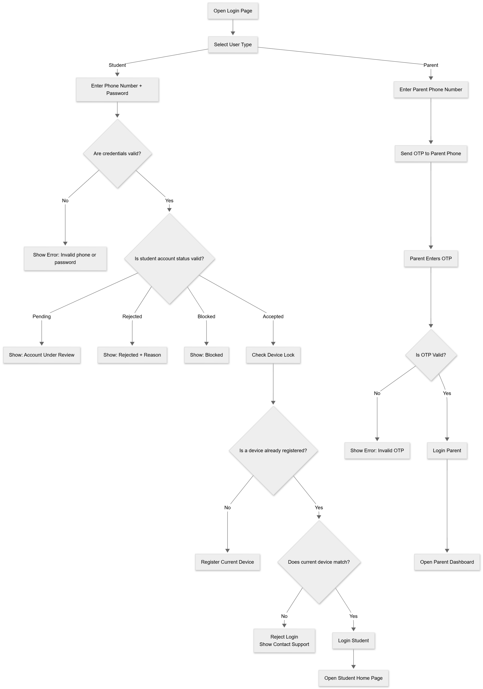{width="7.916666666666667in"
height="9.57638888888889in"}

Parent User Flow:

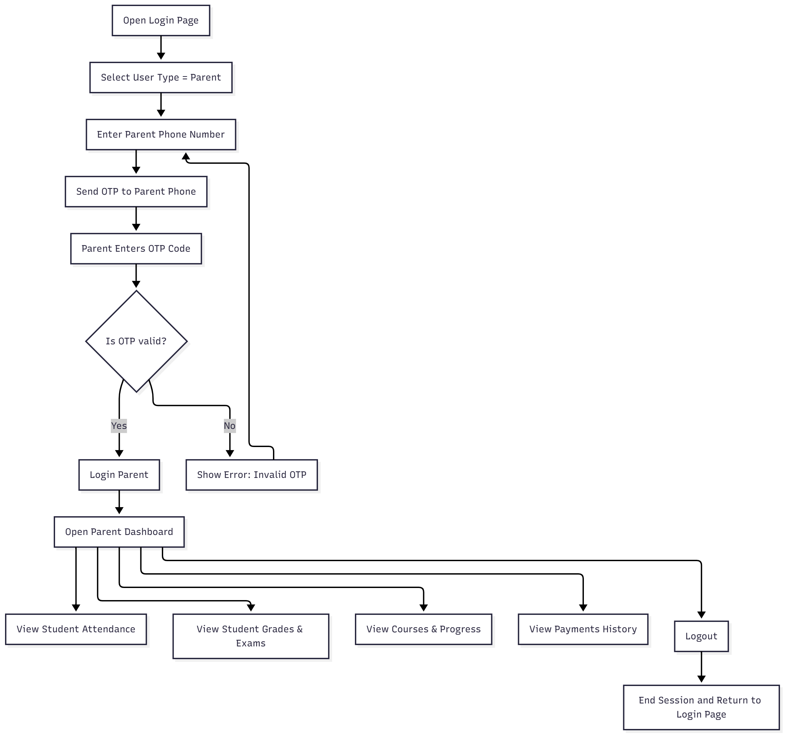{width="7.793055555555555in"
height="7.3in"}

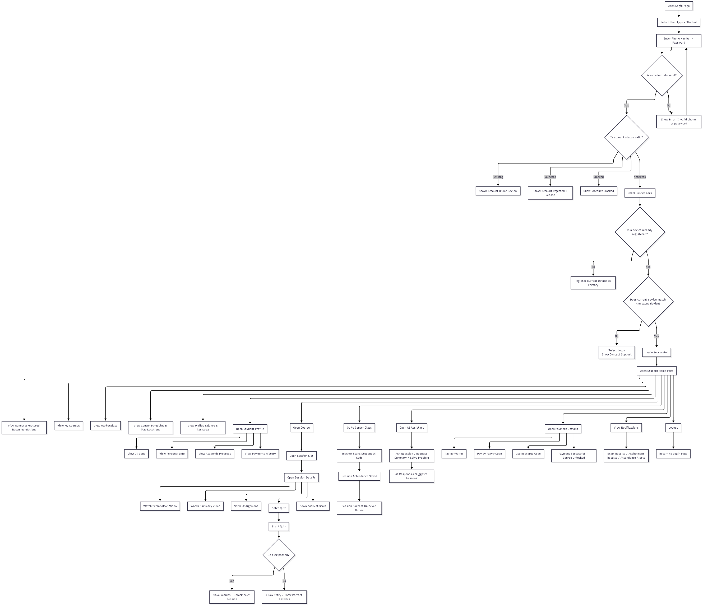{width="7.945833333333334in"
height="9.555555555555555in"}

2)  ***Functional Modeling***

    (a) ***DFD diagram***

> *A **context diagram** illustrates the overall system as a single
> process and shows how it interacts with external entities such as
> users, organizations, or other systems. It provides a high-level view
> of the system's boundaries, inputs, and outputs.*

![**Figure []{dir="rtl"}30 : DFD(AI Asisit)
Diagram**](./assets/media/image10.jpeg){width="4.540277777777778in"
height="5.548373797025372in"}

> 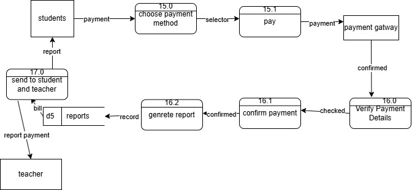{width="5.797695756780403in"
> height="2.6831594488188975in"}

**Figure []{dir="rtl"}31 : DFD(Payment) Diagram**

![**Figure []{dir="rtl"}32 : DFD(Teacher Login)
Diagram**](./assets/media/image12.jpeg){width="5.478213035870517in"
height="2.05in"}

> 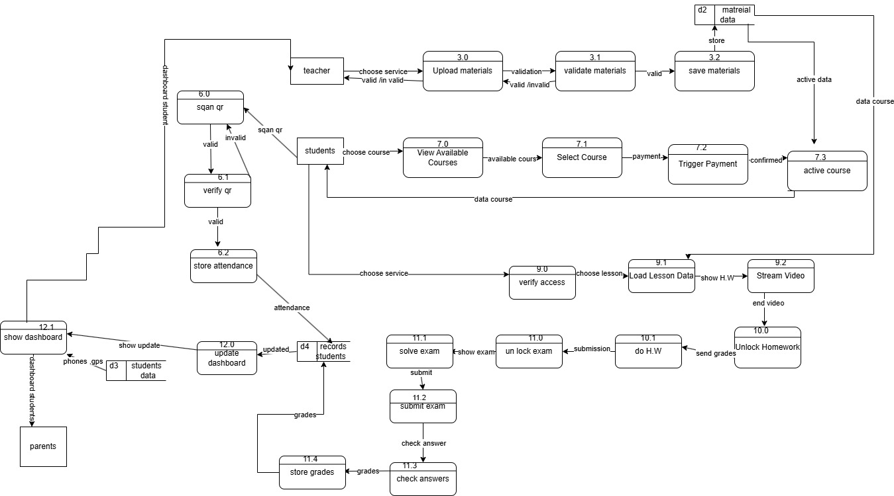{width="6.490146544181977in"
> height="3.6083103674540684in"}

**Figure []{dir="rtl"}33 : DFD(Teacher Services) Diagram**

> *\*
>
> 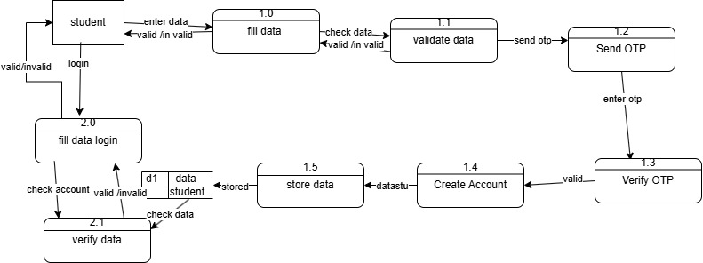{width="5.999996719160105in"
> height="2.245258092738408in"}

**Figure []{dir="rtl"}34 : DFD (Student Login Diagram)Diagram**

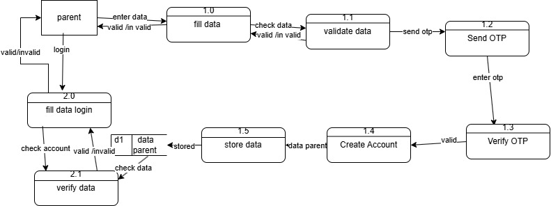{width="6.0in"
height="2.245258092738408in"}

**Figure []{dir="rtl"}34 : DFD (Parent Login Diagram)Diagram**

*\*
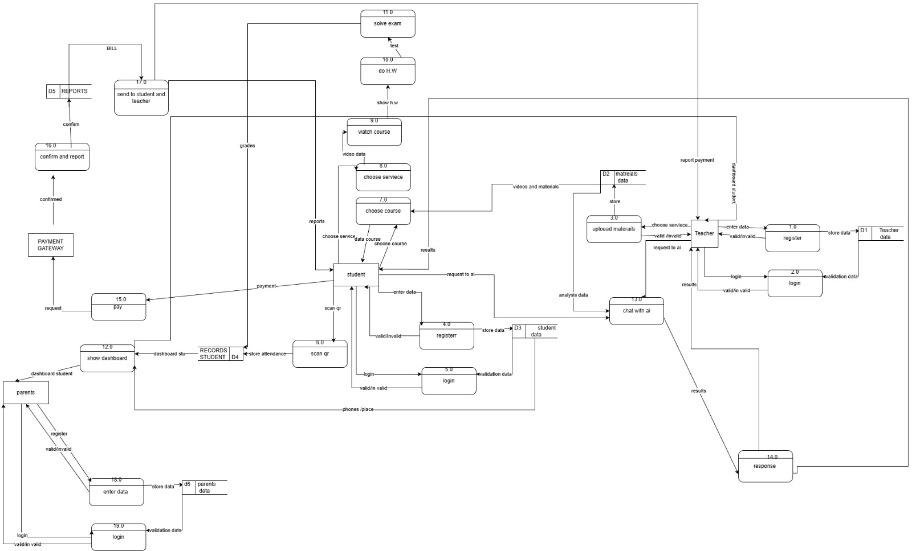{width="7.639828302712161in"
height="5.032256124234471in"}

**Figure []{dir="rtl"}34 : DFD 1 Diagram**

(b) ***Activity diagram***

*An activity diagram illustrates the workflow of processes or actions in
a system, showing how activities are sequenced and how decisions or
parallel operations occur.*

![**Figure [6]{dir="rtl"}: buy Book Activity
Diagram**](./assets/media/image17.png){width="3.7294717847769028in"
height="5.680851924759405in"}

*\*
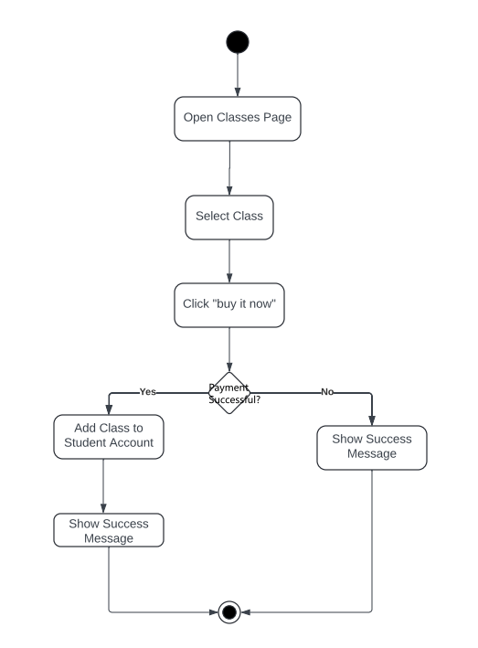{width="5.634722222222222in"
height="7.638659230096238in"}

![**Figure [6]{dir="rtl"}: buy New Session Activity
Diagram**](./assets/media/image19.png){width="5.395007655293089in"
height="7.703985126859143in"}

![**Figure [6]{dir="rtl"}: Attend live session []{dir="rtl"}Activity
Diagram**](./assets/media/image20.png){width="4.55875in"
height="7.297872922134733in"}

![**Figure [6]{dir="rtl"}: Register []{dir="rtl"}Activity
Diagram**](./assets/media/image21.png){width="4.579419291338582in"
height="6.961537620297463in"}

![**Figure [6]{dir="rtl"}: Locate Nearest CenterActivity
Diagram**](./assets/media/image22.png){width="4.804166666666666in"
height="7.469773622047244in"}

**Figure [: 6]{dir="rtl"} Respond to Student Inquiries
[]{dir="rtl"}Diagram**

![**Figure [: 6]{dir="rtl"} Upload New Assignment
[]{dir="rtl"}Diagram**](./assets/media/image23.png){width="3.9574311023622046in"
height="7.115383858267717in"}

![**Figure [: 6]{dir="rtl"} Send Reports to Parents
[]{dir="rtl"}Diagram**](./assets/media/image24.png){width="3.692306430446194in"
height="6.923076334208224in"}

![**Figure [: 6]{dir="rtl"} Upload Grades
[]{dir="rtl"}Diagram**](./assets/media/image25.png){width="2.7868055555555555in"
height="6.775765529308837in"}

![**Figure [: 6]{dir="rtl"} View Sales and Profit Analytics
[]{dir="rtl"}Diagram**](./assets/media/image26.png){width="3.684641294838145in"
height="7.069230096237971in"}

![**Figure [: 6]{dir="rtl"} View Student Grades Report
[]{dir="rtl"}Diagram**](./assets/media/image27.png){width="3.2940627734033248in"
height="6.576922572178478in"}

![**Figure [: 6]{dir="rtl"} Create New Quiz
[]{dir="rtl"}Diagram**](./assets/media/image28.png){width="3.7238877952755907in"
height="6.784615048118985in"}

![**Figure [: 6]{dir="rtl"} View Student Distribution
[]{dir="rtl"}Diagram**](./assets/media/image29.png){width="3.0161767279090115in"
height="6.284615048118985in"}

![**Figure [: 6]{dir="rtl"} View Activity Timeline
[]{dir="rtl"}Diagram**](./assets/media/image30.png){width="4.047099737532808in"
height="7.7in"}

![**Figure [: 6]{dir="rtl"} Contact Support
[]{dir="rtl"}Diagram**](./assets/media/image31.png){width="3.213572834645669in"
height="6.523076334208224in"}

![**Figure [: 6]{dir="rtl"} Monitor Attendance
[]{dir="rtl"}Diagram**](./assets/media/image32.png){width="3.8856692913385826in"
height="6.638461286089239in"}

![**Figure [: 6]{dir="rtl"} View Detailed Report
[]{dir="rtl"}Diagram**](./assets/media/image33.png){width="3.808735783027122in"
height="7.430768810148732in"}

![**Figure [: 6]{dir="rtl"} View Bought sessions []{dir="rtl"}&books
[]{dir="rtl"}Diagram**](./assets/media/image34.png){width="3.637962598425197in"
height="6.484615048118985in"}

![**Figure [: 6]{dir="rtl"} View Quiz Grades
[]{dir="rtl"}Diagram**](./assets/media/image35.png){width="3.7982206911636047in"
height="6.761537620297463in"}

![**Figure [: 6]{dir="rtl"} View Child Statistics
[]{dir="rtl"}Diagram**](./assets/media/image36.png){width="4.161990376202975in"
height="5.784615048118985in"}

![**Figure [: 6]{dir="rtl"} Take Quiz
[]{dir="rtl"}Diagram**](./assets/media/image37.png){width="3.6254286964129485in"
height="7.591367016622923in"}

![**Figure [: 6]{dir="rtl"} Solve Ass
[]{dir="rtl"}Diagram**](./assets/media/image38.png){width="2.9070625546806648in"
height="7.711488407699037in"}

![**Figure [: 6]{dir="rtl"} ViewClasses
[]{dir="rtl"}Diagram**](./assets/media/image39.png){width="3.813583770778653in"
height="7.0in"}

![**Figure [: 6]{dir="rtl"} logout
[]{dir="rtl"}Diagram**](./assets/media/image40.png){width="4.70119094488189in"
height="6.7461537620297465in"}

![**Figure [: 6]{dir="rtl"} Upload New Class
[]{dir="rtl"}Diagram**](./assets/media/image41.png){width="3.25961176727909in"
height="5.278214129483815in"}

3)  ***Behavioral Modeling***

<!-- -->

1)  ***State diagram***

> *An State diagram illustrates the workflow of processes or actions in
> a system, showing how activities are sequenced and how decisions or
> parallel operations occur.*

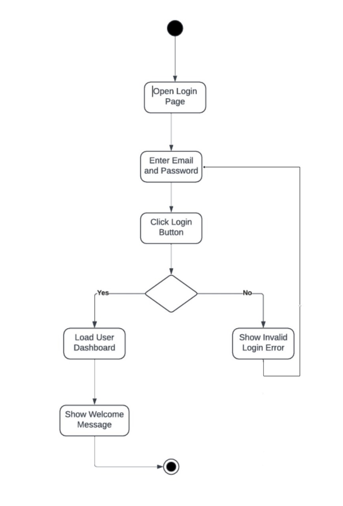{width="4.921069553805775in"
height="7.248525809273841in"}

**Figure [1]{dir="rtl"}3 : Login []{dir="rtl"}State Diagram**

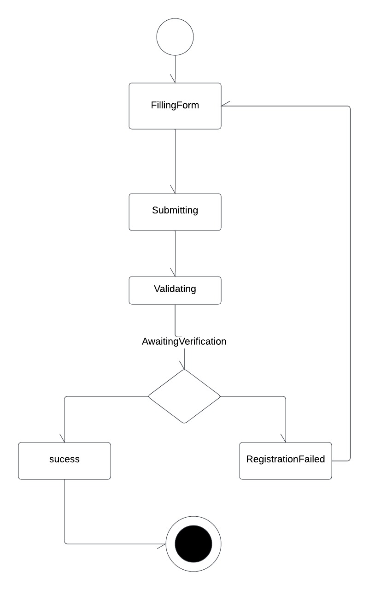{width="4.562988845144357in"
height="7.291666666666667in"}*\*

**Figure [1]{dir="rtl"}4 : Register []{dir="rtl"}State Diagram**

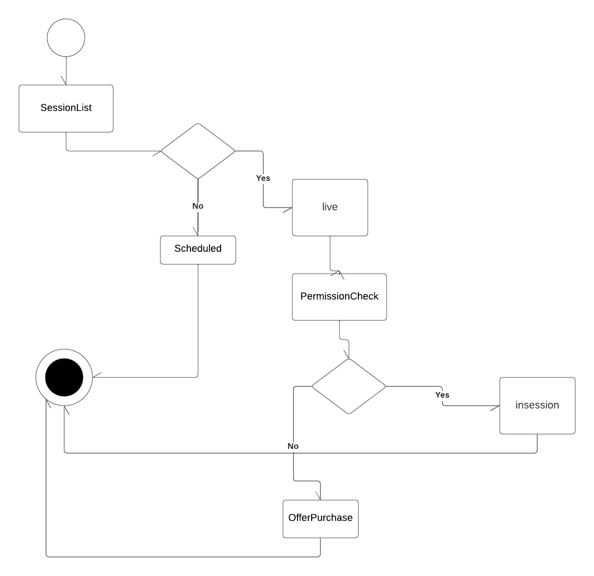{width="6.2302744969378825in"
height="5.8778915135608045in"}

**Figure [1]{dir="rtl"}5 : Select session []{dir="rtl"}State Diagram**

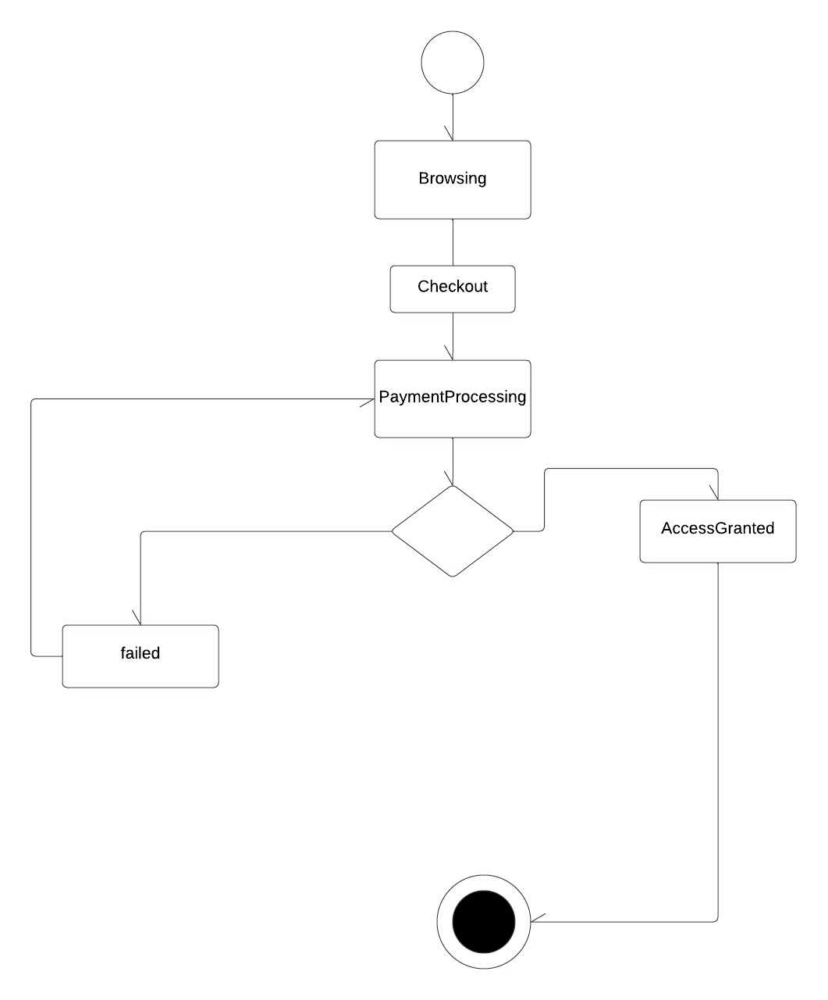{width="5.478146325459318in"
height="6.608883420822397in"}*\*

**Figure [1]{dir="rtl"}6 Attend session []{dir="rtl"}State Diagram**

*\
\*

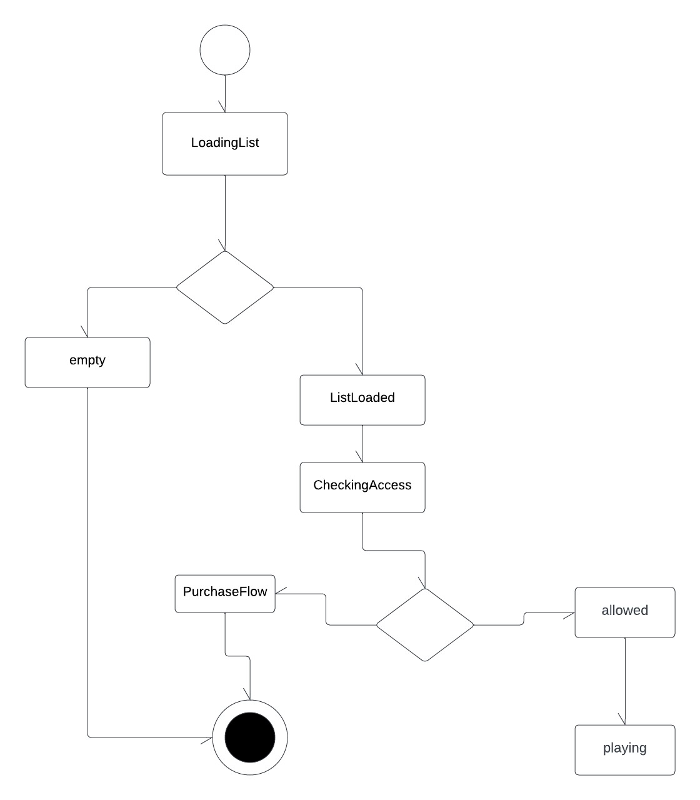{width="4.840425415573053in"
height="5.531914916885389in"}

**Figure [1]{dir="rtl"}7 : Buy session []{dir="rtl"}State Diagram**

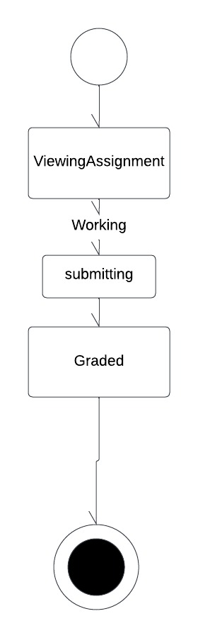{width="1.9215277777777777in"
height="6.176339676290464in"}

**Figure [1]{dir="rtl"}8 : Upload assignment []{dir="rtl"}State
Diagram**

![**Figure [1]{dir="rtl"}9 : Buy session []{dir="rtl"} State
Diagram**](./assets/media/image48.jpeg){width="3.8404254155730535in"
height="6.468085083114611in"}

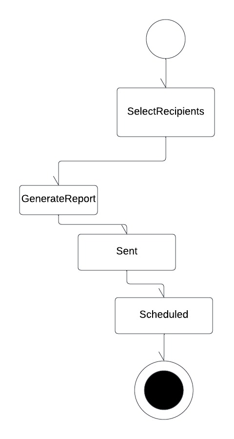{width="3.283791557305337in"
height="6.157109580052493in"}

**Figure []{dir="rtl"}20 : Send Report State Diagram**

![**Figure []{dir="rtl"}22: Upload grades State
Diagram**](./assets/media/image50.jpeg){width="6.206829615048119in"
height="6.489583333333333in"}

2)  ***Sequence diagram***

> *A **sequence diagram** illustrates how objects or components interact
> with each other over time. It shows the sequence of messages exchanged
> between them to carry out a specific process or function in the
> system.*
>
> {width="5.937051618547682in"
> height="7.467361111111111in"}

**Figure []{dir="rtl"}27 : Sequence Diagram**

4)  ***Structural Modeling***

<!-- -->

1)  ***Class diagram***

> *A **class diagram** illustrates the structure of a system by showing
> its classes, their attributes, methods, and the relationships between
> them. It represents the static design or blueprint of an
> object-oriented system.*

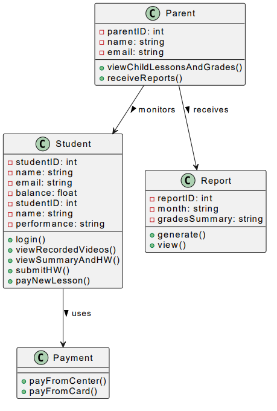{width="3.9270516185476816in"
height="5.81785542432196in"}

![**Figure []{dir="rtl"}28 : Class
Diagram**](./assets/media/image53.png){alt="A diagram of a teacher AI-generated content may be incorrect."
width="6.0in" height="5.382638888888889in"}

2)  ***Block diagram***

*A block diagram visually maps a system's main components and their
connections to clarify architecture, data flow, and interfaces at a high
level.*

![**Figure [4]{dir="rtl"}: Block
Diagram**](./assets/media/image54.png){width="6.0in"
height="5.335416666666666in"}

3)  ***Scheduling & Planning***

<!-- -->

1)  ***Network Diagram***

> *determine the sequence of the activities and precedence relationships
> among all activities and have two major components (arrow and nodes).*

- *[Arrows]{.underline} reflect the sequence of activities.*

- *[Nodes]{.underline} reflect activities that consume time and
  resources.*

> 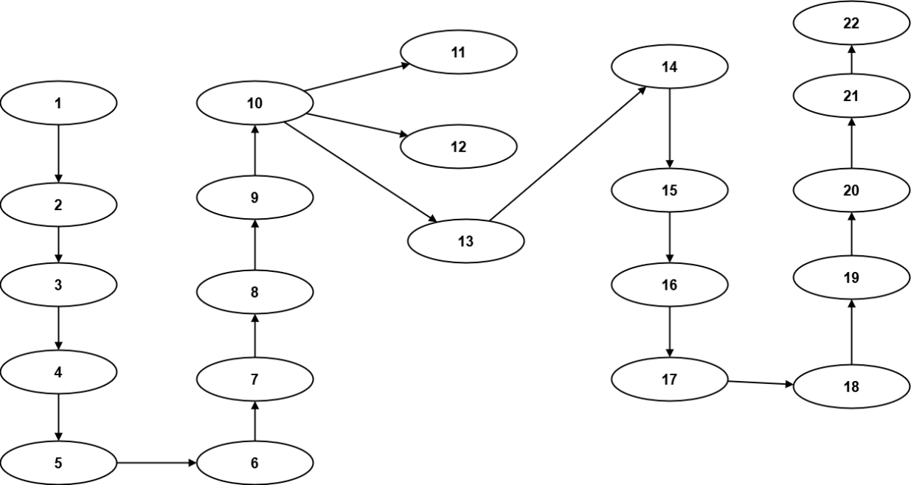{width="5.612830271216098in"
> height="2.9902209098862644in"}
>
> ***Figure 3 : Network Chart***

2)  ***PERT chart***

*A technique that uses optimistic, pessimistic, and realistic time
estimates to calculate the expected time for a particular task.*

***[Were]{.underline}***

*ET = expected time for the completion of an activity.*

*O = optimistic completion time for an activity.*

*R = realistic completion time for an activity.*

*P = pessimistic completion time for an activity*

{width="6.946379046369204in"
height="3.7006660104986877in"}

  -----------------------------------------------------------------------
            *ET*      *p*         *r*        *o*       *Task Name*   *ID*
  -------------- -------- ----------- ---------- ----------------- ------
          *5.17*      *7*         *5*        *4*      *Requirement    *1*
                                                        Gathering* 

          *5.17*      *7*         *5*        *4*      *Stakeholder    *2*
                                                        Interviews 
                                                        (Teachers, 
                                                 Parents, Admins)* 

          *5.17*      *7*         *5*        *4*  *System Analysis    *3*
                                                        & Use Case 
                                                         Modeling* 

          *3.00*      *4*         *3*        *2*    *Feasibility &    *4*
                                                  Risk Assessment* 

          *6.17*      *8*         *6*        *5*           *System    *5*
                                                    Architecture & 
                                                  Database Design* 

          *9.33*     *12*         *9*        *8* *UI/UX Wireframes    *6*
                                                      (Dashboards, 
                                                     Registration, 
                                                         Lessons)* 

          *5.17*      *7*         *5*        *4*        *Prototype    *7*
                                                        Creation & 
                                                       Stakeholder 
                                                           Review* 

         *15.33*     *19*        *15*       *13*          *Backend    *8*
                                                       Development 
                                                            (APIs, 
                                                   Authentication, 
                                                             OTP)* 

          *6.17*      *8*         *6*        *5*         *Database    *9*
                                                      Integration* 

         *18.17*     *23*        *18*       *16*         *Frontend   *10*
                                                      Development* 

         *11.17*     *14*        *11*        *9*     *AI Assistant   *11*
                                                            Module 
                                                      Integration* 

          *8.17*     *10*         *8*        *7*   *Gamification &   *12*
                                                   Rewards System* 

          *6.17*      *8*         *6*        *5*  *Payment Gateway   *13*
                                                 Integration (Cash 
                                                         / Fawry / 
                                                        Vouchers)* 

          *6.17*      *8*         *6*        *5*     *Unit Testing   *14*
                                                     (Module-Level 
                                                         Testing)* 

          *6.17*      *8*         *6*        *5*      *Integration   *15*
                                                           Testing 
                                                     (System-Level 
                                                         Testing)* 

          *4.00*      *5*         *4*        *3*  *User Acceptance   *16*
                                                 Testing (Teachers 
                                                       & Parents)* 

          *3.00*      *4*         *3*        *2*   *Server Setup &   *17*
                                                               SSL 
                                                    Configuration* 

          *3.00*      *4*         *3*        *2*          *Flutter   *18*
                                                       Deployment* 

          *2.00*      *3*         *2*        *1*       *Security &   *19*
                                                     Backup Setup* 

         *17.17*     *22*        *17*       *15*      *Performance   *20*
                                                  Monitoring & Bug 
                                                           Fixing* 

         *11.17*     *14*        *11*        *9*  *Feature Updates   *21*
                                                   & Enhancements* 

         *10.17*     *13*        *10*        *8*      *Analytics &   *22*
                                                         Reporting 
                                                  Dashboard Setup* 
  -----------------------------------------------------------------------

3)  ***Gantt Chart***

*A **Gantt chart** is a visual project management tool that displays
tasks as **horizontal bars**, where the **length of each bar represents
the task's duration**.*

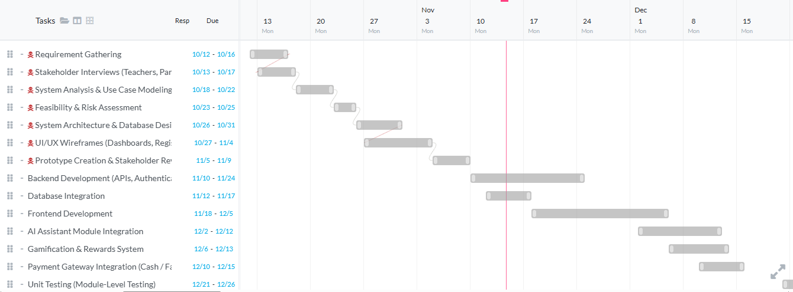{width="6.0in"
height="2.2164173228346455in"}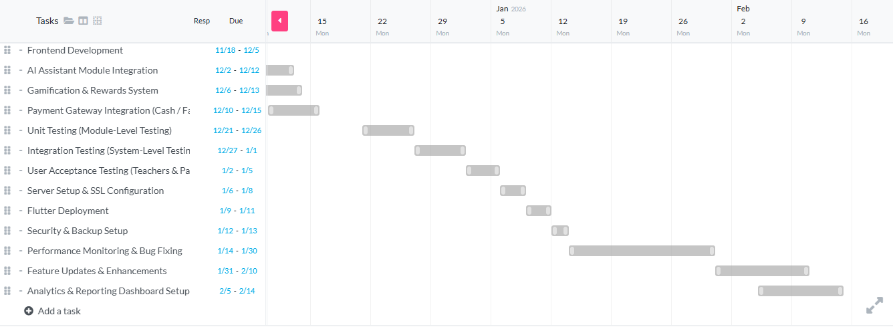{width="6.0in"
height="2.1961067366579177in"}

**Figure [1]{dir="rtl"} : Gantt Chart**

4)  ***Task Scheduling***

*A Task Scheduling Chart provides a visual timeline of project
activities, showing each task as a horizontal bar that reflects the time
required for its completion.*

  -------------------------------------------------------------------------------------
    *Predecessor(s)*   *Duration     *End Date*   *Start Date*       *Task Name*   *ID*
                         (Days)*                                                 
  ------------------ ----------- -------------- -------------- ----------------- ------
                 *-*         *5*   *2025-10-16*   *2025-10-12*      *Requirement    *1*
                                                                      Gathering* 

                 *1*         *5*   *2025-10-17*   *2025-10-13*      *Stakeholder    *2*
                                                                      Interviews 
                                                                      (Teachers, 
                                                               Parents, Admins)* 

                 *2*         *5*   *2025-10-22*   *2025-10-18*  *System Analysis    *3*
                                                                      & Use Case 
                                                                       Modeling* 

                 *3*         *3*   *2025-10-25*   *2025-10-23*    *Feasibility &    *4*
                                                                Risk Assessment* 

                 *4*         *6*   *2025-10-31*   *2025-10-26*           *System    *5*
                                                                  Architecture & 
                                                                Database Design* 

                 *5*         *9*   *2025-11-04*   *2025-10-27* *UI/UX Wireframes    *6*
                                                                    (Dashboards, 
                                                                   Registration, 
                                                                       Lessons)* 

                 *6*         *5*   *2025-11-09*   *2025-11-05*        *Prototype    *7*
                                                                      Creation & 
                                                                     Stakeholder 
                                                                         Review* 

                 *7*        *15*   *2025-11-24*   *2025-11-10*          *Backend    *8*
                                                                     Development 
                                                                          (APIs, 
                                                                 Authentication, 
                                                                           OTP)* 

                 *8*         *6*   *2025-11-17*   *2025-11-12*         *Database    *9*
                                                                    Integration* 

                 *9*        *18*   *2025-12-05*   *2025-11-18*         *Frontend   *10*
                                                                    Development* 

                *10*        *11*   *2025-12-12*   *2025-12-02*     *AI Assistant   *11*
                                                                          Module 
                                                                    Integration* 

                *10*         *8*   *2025-12-13*   *2025-12-06*   *Gamification &   *12*
                                                                 Rewards System* 

                *10*         *6*   *2025-12-15*   *2025-12-10*  *Payment Gateway   *13*
                                                               Integration (Cash 
                                                                       / Fawry / 
                                                                      Vouchers)* 

          *11,12,13*         *6*   *2025-12-26*   *2025-12-21*     *Unit Testing   *14*
                                                                   (Module-Level 
                                                                       Testing)* 

                *14*         *6*   *2026-01-01*   *2025-12-27*      *Integration   *15*
                                                                         Testing 
                                                                   (System-Level 
                                                                       Testing)* 

                *15*         *4*   *2026-01-05*   *2026-01-02*  *User Acceptance   *16*
                                                               Testing (Teachers 
                                                                     & Parents)* 

                *16*         *3*   *2026-01-08*   *2026-01-06*   *Server Setup &   *17*
                                                                             SSL 
                                                                  Configuration* 

                *17*         *3*   *2026-01-11*   *2026-01-09*          *Flutter   *18*
                                                                     Deployment* 

                *18*         *2*   *2026-01-13*   *2026-01-12*       *Security &   *19*
                                                                   Backup Setup* 

                *19*        *17*   *2026-01-30*   *2026-01-14*      *Performance   *20*
                                                                Monitoring & Bug 
                                                                         Fixing* 

                *20*        *11*   *2026-02-10*   *2026-01-31*  *Feature Updates   *21*
                                                                 & Enhancements* 

                *21*        *10*   *2026-02-14*   *2026-02-05*      *Analytics &   *22*
                                                                       Reporting 
                                                                Dashboard Setup* 
  -------------------------------------------------------------------------------------

3)  ***Entity Relationship Diagram (******ERD) []{dir="rtl"}Overview***

+----------------+------------------------+----------------------------+
| > *Entity*     | > *Description*        | > *Relationships*          |
+================+========================+============================+
| > *Parent*     | > *Guardian            | > *1 → Many with Students* |
|                | > information.*        |                            |
+----------------+------------------------+----------------------------+
| > *Student*    | > *Student personal    | > *Many → One (Parent),    |
|                | > and academic info.*  | > One → Many (Enrollment,  |
|                |                        | > Attendance, Grades)*     |
+----------------+------------------------+----------------------------+
| > *Teacher*    | > *Teaching staff      | > *One → Many (Classes)*   |
|                | > details.*            |                            |
+----------------+------------------------+----------------------------+
| > *Subject*    | > *Academic subject    | > *One → Many (Classes)*   |
|                | > information.*        |                            |
+----------------+------------------------+----------------------------+
| > *Class*      | > *Specific class or   | > *Many → One (Teacher,    |
|                | > group taught.*       | > Subject), One → Many     |
|                |                        | > (Enrollments,            |
|                |                        | > Assignments)*            |
+----------------+------------------------+----------------------------+
| > *Enrollment* | > *Student-Class       | > *Many → One (Student,    |
|                | > linking table.*      | > Class)*                  |
+----------------+------------------------+----------------------------+
| > *Attendance* | > *Student attendance  | > *Many → One (Student,    |
|                | > tracking.*           | > Class)*                  |
+----------------+------------------------+----------------------------+
| > *Assignment* | > *Class tasks and     | > *Many → One (Class), One |
|                | > homework.*           | > → Many (Grades)*         |
+----------------+------------------------+----------------------------+
| > *Grade*      | > *Marks and           | > *Many → One (Student,    |
|                | > evaluations.*        | > Assignment)*             |
+----------------+------------------------+----------------------------+
| > *Admin*      | > *System              | > *Independent*            |
|                | > administrators.*     |                            |
+----------------+------------------------+----------------------------+
| > *Message*    | > *Communication       | > *Many → One (Teacher →   |
|                | > between Teacher and  | > Student)*                |
|                | > Student.*            |                            |
+----------------+------------------------+----------------------------+

> ***Coding :\***

**Figure []{dir="rtl"}34 : Mapping**

4)  ***Datasets***

[\
]{dir="rtl"}**Table: user_roles**

CREATE TABLE user_roles (

id BIGINT PRIMARY KEY AUTO_INCREMENT,

user_id BIGINT NOT NULL,

role_id BIGINT NOT NULL,

FOREIGN KEY (user_id) REFERENCES users(id) ON DELETE CASCADE,

FOREIGN KEY (role_id) REFERENCES roles(id) ON DELETE CASCADE

);

**Table: devices**

CREATE TABLE devices (

id BIGINT PRIMARY KEY AUTO_INCREMENT,

student_id BIGINT NOT NULL,

device_hash VARCHAR(255) NOT NULL,

ip_address VARCHAR(100),

created_at TIMESTAMP DEFAULT CURRENT_TIMESTAMP,

FOREIGN KEY (student_id) REFERENCES users(id) ON DELETE CASCADE

);

**Table: grades**

CREATE TABLE grades (

id BIGINT PRIMARY KEY AUTO_INCREMENT,

name VARCHAR(100) NOT NULL

);

**Table: categories**

CREATE TABLE categories (

id BIGINT PRIMARY KEY AUTO_INCREMENT,

grade_id BIGINT NOT NULL,

name VARCHAR(150) NOT NULL,

description TEXT,

active BOOLEAN DEFAULT TRUE,

order_index INT DEFAULT 0,

created_at TIMESTAMP DEFAULT CURRENT_TIMESTAMP,

FOREIGN KEY (grade_id) REFERENCES grades(id)

);

**Table: courses**

CREATE TABLE courses (

id BIGINT PRIMARY KEY AUTO_INCREMENT,

grade_id BIGINT NOT NULL,

category_id BIGINT NOT NULL,

title VARCHAR(255) NOT NULL,

description TEXT,

price DECIMAL(10,2) DEFAULT 0,

old_price DECIMAL(10,2),

points_reward INT DEFAULT 0,

duration_days INT DEFAULT 0,

type ENUM(\'online\',\'center\',\'both\') DEFAULT \'both\',

featured BOOLEAN DEFAULT FALSE,

pinned BOOLEAN DEFAULT FALSE,

ordering_mode ENUM(\'free\',\'lock_session\',\'lock_item\') DEFAULT
\'free\',

has_attendance BOOLEAN DEFAULT FALSE,

created_at TIMESTAMP DEFAULT CURRENT_TIMESTAMP,

FOREIGN KEY (grade_id) REFERENCES grades(id),

FOREIGN KEY (category_id) REFERENCES categories(id)

);

**Table: sessions**

CREATE TABLE sessions (

id BIGINT PRIMARY KEY AUTO_INCREMENT,

course_id BIGINT NOT NULL,

title VARCHAR(255) NOT NULL,

duration_days INT DEFAULT NULL,

is_center_content BOOLEAN DEFAULT FALSE,

image_url TEXT,

order_index INT DEFAULT 0,

created_at TIMESTAMP DEFAULT CURRENT_TIMESTAMP,

FOREIGN KEY (course_id) REFERENCES courses(id)

);

**Table: session_items**

CREATE TABLE session_items (

id BIGINT PRIMARY KEY AUTO_INCREMENT,

session_id BIGINT NOT NULL,

title VARCHAR(255),

item_type ENUM(\'video\',\'file\',\'quiz\',\'assignment\',\'note\') NOT
NULL,

required BOOLEAN DEFAULT FALSE,

skippable BOOLEAN DEFAULT TRUE,

content_url TEXT,

extra_settings JSON,

order_index INT DEFAULT 0,

FOREIGN KEY (session_id) REFERENCES sessions(id) ON DELETE CASCADE

);

**Table: student_courses**

CREATE TABLE student_courses (

id BIGINT PRIMARY KEY AUTO_INCREMENT,

student_id BIGINT NOT NULL,

course_id BIGINT NOT NULL,

enrolled_at TIMESTAMP DEFAULT CURRENT_TIMESTAMP,

expires_at TIMESTAMP NULL,

progress_percent DECIMAL(5,2) DEFAULT 0,

FOREIGN KEY (student_id) REFERENCES users(id),

FOREIGN KEY (course_id) REFERENCES courses(id)

);

**Table: attendance**

CREATE TABLE attendance (

id BIGINT PRIMARY KEY AUTO_INCREMENT,

student_id BIGINT NOT NULL,

session_id BIGINT NOT NULL,

center_group_id BIGINT,

attendance_type ENUM(\'online\',\'center\') NOT NULL,

attendance_time TIMESTAMP DEFAULT CURRENT_TIMESTAMP,

exam_score DECIMAL(5,2),

assignment_score DECIMAL(5,2),

FOREIGN KEY (student_id) REFERENCES users(id),

FOREIGN KEY (session_id) REFERENCES sessions(id),

FOREIGN KEY (center_group_id) REFERENCES center_groups(id)

);

**Table: quiz_results**

CREATE TABLE quiz_results (

id BIGINT PRIMARY KEY AUTO_INCREMENT,

quiz_id BIGINT NOT NULL,

student_id BIGINT NOT NULL,

score DECIMAL(5,2),

answers_json JSON,

status ENUM(\'completed\',\'failed\') DEFAULT \'completed\',

created_at TIMESTAMP DEFAULT CURRENT_TIMESTAMP,

FOREIGN KEY (quiz_id) REFERENCES quizzes(id),

FOREIGN KEY (student_id) REFERENCES users(id)

);

**Table: assignment_submissions**

CREATE TABLE assignment_submissions (

id BIGINT PRIMARY KEY AUTO_INCREMENT,

assignment_id BIGINT NOT NULL,

student_id BIGINT NOT NULL,

file_url TEXT,

score DECIMAL(5,2),

created_at TIMESTAMP DEFAULT CURRENT_TIMESTAMP,

FOREIGN KEY (assignment_id) REFERENCES assignments(id),

FOREIGN KEY (student_id) REFERENCES users(id)

);

**Table: quizzes**

CREATE TABLE quizzes (

id BIGINT PRIMARY KEY AUTO_INCREMENT,

session_id BIGINT NOT NULL,

title VARCHAR(255),

total_marks INT,

duration_minutes INT,

created_at TIMESTAMP DEFAULT CURRENT_TIMESTAMP,

FOREIGN KEY (session_id) REFERENCES sessions(id)

);

**Table: quiz_questions**

CREATE TABLE quiz_questions (

id BIGINT PRIMARY KEY AUTO_INCREMENT,

quiz_id BIGINT NOT NULL,

question_text TEXT,

question_type ENUM(\'mcq\',\'truefalse\',\'text\') NOT NULL,

topic VARCHAR(255),

difficulty ENUM(\'easy\',\'medium\',\'hard\'),

options_json JSON,

correct_answer TEXT,

FOREIGN KEY (quiz_id) REFERENCES quizzes(id)

);

**[\
]{dir="rtl"}Table: assignments**

CREATE TABLE assignments (

id BIGINT PRIMARY KEY AUTO_INCREMENT,

session_id BIGINT NOT NULL,

title VARCHAR(255),

total_marks INT,

created_at TIMESTAMP DEFAULT CURRENT_TIMESTAMP,

FOREIGN KEY (session_id) REFERENCES sessions(id)

);

**Table: center_groups**

CREATE TABLE center_groups (

id BIGINT PRIMARY KEY AUTO_INCREMENT,

grade_id BIGINT NOT NULL,

teacher_id BIGINT NOT NULL,

location_id BIGINT NOT NULL,

name VARCHAR(255),

created_at TIMESTAMP DEFAULT CURRENT_TIMESTAMP,

FOREIGN KEY (grade_id) REFERENCES grades(id),

FOREIGN KEY (teacher_id) REFERENCES users(id),

FOREIGN KEY (location_id) REFERENCES locations(id)

);

**Table: locations**

CREATE TABLE locations (

id BIGINT PRIMARY KEY AUTO_INCREMENT,

name VARCHAR(255),

area VARCHAR(255),

maps_url TEXT,

phones TEXT,

type ENUM(\'codes\',\'books\',\'centers\') NOT NULL,

grade_id BIGINT,

schedule_text TEXT,

created_at TIMESTAMP DEFAULT CURRENT_TIMESTAMP,

FOREIGN KEY (grade_id) REFERENCES grades(id)

);

**Table: payments**

CREATE TABLE payments (

id BIGINT PRIMARY KEY AUTO_INCREMENT,

student_id BIGINT NOT NULL,

amount DECIMAL(10,2) NOT NULL,

method ENUM(\'wallet\',\'fawry\',\'code\') NOT NULL,

status ENUM(\'pending\',\'paid\',\'failed\') DEFAULT \'pending\',

reference VARCHAR(255),

course_id BIGINT,

created_at TIMESTAMP DEFAULT CURRENT_TIMESTAMP,

paid_at TIMESTAMP NULL,

FOREIGN KEY (student_id) REFERENCES users(id),

FOREIGN KEY (course_id) REFERENCES courses(id)

);

**Table: wallet_transactions**

CREATE TABLE wallet_transactions (

id BIGINT PRIMARY KEY AUTO_INCREMENT,

student_id BIGINT NOT NULL,

transaction_type ENUM(\'add\',\'deduct\') NOT NULL,

amount DECIMAL(10,2) NOT NULL,

before_balance DECIMAL(10,2),

after_balance DECIMAL(10,2),

admin_id BIGINT,

note TEXT,

created_at TIMESTAMP DEFAULT CURRENT_TIMESTAMP,

FOREIGN KEY (student_id) REFERENCES users(id),

FOREIGN KEY (admin_id) REFERENCES users(id)

);

**Table: codes**

CREATE TABLE codes (

id BIGINT PRIMARY KEY AUTO_INCREMENT,

code VARCHAR(50) UNIQUE NOT NULL,

value DECIMAL(10,2),

code_type ENUM(\'wallet\',\'course\',\'general\') NOT NULL,

course_id BIGINT,

status ENUM(\'unused\',\'used\') DEFAULT \'unused\',

created_by BIGINT,

used_by BIGINT,

created_at TIMESTAMP DEFAULT CURRENT_TIMESTAMP,

used_at TIMESTAMP NULL,

FOREIGN KEY (course_id) REFERENCES courses(id),

FOREIGN KEY (created_by) REFERENCES users(id),

FOREIGN KEY (used_by) REFERENCES users(id)

);

**Table: ai_logs**

CREATE TABLE ai_logs (

id BIGINT PRIMARY KEY AUTO_INCREMENT,

student_id BIGINT NOT NULL,

message_type ENUM(\'student\',\'ai\'),

content TEXT,

created_at TIMESTAMP DEFAULT CURRENT_TIMESTAMP,

FOREIGN KEY (student_id) REFERENCES users(id)

);

**Table: points_history**

CREATE TABLE points_history (

id BIGINT PRIMARY KEY AUTO_INCREMENT,

student_id BIGINT NOT NULL,

source VARCHAR(255),

points INT,

created_at TIMESTAMP DEFAULT CURRENT_TIMESTAMP,

FOREIGN KEY (student_id) REFERENCES users(id)

);

**Table: reward_items**

CREATE TABLE reward_items (

id BIGINT PRIMARY KEY AUTO_INCREMENT,

title VARCHAR(255),

description TEXT,

image_url TEXT,

required_points INT,

created_at TIMESTAMP DEFAULT CURRENT_TIMESTAMP

);

**Table: reward_claims**

CREATE TABLE reward_claims (

id BIGINT PRIMARY KEY AUTO_INCREMENT,

student_id BIGINT NOT NULL,

reward_item_id BIGINT NOT NULL,

status ENUM(\'pending\',\'approved\',\'rejected\') DEFAULT \'pending\',

created_at TIMESTAMP DEFAULT CURRENT_TIMESTAMP,

FOREIGN KEY (student_id) REFERENCES users(id),

FOREIGN KEY (reward_item_id) REFERENCES reward_items(id)

);

**Table: marketplace_items**

CREATE TABLE marketplace_items (

id BIGINT PRIMARY KEY AUTO_INCREMENT,

title VARCHAR(255),

description TEXT,

price DECIMAL(10,2),

image_url TEXT,

category VARCHAR(100),

is_featured BOOLEAN DEFAULT FALSE,

created_at TIMESTAMP DEFAULT CURRENT_TIMESTAMP

);

**Table: marketplace_purchases**

CREATE TABLE marketplace_purchases (

id BIGINT PRIMARY KEY AUTO_INCREMENT,

student_id BIGINT NOT NULL,

item_id BIGINT NOT NULL,

price DECIMAL(10,2),

created_at TIMESTAMP DEFAULT CURRENT_TIMESTAMP,

FOREIGN KEY (student_id) REFERENCES users(id),

FOREIGN KEY (item_id) REFERENCES marketplace_items(id)

);

**Table: banners**

CREATE TABLE banners (

id BIGINT PRIMARY KEY AUTO_INCREMENT,

title VARCHAR(255),

image_url TEXT,

link_url TEXT,

active BOOLEAN DEFAULT TRUE,

created_at TIMESTAMP DEFAULT CURRENT_TIMESTAMP

);

**Table: notifications**

CREATE TABLE notifications (

id BIGINT PRIMARY KEY AUTO_INCREMENT,

student_id BIGINT,

title VARCHAR(255),

message TEXT,

created_at TIMESTAMP DEFAULT CURRENT_TIMESTAMP,

FOREIGN KEY (student_id) REFERENCES users(id)

);

**Table: admin_logs**

CREATE TABLE admin_logs (

id BIGINT PRIMARY KEY AUTO_INCREMENT,

admin_id BIGINT,

action VARCHAR(255),

details TEXT,

created_at TIMESTAMP DEFAULT CURRENT_TIMESTAMP,

FOREIGN KEY (admin_id) REFERENCES users(id)

);

5)  ***Methodologies, Technologies, and Risk Assessment.***

<!-- -->

1.  ***Development Lifecycle (SDLC Alignment)***

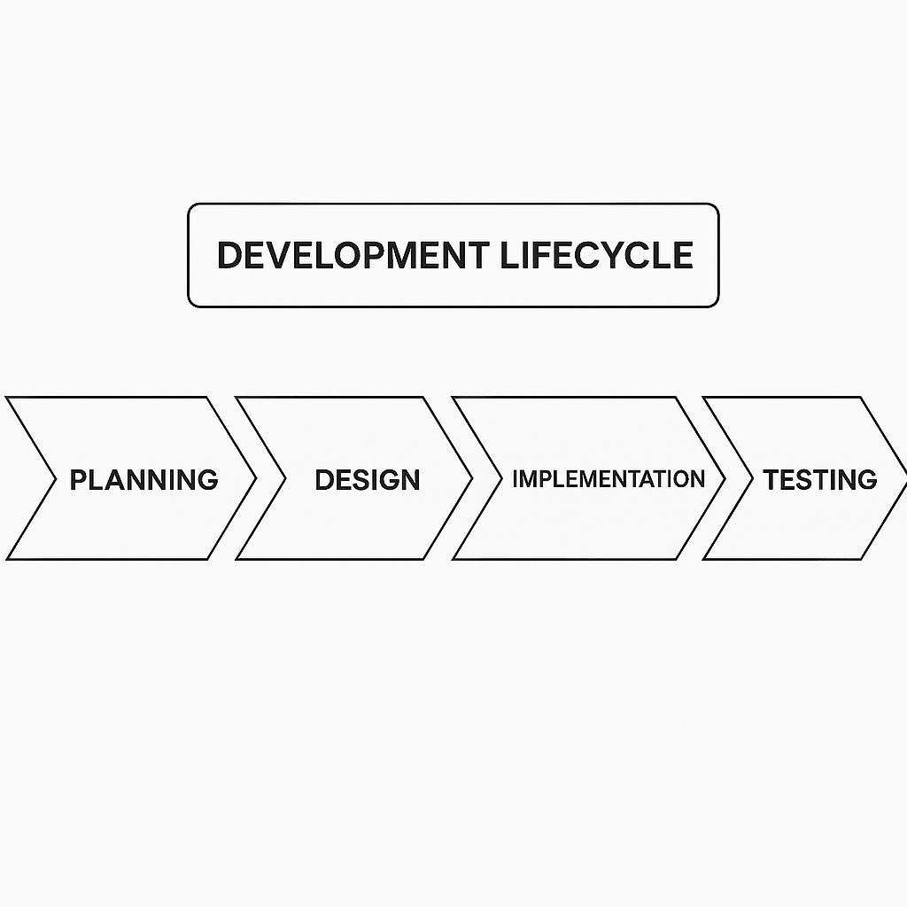{width="2.2958333333333334in"
height="2.2958333333333334in"}

*Software*

*Development Life Cycle (SDLC) stages:*

1.  ***Requirement Analysis:**\
    Collecting needs from stakeholders ---*

> *teachers,*
>
> *students, parents, and administrators ---*

**Figure 36: Development Lifecycle**

2.  ***System Design:**\
    The UI/UX team creates prototypes and*

> *wireframes, which are then converted into*
>
> *functional dashboards and mobile interfaces.*

3.  ***Implementation:**\
    Developers (Frontend, Backend, Flutter, and*

> *ML Engineers) build and integrate features*
>
> *sprint by sprint.*

4.  ***Testing:**\
    QA engineers and developers perform functional,*

> *performance, and security testing to ensure system reliability.*

5.  ***Deployment:**\
    The final version is deployed to cloud servers and app stores,
    ensuring accessibility via web and mobile platforms.*

6.  ***Maintenance & Continuous Improvement:**\
    Feedback-driven updates and AI-driven insights are continuously
    integrated into the system.*

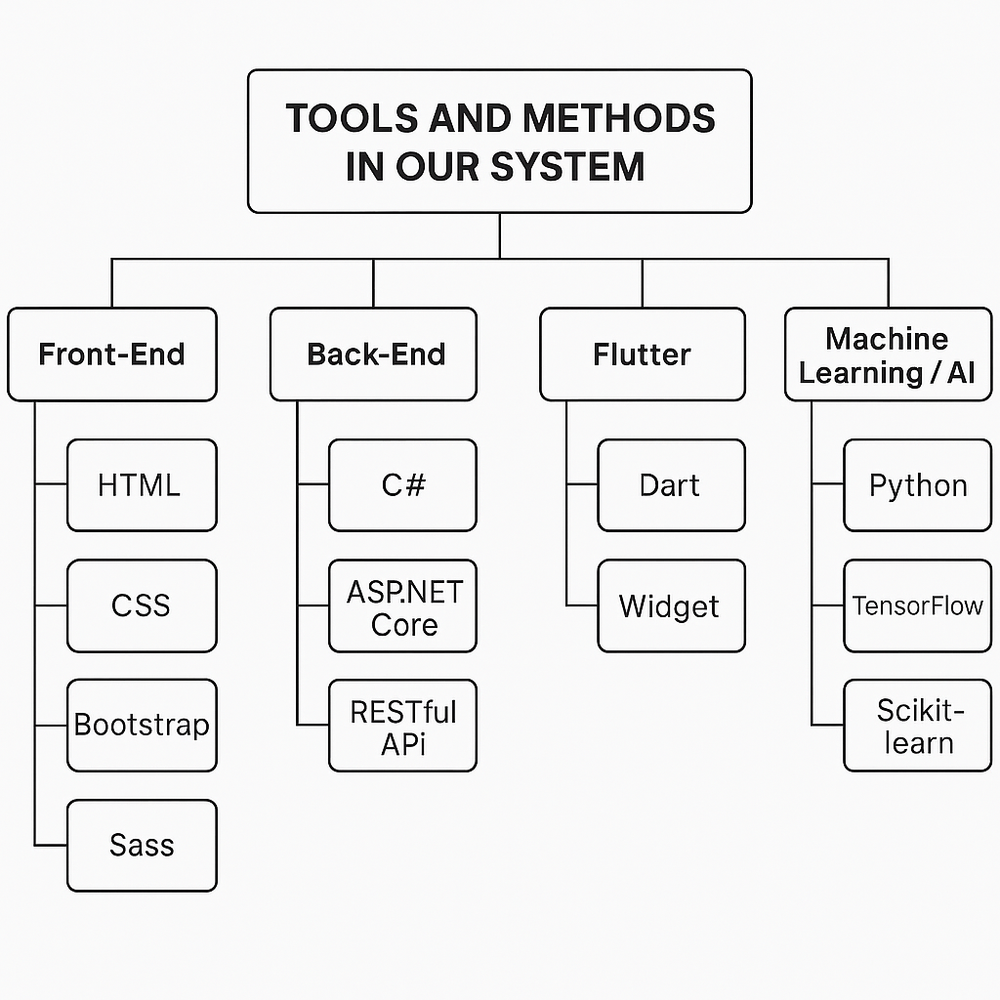{width="2.1174660979877515in"
height="1.797503280839895in"}

***3.1 Front-End Development***

> *Programming Languages*

- *HTML5 (Hypertext Markup Language)\
  HTML5 is the standard markup language*

> *used to define the content and structure*
>
> *of web pages and applications. It allows*

**Figure 37: Tools**

> *text, images, buttons, and forms in a semantic*
>
> *and accessible way.*

- *CSS (Cascading Style Sheets)\
  CSS manages the layout, color scheme,*

> *fonts, and overall visual presentation of web pages. It ensures
> responsiveness and consistent design across all devices.*

- *JavaScript\
  JavaScript brings interactivity and dynamic behavior to the platform.
  It allows for animations, form validation, and real-time updates
  without refreshing the page.*

*Libraries and Frameworks*

- *Bootstrap -- used to design responsive and mobile-first layouts
  efficiently.*

- *Sass (Syntactically Awesome Style Sheets) -- extends CSS with
  variables, nesting, and reusable components for clean and maintainable
  styles.*

- *Pug.js -- template engine for HTML that simplifies code structure and
  allows inclusion, inheritance, and condition-based rendering.*

*Design Tools*

- *Figma -- for interface prototyping and collaborative design.*

- *Google Fonts -- for customized typography.*

- *Coolors -- for generating professional color palettes.*

*Development Tools*

- *VS Code -- integrated development environment for coding and
  debugging.*

- *Git + GitHub -- for version control and collaborative development.*

***3.2 Back-End Development***

*Programming Language*

- *C# -- used for building secure and scalable server-side logic.*

*Framework*

- *ASP.NET Core -- provides a modern, cross-platform environment for
  developing high-performance APIs and web applications.*

*Database Management*

- *Microsoft SQL Server -- used for data storage and management.*

- *Entity Framework Core (Code-First Approach) -- facilitates
  interaction between application models and database tables while
  automating schema creation.*

*API and Methods*

- *RESTful API Design\
  The backend exposes REST APIs to communicate with the front-end and
  Flutter applications through standard HTTP methods (GET, POST, PUT,
  DELETE).\
  Example endpoints:*

  - */users*

  - */courses*

  - */attendance/{id}*

*Authentication and Authorization*

- *Session-based Authentication -- ensures secure login sessions via
  cookies.*

- *Role-Based Access Control (RBAC) -- manages access based on user
  roles (e.g., student, instructor, admin).*

- *ASP.NET Middleware -- handles permission checks before route access.*

***3.3 Flutter (Cross-Platform Mobile Application)***

***Framework***

- *Flutter -- a cross-platform UI toolkit developed by Google that
  allows building native-like applications for Android, iOS, and web
  from a single codebase.*

*Programming Language*

- *Dart -- the core language of Flutter, known for its speed and
  expressiveness.*

*Structure and Components*

- *UI Layer (Widgets):\
  Flutter's widget-based architecture allows dynamic and flexible UI
  design.*

- *State Management:\
  Uses Provider or Bloc pattern to manage data flow efficiently between
  UI and backend.*

- *API Integration:\
  Communicates with the backend's REST APIs for authentication, data
  fetching, and updates.*

- *Local Database (if needed):\
  Uses SQLite or Hive for offline data storage and caching.*

*Development Tools*

- *Android Studio / VS Code -- for development and debugging.*

- *Firebase -- optional for push notifications and analytics
  integration.*

- *Git + GitHub -- for collaborative mobile app development.*

***3.4 Machine Learning and Artificial Intelligence***

*Programming Language*

- *Python -- chosen for AI due to its simplicity, extensive libraries,
  and community support.*

*Frameworks and Libraries*

- *TensorFlow -- for deep learning model creation, training, and
  deployment.*

- *PyTorch -- for flexible neural network experimentation.*

- *Scikit-learn -- for data preprocessing, classification, and
  regression models.*

- *Pandas & NumPy -- for data manipulation and numerical computation.*

- *SpaCy & NLTK -- for natural language processing (NLP) and text
  analysis.*

- *Transformers (Hugging Face) -- for pre-trained NLP and computer
  vision models.*

- *Matplotlib / Seaborn -- for data visualization and performance
  analysis.*

*Integration*

- *The AI models are integrated with the backend through Flask APIs or
  FastAPI, allowing intelligent features such as:*

  - *Smart performance prediction for students.*

  - *Personalized study recommendations.*

  - *Automated grading or speech analysis.*

*Development Tools*

- *Anaconda -- environment management and dependency control.*

- *Google Colab -- for cloud-based model training.*

- *Kaggle -- for experimentation and dataset usage.*

- *Postman -- for testing AI and backend API endpoints.*

- *Git + GitHub -- for versioning and collaboration.*

***3.5 Cloud & Infrastructure***

- *Cloud Platform: AWS / Google Cloud / Azure*

- *Services: Cloud Storage, Load Balancer, Auto Scaling, API Gateway*

- *Version Control: Git & GitHub*

- *CI/CD: GitHub Actions or Jenkins*

- *Purpose:\
  Ensures secure hosting, continuous integration, and automated
  deployment of web and mobile applications with high availability.*

***3.6 Testing & Quality Assurance***

- *Tools: Postman (API testing), Jest / Mocha (unit testing), Selenium
  (UI testing)*

- *Purpose:\
  To validate functionality, security, and performance before
  deployment, ensuring that all features work correctly across
  platforms.*

***3.7 Communication & Project Management***

- *Tools: Jira, Trello, Slack, Notion, Google Workspace*

- *Purpose:\
  Used for task management, sprint tracking, and communication between
  development teams during Agile sprints.*

4.  ***System Units***

*The MentorX platform is composed of multiple interconnected system
units, each designed to serve a specific user group and function.\
Together, these modules form a unified ecosystem that enhances learning
efficiency, transparency, and engagement across all stakeholders ---
students, parents, teachers, and administrators.*

***1. Student Unit***

*Purpose:\
Provides students with full access to academic resources and performance
insights.*

*Key Features:*

- *View live and recorded sessions.*

- *Access assignments, quizzes, and course materials.*

- *Participate in makeup sessions for missed classes.*

- *Track attendance, grades, and rewards through gamified elements.*

- *Receive AI-based learning recommendations and progress reports.*

***2. Teacher Unit***

*Purpose:\
Designed to support teachers in managing classes, tracking performance,
and interacting with students efficiently.*

*Key Features:*

- *Manage attendance through QR code scanning or online tracking.*

- *Upload lesson summaries, assignments, and assessments.*

- *Access the analytics dashboard showing student performance trends.*

- *Receive automated reports on attendance and class participation.*

- *Use AI tools for question generation and grading support.*

***3. Parent Unit***

*Purpose:\
Empowers parents with real-time visibility into their child's academic
journey and attendance records.*

*Key Features:*

- *Access to a dedicated Parent Dashboard.*

- *Receive WhatsApp updates on grades, attendance, and teacher
  feedback.*

- *Monitor academic progress and performance reports.*

- *Get AI-generated predictive insights about potential academic risks.*

***4. Admin Unit***

*Purpose:\
Handles platform management, user control, and institutional
operations.*

*Key Features:*

- *Manage user accounts (students, teachers, and parents).*

- *Monitor overall performance analytics across the institution.*

- *Control system settings, permissions, and financial tracking.*

- *Generate automated reports for management review.*

- *Supervise AI-driven insights related to student retention and revenue
  growth.*

***5. AI & Analytics Unit***

*Purpose:\
Integrates artificial intelligence into the system to support
data-driven learning, management, and financial decisions.*

*Key Features:*

- *Student performance prediction and personal recommendations.*

- *AI-generated question banks for unique and secure exams.*

- *Dropout risk detection and alert system.*

- *Financial analytics and branch expansion forecasting.*

- *Smart recommendations for products, lessons, and services.*

***6. Financial Management Unit***

*Purpose:\
Ensures efficient tracking of payments, session enrollments, and
financial operations.*

*Key Features:*

- *Automated fee tracking and notifications for overdue payments.*

- *AI-based revenue and cash-flow monitoring.*

- *Secure payment gateway integration.*

- *Reports on income, expenses, and branch-wise revenue.*

***7. Security & Authentication Unit***

*Purpose:\
Protects system data and ensures account integrity for all users.*

*Key Features:*

- *OTP-based login verification.*

- *Device-bound and IP-restricted user sessions.*

- *Encrypted data storage and secure API communication.*

- *Role-based access control (RBAC) for data privacy.*

***8. Notification & Communication Unit***

*Purpose:\
Facilitates communication among students, parents, and teachers through
automated updates and alerts.*

*Key Features:*

- *WhatsApp and in-app notifications for attendance, grades, and
  announcements.*

- *AI-powered reminders for deadlines, assignments, and exams.*

- *Feedback and message center for two-way communication.*

***Cost Estimation***

> *The cost estimation for MentorX covers all aspects of the project,
> including software development, design, AI integration, hosting, and
> maintenance.\
> The estimation assumes a small to medium-scale deployment suitable for
> educational centers and institutions.*

***1. Human Resource Costs***

  -------------------------------------------------------------------------
  *Role*           *Responsibilities*     *Estimated       *Estimated Cost
                                          Duration*        (USD)*
  ---------------- ---------------------- ---------------- ----------------
  *UI/UX Designer* *User research,        *2 months*       *\$1,500*
                   wireframes, and visual                  
                   design*                                 

  *Frontend        *Web dashboard and     *3 months*       *\$2,000*
  Developer*       responsive design*                      

  *Backend         *API development,      *3 months*       *\$2,200*
  Developer*       database,                               
                   authentication*                         

  *Flutter         *Mobile application    *3 months*       *\$2,000*
  Developer*       for Android & iOS*                      

  *Machine         *AI models for         *3 months*       *\$2,500*
  Learning         recommendations and                     
  Engineer*        exams*                                  

  *Project Manager *Coordination,         *2 months*       *\$1,500*
  / QA Engineer*   testing,                                
                   documentation*                          

  *Total Human     *---*                  *---*            ***≈ \$11,700***
  Resources Cost*                                          
  -------------------------------------------------------------------------

***2. Software & Tools***

  -----------------------------------------------------------------------
  *Tool / Service*        *Purpose*                 *Estimated Cost
                                                    (USD)*
  ----------------------- ------------------------- ---------------------
  *Figma / Adobe XD*      *UI/UX design*            *Free -- \$30/month*

  *VS Code / Android      *Development environment* *Free*
  Studio*                                           

  *GitHub (Private        *Version control*         *\$10/month*
  Repos)*                                           

  *Firebase / AWS /       *Hosting, database, and   *\$100--200/month*
  Google Cloud*           notifications*            

  *Postman, Jira, Trello* *API testing and task     *Free -- \$30/month*
                          management*               

  *Google Colab /         *AI model training*       *Free (basic tier)*
  Jupyter*                                          

  *Total Software Tools   *---*                     ***≈ \$500 (setup + 3
  Cost*                                             months)***
  -----------------------------------------------------------------------

***3. Cloud Infrastructure & Deployment***

  -----------------------------------------------------------------------
  *Item*                     *Description*            *Estimated Cost
                                                      (USD)*
  -------------------------- ------------------------ -------------------
  *Web Hosting / Cloud       *AWS EC2 / Google Cloud  *\$50/month*
  Server*                    instance*                

  *Database Hosting*         *PostgreSQL / MongoDB    *\$40/month*
                             Atlas*                   

  *Domain & SSL*             *Domain name +           *\$20/year*
                             certificate*             

  *CI/CD Pipeline (GitHub    *Automated deployment*   *Free*
  Actions)*                                           

  *Backup & Monitoring*      *Storage and security    *\$30/month*
                             logs*                    

  *Total Infrastructure Cost *---*                    ***≈ \$360***
  (3 months)*                                         
  -----------------------------------------------------------------------

***4. Miscellaneous Costs***

  ------------------------------------------------------------------------
  *Category*               *Description*             *Estimated Cost
                                                     (USD)*
  ------------------------ ------------------------- ---------------------
  *Testing Devices*        *Android & iOS devices    *\$300*
                           for QA*                   

  *Marketing / Branding*   *Logo, promotional        *\$150*
                           materials*                

  *Electricity & Internet* *Development resources*   *\$100*

  *Contingency (10%)*      *Unexpected costs*        *\$250*

  *Total Miscellaneous     *---*                     ***≈ \$800***
  Cost*                                              
  ------------------------------------------------------------------------

***5. Total Project Cost Summary***

  ---------------------------------------------------------------
  *Category*                         *Estimated Cost (USD)*
  ---------------------------------- ----------------------------
  *Human Resources*                  *\$11,700*

  *Software & Tools*                 *\$500*

  *Cloud Infrastructure*             *\$360*

  *Miscellaneous*                    *\$800*

  *Total Estimated Project Cost*     ***≈ \$13,360***
  ---------------------------------------------------------------

***Risk Assessment***

> *The Risk Assessment for the MentorX platform identifies potential
> risks that could impact the development, deployment, and operational
> performance of the system.\
> Each risk is analyzed based on its type, probability, impact, and
> mitigation plan to ensure long-term stability and reliability.*

***1. Technical Risks***

  -------------------------------------------------------------------------------
  *Risk*           *Description*     *Probability*   *Impact*    *Mitigation
                                                                 Plan*
  ---------------- ----------------- --------------- ----------- ----------------
  *Server Downtime *Cloud            *Medium*        *High*      *Use reliable
  / Crash*         infrastructure                                cloud providers
                   may experience                                (AWS, Google
                   service                                       Cloud) with
                   interruptions.*                               backups and
                                                                 monitoring.*

  *Integration     *API or AI model  *Medium*        *High*      *Continuous
  Failures*        integration might                             integration
                   cause system                                  testing (CI/CD)
                   bugs.*                                        and sandbox
                                                                 environment for
                                                                 deployment.*

  *Performance     *High user load   *Medium*        *Medium*    *Use load
  Bottlenecks*     could slow down                               balancing,
                   the system.*                                  caching, and
                                                                 performance
                                                                 optimization.*

  *Compatibility   *Differences      *Low*           *Medium*    *Apply
  Issues*          between browsers                              responsive
                   or mobile                                     design and
                   devices.*                                     cross-platform
                                                                 testing.*
  -------------------------------------------------------------------------------

***2. Security Risks***

  --------------------------------------------------------------------------------
  *Risk*          *Description*       *Probability*   *Impact*    *Mitigation
                                                                  Plan*
  --------------- ------------------- --------------- ----------- ----------------
  *Unauthorized   *Users may share    *High*          *High*      *Enforce
  Access /        accounts, causing                               device-bound
  Account         revenue loss and                                login, OTP
  Sharing*        privacy issues.*                                verification,
                                                                  and IP
                                                                  restrictions.*

  *Data Breach /  *Sensitive data     *Medium*        *High*      *Encrypt data
  Leakage*        (grades, payments,                              (AES-256,
                  attendance) might                               SSL/TLS),
                  be exposed.*                                    implement
                                                                  role-based
                                                                  access control
                                                                  (RBAC).*

  *Malware or     *Mobile or web app  *Medium*        *High*      *Apply
  MITM Attacks*   may be vulnerable                               certificate
                  to                                              pinning and
                  man-in-the-middle                               regular
                  attacks.*                                       penetration
                                                                  testing.*

  *AI Model       *Manipulation of    *Low*           *Medium*    *Use anonymized
  Exploitation*   training data or                                datasets,
                  bias in AI                                      monitor AI model
                  recommendations.*                               outputs
                                                                  regularly.*
  --------------------------------------------------------------------------------

***3. Operational Risks***

  ---------------------------------------------------------------------------
  *Risk*          *Description*   *Probability*   *Impact*    *Mitigation
                                                              Plan*
  --------------- --------------- --------------- ----------- ---------------
  *Internet       *Poor internet  *High*          *Medium*    *Provide
  Connectivity    may disrupt                                 offline access
  Issues*         online                                      to recorded
                  sessions.*                                  sessions and
                                                              downloadable
                                                              content.*

  *System Misuse  *Improper use   *Medium*        *Low*       *Provide
  by Users*       of features by                              onboarding
                  teachers or                                 tutorials and
                  students.*                                  usage
                                                              guidelines.*

  *Delayed        *Lack of timely *Medium*        *Medium*    *Maintain Agile
  Feedback Loops* feedback from                               sprints with
                  users during                                regular user
                  testing.*                                   testing and
                                                              feedback
                                                              sessions.*
  ---------------------------------------------------------------------------

***4. Financial Risks***

  --------------------------------------------------------------------------
  *Risk*          *Description*   *Probability*   *Impact*    *Mitigation
                                                              Plan*
  --------------- --------------- --------------- ----------- --------------
  *Budget         *Costs may      *Medium*        *High*      *Use
  Overruns*       exceed the                                  open-source
                  estimated                                   tools and
                  budget during                               continuous
                  development.*                               budget
                                                              tracking.*

  *Unstable       *Institutions   *Low*           *Medium*    *Implement
  Revenue Model*  may delay                                   automated
                  subscription or                             billing
                  licensing                                   reminders and
                  payments.*                                  flexible
                                                              payment
                                                              options.*

  *Server Cost    *Cloud costs    *Medium*        *Medium*    *Apply
  Fluctuations*   may increase                                auto-scaling
                  with user                                   and monitor
                  growth.*                                    usage to
                                                              control
                                                              expenses.*
  --------------------------------------------------------------------------

***5. Human & Management Risks***

  -----------------------------------------------------------------------------
  *Risk*         *Description*       *Probability*   *Impact*   *Mitigation
                                                                Plan*
  -------------- ------------------- --------------- ---------- ---------------
  *Team Skill    *Limited technical  *Medium*        *Medium*   *Conduct
  Gaps*          experience among                               training
                 developers or                                  sessions and
                 teachers.*                                     assign mentors
                                                                for each team.*

  *Team          *Miscommunication   *Medium*        *Medium*   *Use Jira /
  Coordination   during Agile                                   Slack for
  Delays*        sprints.*                                      communication
                                                                and daily Scrum
                                                                meetings.*

  *Project       *Unexpected         *Low*           *High*     *Maintain
  Delivery       technical or                                   realistic
  Delay*         external issues.*                              timelines and
                                                                track progress
                                                                using Agile
                                                                milestones.*
  -----------------------------------------------------------------------------

***6. Risk Matrix Overview***

  -----------------------------------------------------------------------
  *Impact ↓ /         *Low*             *Medium*      *High*
  Probability →*                                      
  ------------------- ----------------- ------------- -------------------
  *Low Impact Risks*  *Acceptable*      *Monitor*     *Monitor Closely*

  *Medium Impact      *Monitor*         *Mitigate*    *Mitigate*
  Risks*                                              

  *High Impact Risks* *Mitigate         *Mitigate*    *Critical ---
                      Strongly*                       Immediate Action*
  -----------------------------------------------------------------------

5.  ***F******unctional & NON-REQUIREMENTS***

> 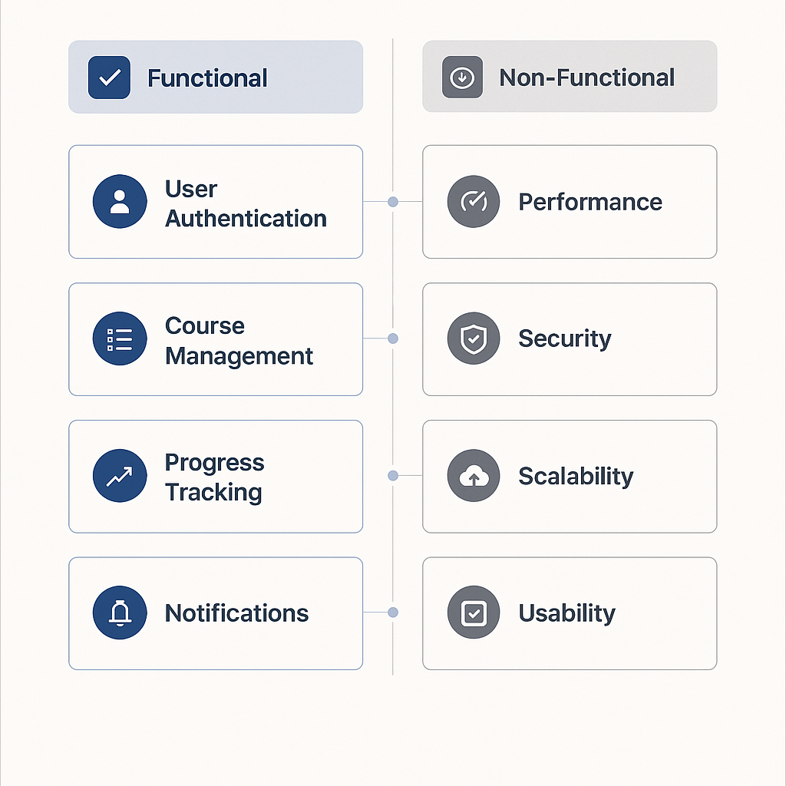{width="6.0in" height="6.0in"}

- ***Functional requirements***

> *The functional requirements specify all system capabilities and
> behaviors that are essential for the successful operation of the
> MentorX platform. These requirements describe how each component
> should function to support students, instructors, parents,
> administrators, and the AI learning engine.*
>
> ***1.1.1 User Management***
>
> ***1. User Registration***
>
> *The system shall permit users (students, instructors, parents, and
> administrators) to securely create new accounts through a registration
> interface accessible via web and mobile platforms.\
> Each registration attempt shall require mandatory input fields
> including:*

- *Full name*

- *Email address*

- *Mobile number*

- *User role selection (student, teacher, parent, or admin)*

- *Secure password*

> *The system shall perform input validation to ensure:*

- *The email address conforms to RFC 5322 standard format.*

- *The password meets complexity requirements (minimum 8 characters,
  alphanumeric, at least one special character).*

> *The system shall send a **One-Time Password (OTP)** via both email
> and SMS to validate the user's identity before activation.\
> Additionally, the platform shall bind each account to a unique device
> identifier (IMEI) and IP address to prevent credential sharing or
> unauthorized access.\
> If a user attempts to access the platform from an unrecognized device,
> a secondary OTP verification or administrator approval shall be
> required.*
>
> ***2. Secure Authentication***
>
> *The system shall implement a **multi-layered authentication
> mechanism** consisting of:*

1.  *Username/Email and Password verification.*

2.  *OTP or two-factor authentication (2FA).*

3.  *Device and IP recognition.*

> *All credentials shall be transmitted securely using **TLS 1.3
> encryption**.\
> Failed login attempts exceeding three (3) consecutive tries shall
> result in temporary account suspension and a security alert
> notification.\
> The system shall automatically log users out after a configurable
> period of inactivity to prevent session hijacking.*
>
> ***3. User Profile Management***
>
> *Each user shall have access to a **Profile Management Interface**
> where personal details such as name, photo, contact information, and
> password can be updated.\
> Profile modifications shall be validated and recorded in audit logs
> for traceability.\
> Parents shall be permitted to link multiple student profiles under
> their account for consolidated monitoring.\
> All updates shall propagate across dependent modules, ensuring data
> consistency in dashboards, reports, and analytics.*
>
> ***1.1.2 Course and Content Management***
>
> ***4. Course Creation***
>
> *The system shall provide instructors with a **Course Management
> Dashboard** for creating and configuring courses.\
> Each new course shall require input fields including course title,
> description, subject, grade level, duration, schedule, and pricing (if
> applicable).\
> Instructors shall be able to attach course materials such as:*

- *PDF documents*

- *PowerPoint files*

- *Recorded video lectures*

- *Interactive links*

> *Upon submission, the system shall automatically verify file types and
> generate metadata for indexing and search optimization.*
>
> ***5. Course Editing and Deletion***
>
> *Instructors shall have the authority to modify course content, update
> schedules, or deactivate outdated materials.\
> Deletion requests shall require confirmation and administrative
> approval when enrolled students are affected.\
> All deleted courses shall be archived within a **Course Repository**
> for future restoration or audit reference.*
>
> ***6. Lesson Management***
>
> *Each course shall contain a sequence of lessons managed through a
> dedicated interface.\
> Lessons shall include:*

- *Title and description*

- *Video or live session link*

- *Summary notes and supporting documents*

- *Assignments or practice tasks*

> *The system shall enforce **lesson progression control**, ensuring
> students cannot access subsequent lessons without completing
> prerequisites (e.g., watching videos, submitting assignments, or
> passing a quiz).\
> Completion status shall be automatically updated in the student's
> progress record.*
>
> ***1.1.3 Attendance and Engagement Tracking***
>
> ***7. Attendance Recording***
>
> *For physical sessions, students shall record attendance via **QR code
> scanning** generated by the system and linked to their unique Student
> ID.\
> For online sessions, attendance shall be automatically logged when
> students join live classes, interact with materials, or submit
> assignments.\
> In cases of absence, automated notifications shall be sent to the
> parent and teacher dashboard.\
> Attendance logs shall be stored in the database for at least one
> academic year and accessible for reporting.*
>
> ***8. Engagement Analytics***
>
> *The system shall track student engagement metrics, including:*

- *Video completion rates*

- *Assignment submission frequency*

- *Login activity*

- *Session duration*

> *AI algorithms shall process this data to determine participation
> levels and detect early signs of disengagement or dropout risk.*
>
> ***1.1.4 Assignments and Examinations***
>
> ***9. Assignment Management***
>
> *Instructors shall upload assignments linked to specific lessons or
> topics.\
> Students shall submit assignments via file upload, structured forms,
> or text input.\
> The system shall timestamp every submission and flag late entries.\
> AI models shall automatically grade objective questions and provide
> instructors with suggestions for subjective answer evaluation.*
>
> ***10. Exam Creation and Randomization***
>
> *Instructors shall create exams by specifying parameters including:*

- *Course and topic coverage*

- *Number of questions*

- *Difficulty level (easy, medium, hard)*

- *Exam duration*

- *Grading weightage*

> *An integrated **AI Question Generator** shall automatically create
> randomized and unique question variations per student to prevent
> cheating.\
> The generated questions shall be validated against the course content
> database to ensure relevance and accuracy.*
>
> ***11. Exam Administration***
>
> *Students shall take exams within a **secure, monitored environment**
> that:*

- *Disables navigation away from the exam page.*

- *Includes real-time terms and progress tracking.*

- *Saves answers periodically (auto-save every 30 seconds).*

- *Prevents multiple logins during an exam session.*

> *Upon submission, AI algorithms shall instantly grade objective
> questions, while subjective responses shall be queued for instructor
> review.*
>
> ***12. Grading and Feedback***
>
> *Grading shall be performed through a hybrid model:*

- *Automated AI grading for structured questions.*

- *Instructor grading for essay-type responses.*

> *The system shall calculate final scores, store them in the student
> profile, and notify both student and parent upon release.\
> Teachers shall be able to modify scores manually, with reasons
> documented in audit logs.\
> Students shall receive detailed performance feedback, highlighting
> strong and weak areas.*
>
> ***1.1.5 Communication and Collaboration***
>
> ***13. Public Discussion Forums***
>
> *Each course and lesson shall include a moderated discussion board.\
> Students and teachers may post questions, replies, and resource
> links.\
> An AI-based moderation filter shall detect and flag offensive or
> irrelevant content.\
> All discussions shall be stored for academic tracking and future
> reference.*
>
> ***14. Private Messaging***
>
> *The platform shall include an internal messaging system that enables
> direct communication between:*

- *Student ↔ Teacher*

- *Parent ↔ Teacher*

- *Admin ↔ User*

> *Unread messages shall trigger notification badges and optional email
> alerts.\
> Message data shall be encrypted and retained according to privacy
> policy settings.*
>
> ***15. AI Chatbot Assistance***
>
> *An AI chatbot shall be integrated across all modules to:*

- *Provide real-time help and guidance.*

- *Answer frequently asked questions.*

- *Recommend learning materials.*

- *Offer troubleshooting support.*

> *The chatbot shall use Natural Language Processing (NLP) for
> contextual understanding and continuous learning based on user
> interactions.*
>
> ***1.1.6 Financial and Administrative Operations***
>
> ***16. Payment Management***
>
> *The system shall manage all financial transactions related to:*

- *Tuition fees*

- *Course subscriptions*

- *Refund requests*

- *Promotional discounts*

> *Payments shall be processed through secure gateways (e.g., PayPal,
> Stripe, or Fawry).\
> Admins shall have access to a **Financial Dashboard** for tracking
> revenue, expenses, and overdue payments.*
>
> ***17. Reporting and Analytics***
>
> *Administrators shall generate analytical reports including:*

- *Student performance summaries*

- *Teacher productivity metrics*

- *Revenue reports*

- *Attendance statistics*

- *Dropout risk predictions*

> *Reports shall be exportable in PDF, Excel, or CSV formats and
> accessible by authorized personnel only.*
>
> ***1.1.7 Security and Access Control***
>
> ***18. Access Levels***
>
> *The system shall implement **Role-Based Access Control (RBAC)** to
> restrict functionality based on user type:*

- *Students: access only to personal academic data.*

- *Teachers: access to managed courses and enrolled students.*

- *Parents: access to child-related data.*

- *Admins: full system oversight and configuration authority.*

> ***19. Session Management***
>
> *All user sessions shall have unique tokens with expiration
> timestamps.\
> The system shall immediately terminate sessions upon logout or
> security breach detection.*
>
> ***1.2 NON-FUNCTIONAL REQUIREMENTS***
>
> *The non-functional requirements define system quality attributes such
> as performance, scalability, reliability, and compliance that govern
> the overall user experience and platform robustness.*
>
> ***2.2.1 Performance***

- *The system shall support a minimum of **10,000 concurrent active
  users** with no degradation in response time.*

- *Average server response time shall not exceed **2 seconds** for 95%
  of transactions.*

- *The platform shall deliver real-time updates (attendance, grades,
  notifications) with a maximum delay of **1 second**.*

- *Database queries shall be optimized to maintain read/write operations
  within **300 milliseconds**.*

> ***2.2.2 Scalability***

- *The architecture shall support **horizontal scaling** of backend
  services.*

- *Auto-scaling shall be configured on cloud infrastructure (AWS/Google
  Cloud) to handle traffic spikes.*

- *System modules (AI, backend, storage) shall be containerized for
  efficient deployment and scaling.*

> ***2.2.3 Reliability and Availability***

- *The system shall maintain **99.5% uptime** annually.*

- *Redundant servers shall ensure continuous operation during
  maintenance or server failure.*

- *Automatic failover and data recovery mechanisms shall be implemented
  to prevent service disruption.*

- *Data backup frequency shall be **every 24 hours** with retention for
  **90 days**.*

> ***2.2.4 Security***

- *All communication shall be encrypted using **SSL/TLS (HTTPS)**.*

- *Sensitive data shall be encrypted at rest using **AES-256**.*

- *Multi-factor authentication (MFA) shall be mandatory for all
  privileged accounts.*

- *The system shall be resistant to common web vulnerabilities (SQL
  Injection, XSS, CSRF).*

- *Regular penetration testing shall be conducted every quarter.*

> ***2.2.5 Usability***

- *The user interface shall adhere to **WCAG 2.1 accessibility
  standards**, ensuring support for visually impaired users.*

- *Font sizes, contrast ratios, and layout responsiveness shall be
  consistent across devices.*

- *Interactive tutorials and help sections shall guide first-time
  users.*

- *Navigation flow shall remain uniform across dashboards.*

> ***2.2.6 Maintainability***

- *The codebase shall adopt modular and microservices architecture.*

- *Continuous Integration and Continuous Deployment (CI/CD) pipelines
  shall automate testing and deployment.*

- *Source code shall be version-controlled using GitHub or GitLab.*

- *Documentation shall accompany all APIs, database schemas, and system
  modules.*

> ***2.2.7 Compatibility***

- *The platform shall support all major browsers: Chrome, Edge, Firefox,
  and Safari.*

- *The mobile application shall support Android (v10+) and iOS (v14+).*

- *Backend APIs shall follow RESTful conventions and JSON standards.*

> ***2.2.8 Privacy and Compliance***

- *The system shall comply with data protection regulations (GDPR, CCPA
  equivalents).*

- *Users shall be informed of data collection and consent policies upon
  registration.*

- *The system shall support data anonymization and deletion requests.*

- *Audit logs shall maintain a record of all access, modification, and
  deletion events.*

> ***2.2.9 Accessibility***

- *The platform shall integrate **Text-to-Speech (TTS)** and
  **Speech-to-Text (STT)** for inclusivity.*

- *Voice navigation and dictation features shall be available on both
  mobile and web interfaces.*

{alt="A graph with orange bars AI-generated content may be incorrect."
width="5.152777777777778in" height="2.576388888888889in"}

- ***NON-FUNCTIONAL requirements***

> *This section defines the Non-Functional Requirements (NFRs) for the
> MentorX (EduCore) platform. NFRs describe system qualities that
> transcend individual features---such as performance, security,
> reliability, maintainability, compatibility, and accessibility---and
> they establish measurable constraints and expectations for system
> behavior. The purpose of documenting NFRs is to provide a clear
> framework that guides design, implementation, testing, and operations
> to ensure the platform is robust, secure, scalable, and
> user-friendly.*

*Key NFR categories covered in this section:*

1.  *Security*

2.  *Availability*

3.  *Safety*

4.  *Reliability*

5.  *Usability*

6.  *Efficiency*

7.  *Maintainability*

8.  *Performance*

9.  *Scalability*

10. *Compatibility*

11. *Accessibility*

***2.1 Security***

***2.1.1 Security Overview and Terminology***

> *Below are the principal security assets, common exposures,
> vulnerabilities, attack examples, threats, and controls relevant to
> the platform.*

***Assets** (examples)*

- ***User Data***

  - *Personal information: names, email addresses, phone numbers,
    addresses.*

  - *Authentication credentials: usernames, passwords, 2FA/OTP tokens.*

- ***Educational Content***

  - *Course materials: lecture files, presentations, videos.*

  - *Assessment content: exam questions, student answers, grading data.*

- ***Communication Channels***

  - *Chat logs, private messages, forum posts.*

- ***Platform Infrastructure***

  - *Server instances, databases, code repositories.*

- ***Access Controls***

  - *Role definitions, permissions, RBAC policies.*

- ***Configuration & Monitoring***

  - *System and security configuration settings, audit and security
    logs.*

- ***Intellectual Property***

  - *Copyrighted teaching materials.*

- ***Third-party Integrations***

  - *API keys, integration tokens, external services.*

***Exposure** (examples)*

- *Unprotected or unencrypted user data.*

- *Unencrypted communications (data in transit).*

- *Weak authentication allows unauthorized access.*

- *Misconfigured access permission permitting privilege escalation.*

- *Vulnerable third-party APIs or libraries.*

- *Insecure chat or file-sharing channels.*

- *Insider threats or social engineering attacks.*

***Vulnerabilities** (examples)*

- *Weak password policies or missing multi-factor authentication.*

- *Outdated or unpatched third-party libraries.*

- *Insecure API endpoints (lack of input validation).*

- *Misconfigured cloud permissions or open storage buckets.*

***Attack Scenarios** (examples)*

- *Credential stuffing or brute-force login attempts.*

- *Malware or ransomware infecting servers.*

- *Exploitation of unpatched software to gain remote control.*

- *API key theft leading to data exfiltration.*

***Threats** (examples)*

- *Unauthorized accounts compromise by guessing or stealing
  credentials.*

- *Administrator account takeover.*

- *Creation and use of fake or bot accounts to manipulate content or
  assessments.*

***Controls** (recommended)*

1.  ***Security Audits & Penetration Testing***

    - *Regularly scheduled security assessments; penetration tests at
      least quarterly or before major releases.*

2.  ***Patch & Vulnerability Management***

    - *Timely application of security patches for OS, middleware,
      frameworks, and third-party components.*

3.  ***Secure Development***

    - *Secure coding standards, static and dynamic code analysis,
      mandatory code reviews focused on security.*

4.  ***Strong Access Control***

    - *Enforce MFA/OTP, device binding, RBAC, and least privilege.*

5.  ***Third-Party Security***

    - *vetting and periodic audits of third-party vendors; use of scoped
      API keys and short token lifetimes.*

6.  ***Monitoring & Logging***

    - *Centralized logs, SIEM integration, anomaly detection, and
      automated alerts for suspicious activities.*

7.  ***Encryption***

    - *TLS for all in-transit data; AES-256 (or equivalent) for
      sensitive data at rest.*

8.  ***Incident Response***

    - *Formal incident response plan, playbooks for common incidents,
      and recovery/testing exercises.*

***2.1.2 Security Assurance: Strategy and Measures***

> ***Vulnerability avoidance***

- *Apply secure development lifecycle (SDL) practices: threat modeling,
  secure design reviews, and coding guidelines.*

- *Enforce strict input validation and output encoding to prevent
  injection attacks.*

- *Use hardened system images and infrastructure as code with secure
  defaults.*

***Attack detection and elimination***

- *Deploy anti-malware scanning on servers and CI pipelines to detect
  infected artifacts.*

- *Implement device recognition and trigger re-verification (OTP) for
  logins from new devices or suspicious IPs.*

- *Employ runtime protection mechanisms (WAF, EDR) to detect and block
  malicious traffic.*

***Exposure limitation and recovery***

- *Maintain daily backups with immutable snapshots and tested restore
  procedures.*

- *Implement account suspension, forced password reset, and step-up
  authentication on compromise detection.*

- *Maintain data classification and least-privilege policies to minimize
  sensitive data exposure.*

***2.2 Availability***

> ***Goal:** Ensure the platform is accessible and usable with minimal
> downtime.*
>
> ***Key concepts and measures***

- ***High Availability:** Architect systems across multiple availability
  zones/regions to reduce single points of failure.*

- ***Redundancy & Failover:** Deploy redundant instances for all
  critical components (app servers, databases, cache, message queues);
  automated failover configured.*

- ***Load Balancing:** Use load balancers to distribute traffic across
  healthy instances and enable session stickiness if required.*

- ***Fault Tolerance:** Design services to degrade gracefully;
  non-critical features may be temporarily disabled while core learning
  services remain available.*

- ***Disaster Recovery:** Maintain a disaster recovery plan with RTO
  (Recovery Time Objective) and RPO (Recovery Point Objective) targets;
  test recovery procedures periodically.*

- ***Monitoring & Alerting:** Implement real-time monitoring, health
  checks, and alerting for service degradation.*

- ***Service Level Agreements (SLAs):** Define uptime targets (e.g.,
  99.5% or higher) and response time SLAs for critical services.*

- ***Performance Optimization:** Cache static assets, optimize DB
  queries, and use CDN for media to reduce load and improve
  availability.*

- ***Data Replication & Capacity Planning:** Replicate critical data
  across zones; perform capacity planning and load testing before peak
  periods.*

***2.3 Safety***

> *Safety addresses accidental or intentional harms to users or data and
> prescribes controls to reduce hazards and limit damage.*

***2.3.1 Safety Terminology and Examples***

> ***Accidents** (examples)*

- *Uploading inappropriate or harmful content by mistake.*

- *Unsafe or abusive communications in chat channels.*

- *Unintentional exposure of private data due to configuration errors.*

***Hazards** (examples)*

- *Data breaches exposing student records or exam content.*

- *Distribution of inaccurate or misleading educational content.*

- *Chat misuse (cyberbullying, harassment).*

- *Weak authentication leading to account takeover.*

***Damage** (examples)*

- *Privacy violations, identity theft, reputational harm to users or
  institutions.*

- *Loss of assessment integrity (exam cheating, result tampering).*

- *Emotional harm to students from abusive interactions.*

***Hazard severity** (assessment)*

- *High: Data breaches and exam integrity compromises.*

- *Moderate to High: Technical failures during timed exams.*

- *Moderate: Inappropriate content or chat misuse.*

- *Low to Moderate: Authentication weaknesses and phishing.*

- *Low: Accessibility shortcomings that limit some users' experience.*

***Hazard probability***

- *Probability assessments should be based on empirical data; treat
  hazards as realistic threats and plan mitigations accordingly (even if
  probability is low, impact may be high).*

***2.3.2 Safety Achievement: Prevention and Mitigation***

***Hazard avoidance***

- *Implement content moderation (automated filters + human review) to
  block or flag inappropriate uploads and chat posts.*

- *Enforce robust identity verification (OTP, device binding) during
  registration and high-risk operations.*

- *Provide user education and acceptable use policies; require
  acknowledgment during onboarding.*

- *Implement secure default configurations and continuous security
  posture management.*

***Damage limitation***

- ***Data breaches:** Encrypt data at rest and in transit; segment
  networks and apply strict access controls; rapid breach containment
  and notification procedures.*

- ***Exam failures:** Use redundant exam delivery services, autosave,
  and offline submission fallback strategies; communicate procedures
  clearly to users.*

- ***Inappropriate content/chat misuse:** Enable reporting tools,
  automated moderation, escalation workflows, and sanctions for
  violations.*

- ***Authentication failures:** Use MFA, monitor logs, and use adaptive
  authentication policies.*

- ***Phishing/social engineering:** Provide ongoing awareness training
  and phishing simulation exercises.*

***2.4 Reliability***

*Reliability ensures the system performs consistently and correctly
under defined conditions.*

***2.4.1 Reliability Terminology***

***Human error examples***

- *Incorrect content upload by instructors.*

- *Misconfiguration of exam parameters or permissions.*

- *Inadvertent deletion of course materials.*

***System fault***

- *Server outages, database errors, or storage failures that impair
  system operation.*

***System error***

- *Software bugs or unexpected runtime exceptions causing incorrect
  behavior.*

***System failure***

- *Catastrophic events that render the system unavailable (e.g., major
  outage, data corruption).*

***2.4.2 Reliability Achievement: Strategies and Measures***

***Fault avoidance***

- *Adopt comprehensive testing practices: unit tests, integration tests,
  end-to-end tests, and user acceptance testing (UAT).*

- *Enforce CI/CD with automated checks to prevent regressions.*

- *Use configuration management and infrastructure as code to reduce
  manual configuration errors.*

***Fault detection and removal***

- *Implement centralized logging and monitoring; set up alerts for
  anomalies and error spikes.*

- *Conduct regular audits and code reviews; run static/dynamic analysis
  tools.*

- *Maintain robust rollback mechanisms in the deployment pipeline.*

***Fault tolerance***

- *Redundancy and replication for critical components (master-slave or
  multi-master DB, replicated caches).*

- *Load balancing and circuit breakers to isolate failing components.*

- *Graceful degradation: preserve core functionalities (viewing lessons,
  submitting assignments) even when non-critical services are degraded.*

- *Automated failover and tested disaster recovery plans.*

- *Frequent backups with verification of restore capability.*

***2.5 Usability***

*Usability focuses on how easily users can learn and effectively use the
system.*

***2.5.1 Usability Terminology***

- ***Consistency:** Uniform layouts, controls, and visual language
  across the application.*

- ***User Flow:** Intuitive progression for common tasks (registration,
  course enrollment, exam-taking).*

- ***User Experience (UX):** Design decisions that reduce cognitive load
  and improve task completion rates.*

- ***Efficiency:** Minimize steps and time required to complete tasks.*

- ***Information Architecture:** Structured organization of content to
  facilitate findability.*

***2.5.2 Usability Achievement: Requirements and Practices***

- *Maintain a consistent visual and interaction design system (UI kit,
  components).*

- *Optimize onboarding: concise guided tours, contextual help, and
  progressive disclosure of advanced features.*

- *Use A/B testing and usability testing sessions with representative
  users to iterate the UI.*

- *Provide clear form validation messages and error recovery options.*

- *Ensure responsive design so the interface adapts across desktop,
  tablet, and mobile.*

- *Provide non-technical, plain-language help content and video
  tutorials.*

- *Reduce unnecessary clicks and streamline workflows for instructors
  and students.*

***2.6 Efficiency***

> *Efficiency relates to resource usage, throughput, and the speed of
> completing tasks.*

***2.6.1 Efficiency Terminology***

- ***Optimization:** Reducing resource consumption (CPU, memory,
  bandwidth) while preserving functionality.*

- ***Throughput:** Amount of work the system can process in a given time
  (e.g., grading jobs/minute).*

- ***Cycle Time:** Time required to complete a standard process (e.g.,
  content review, exam generation).*

- ***Streamlining:** Removing unnecessary steps in common workflows.*

***2.6.2 Efficiency Achievement: Measures***

- *Implement AI model batching and parallel processing for large-scale
  tasks (e.g., automated grading).*

- *Use CDNs and optimized media encoding for video delivery to reduce
  bandwidth.*

- *Cache frequently accessed metadata and use async processing for heavy
  background jobs.*

- *Optimize database indexes and queries; use read replicas for
  analytics workloads.*

- *Apply compression and progressive loading for multimedia resources.*

- *Continuously monitor model performance and retrain AI components to
  maintain accuracy and efficiency.*

***2.7 Maintainability***

*Maintainability ensures the system can be changed, extended, and
repaired effectively.*

***2.7.1 Maintainability Terminology***

- ***Modularity:** Components are decoupled and independently
  deployable.*

- ***Standardization:** Coding standards, linting, and documentation
  practices.*

- ***Upgradability:** Ability to apply updates with minimal disruption.*

- ***Testability:** Availability of automated tests and test data to
  validate changes.*

***2.7.2 Maintainability Achievement: Practices***

1.  ***Analyzability***

    - *Maintain architecture diagrams, data flow maps, and component
      interaction documents.*

    - *Keep high-level design and decision records.*

2.  ***Changeability***

    - *Adopt modular/microservices architecture to isolate changes.*

    - *Maintain backward-compatible APIs where possible and use
      versioning for breaking changes.*

3.  ***Stability***

    - *Use staging environments and extensive smoke tests before
      production releases.*

4.  ***Testability***

    - *Provide automated unit, integration, and end-to-end tests in CI
      pipelines.*

    - *Include test fixtures for common use cases (courses, exams, user
      roles).*

5.  ***Documentation***

    - *Keep API docs, deployment runbooks, and operational guides up to
      date.*

    - *Maintain a changelog and release notes for each deployment.*

6.  ***Continuous Feedback***

    - *Collect user feedback and telemetry to prioritize maintenance and
      improvements.*

***2.8 Performance***

*Performance requirements define acceptable response times, latency
thresholds, and throughput expectations.*

***2.8.1 Performance Terminology***

- ***Response Time:** Time to react to a user request (UI action, API
  call).*

- ***Latency:** Delay between user action and system response.*

- ***Concurrency:** Number of simultaneous users the system can
  support.*

- ***Bottleneck:** Component limiting overall system throughput.*

- ***Scalability (see §2.9):** Ability to handle increased load.*

***2.8.2 Performance Targets and Achievements***

***Target metrics (examples)***

- *Support ≥ 10,000 concurrent users with acceptable responsiveness.*

- *95th percentile API response time ≤ 2 seconds for typical
  operations.*

- *Page load time ≤ 3 seconds for dashboard pages under normal load.*

- *Media (video) startup within 2--4 seconds using CDN and adaptive
  streaming.*

- *AI inference latency: conversational chatbot responses within ≤ 2
  seconds for simple queries; longer, complex model responses may have
  higher SLAs.*

***Performance measures***

- *Optimize critical paths through catching, indexing, and async
  processing.*

- *Adopt horizontal scaling for stateless services; use autoscaling
  policies.*

- *Conduct load and stress testing pre-launch and before major
  releases.*

***AI-Assisted Features***

- *Use model caching, batching, and quota controls to maintain
  predictable response times.*

- *Continually measure and retrain models to balance accuracy and
  inference latency.*

***2.9 Scalability***

*Scalability describes how the platform grows to meet increased demand.*

***2.9.1 Scalability Concepts and Practices***

- ***Horizontal Scaling:** Add more instances of services to distribute
  load (preferred for web/app layers).*

- ***Vertical Scaling:** Increase resources (CPU, RAM) of single nodes
  when appropriate (useful for databases).*

- ***Auto-Scaling:** Automatically adjust instance counts based on
  metrics (CPU, request rate).*

- ***Elasticity:** Dynamic provisioning to respond to spikes
  (promotional events, exam windows).*

- *Use container orchestration (Kubernetes) and immutable infrastructure
  to enable predictable, repeatable scaling.*

- *Design stateful components (databases, caches) with replication and
  sharding strategies.*

***2.10 Compatibility***

*Compatibility ensures the platform works across diverse client
environments.*

***2.10.1 Compatibility Dimensions and Achievements***

- ***Cross-Browser Support:** Ensure consistent behavior on modern
  versions of Chrome, Firefox, Edge, and Safari.*

- ***Operating Systems:** Support Windows, macOS, Linux on desktop;
  Android and iOS on mobile.*

- ***Backward Compatibility:** Maintain compatibility with reasonable
  older browser or OS versions as defined in the compatibility policy.*

- ***Forward Compatibility:** Use feature detection and polyfills and
  decouple clients from server to minimize disruption by future
  changes.*

- ***Hardware & Database Compatibility:** Support for different hardware
  profiles and database backends (PostgreSQL, MySQL, MongoDB) through
  abstract data access layers.*

***Testing***

- *Maintain a compatibility test matrix and run automated
  cross-browser/device tests on CI.*

***2.11 Accessibility***

*Accessibility ensures inclusive access for users with disabilities and
meets international guidelines.*

***2.11.1 Accessibility Terminology***

- ***Inclusive Design:** Design that considers diverse user needs from
  the outset.*

- ***WCAG:** Web Content Accessibility Guidelines (2.1 recommended).*

- ***Alt Text:** Descriptive text for images and media.*

- ***Contrast Ratio:** Color contrast meeting WCAG minimums.*

- ***Focus Indicator:** Visible focus states for keyboard navigation.*

***2.11.2 Accessibility Measures and Achievements***

- *Conform to **WCAG 2.1 AA** as a minimum target standard.*

- *Provide **Text-to-Speech (TTS)** and **Speech-to-Text (STT)**
  features for content consumption and input.*

- *Ensure keyboard navigability, logical tab order, and clear focus
  indicators.*

- *Provide skip-navigation links and semantic HTML for screen readers.*

- *Ensure forms have clear labels, error messages, and ARIA attributes
  where appropriate.*

- *Conduct regular accessibility audits and include users with
  disabilities in usability testing.*

- *Maintain an accessibility statement and processes to handle
  accessibility feedback and remediation requests.*

***Acceptance Criteria and Measurable Targets (summary)***

*Below are suggested measurable acceptance criteria to accompany the
NFRs for testing and verification:*

- ***Security***

  - *All sensitive data encrypted at rest (AES-256) and all network
    traffic encrypted (TLS 1.2+ / TLS 1.3).*

  - *Penetration test remediation was completed within 30 days of
    discovery.*

- ***Availability***

  - *Production availability ≥ 99.5% measured monthly.*

  - *RTO ≤ 30 minutes for critical failures; RPO ≤ 1 hour for core
    data.*

- ***Performance***

  - *95th percentile API latency ≤ 2 seconds under baseline load.*

  - *Dashboard page load ≤ 3 seconds for 95% of requests.*

- ***Reliability***

  - *Automated test coverage ≥ 80% for critical modules; zero critical
    regressions on release.*

- ***Scalability***

  - *System sustains 2× expected peak loads with autoscaling enabled and
    no outage.*

- ***Accessibility***

  - *WCAG 2.1 AA compliance verified via audits and usability tests.*

- ***Maintainability***

  - *Mean time to recover (MTTR) ≤ 60 minutes for common incidents;
    documented runbooks in place.*

{alt="A bar graph with text AI-generated content may be incorrect."
width="6.218942475940508in" height="3.7083333333333335in"}

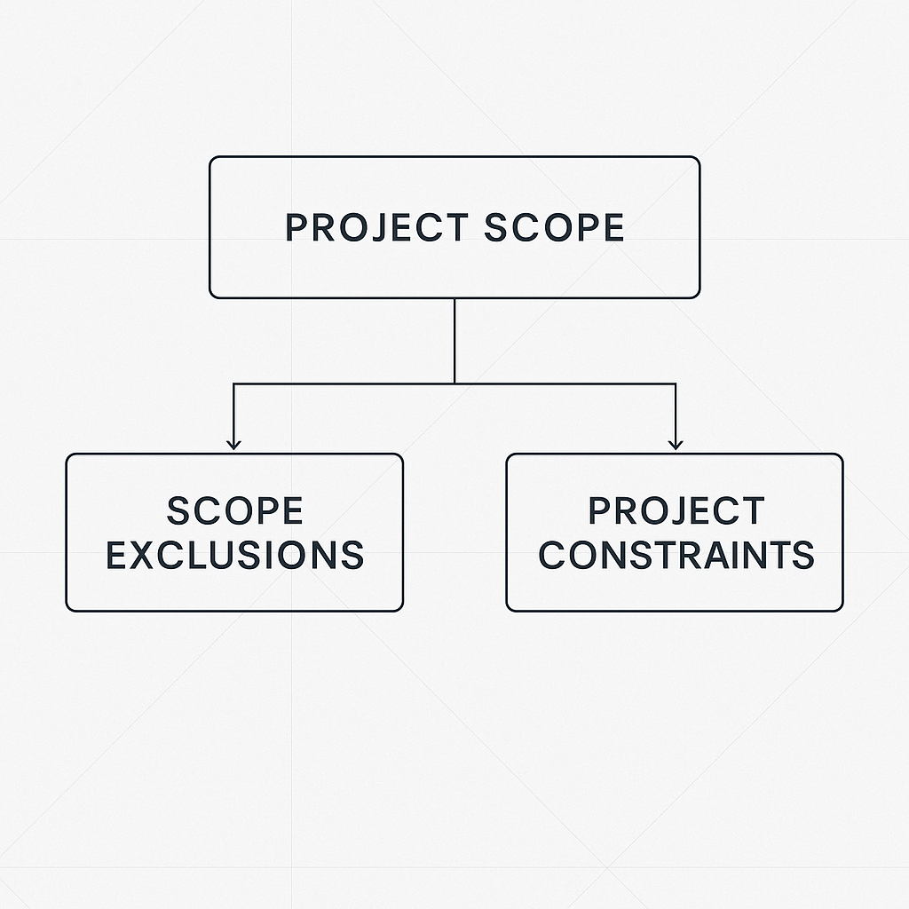{width="1.5416666666666667in"
height="1.5416666666666667in"}

- ***Scope Of the project***

### ***Scope Exclusions***

  -----------------------------------------------------------------------
  **Name**           **Description**
  ------------------ ----------------------------------------------------
  **Payment during   The system does not include an integrated payment
  Course             feature during course enrollment. Students will not
  Enrollment**       be able to make online payments or purchase premium
                     content directly through the platform.

  **Mobile           The development of dedicated mobile applications for
  Application        iOS and Android is excluded. The platform will be
  Development**      fully optimized for mobile browsers but will not
                     include native mobile apps.

  **Large-Scale      The system will not be designed to support a very
  Hosting**          high number of concurrent users beyond the planned
                     capacity limit.

  **Live Streaming** The platform will not support real-time live
                     streaming of classes or events. Video content will
                     be uploaded and accessed asynchronously.

  **Multilingual     The system will not include support for multiple
  Support**          languages. Content will be provided in a single
                     language only.

  **Certification    The project excludes a certificate or diploma
  Management**       management system. Automated issuance or
                     verification of certifications is not within the
                     current scope.

  **Accessibility    Advanced accessibility features (for users with
  Enhancements**     visual, auditory, or motor disabilities) are not
                     implemented in this version of the system.
  -----------------------------------------------------------------------

###  

### ***Project Constraints***

  -----------------------------------------------------------------------
  **Name**            **Description**
  ------------------- ---------------------------------------------------
  **Budget**          The project operates under a fixed budget, with no
                      provision for major financial expansion or
                      unforeseen expenses.

  **Timeline**        The project must be completed within a predefined
                      schedule, which may restrict the addition of extra
                      functionalities.

  **Scalability**     Platform scalability is limited by available
                      infrastructure and technical resources, which may
                      affect performance under heavy load.

  **Security**        Security measures are implemented within available
                      means. Full protection against all potential
                      threats may not be guaranteed due to limited
                      resources.

  **Regulatory        The system must comply with applicable regulations
  Compliance**        and policies (such as data privacy laws), which may
                      restrict some technical or functional decisions.

  **User Acceptance** The overall success depends on user engagement and
                      acceptance, which may vary based on user experience
                      and satisfaction.

  **Resource          The project is limited by the number of available
  Limitations**       developers, designers, and technical experts.

  **User Feedback**   Gathering user feedback and conducting large-scale
                      usability surveys may be constrained by time and
                      resources.

  **Legal and Ethical The project must adhere to data privacy standards
  Considerations**    (e.g., GDPR) and intellectual property regulations,
                      potentially influencing feature implementation.
  -----------------------------------------------------------------------

*Technical Report*

***For:** Graduation Project --- MentorX*

*RAG Chatbot*

# *Title*

***Retrieval**‑**Augmented Generation (RAG) Educational Chatbot for
High**‑**School Teacher***

# *Abstract*

*This report describes the design, implementation and evaluation of a
knowledge‑grounded educational chatbot for a single high‑school teacher
and one subject. The chatbot uses a RAG pipeline: document ingestion →
chunking → embeddings → vector DB → semantic retrieval → LLM generation.
The goal is a practical, deployable prototype (Streamlit) that answers
students' questions based on the teacher's real material and achieves
measurable accuracy on a held‑out QA set.*

# *Goals*

- *Build a chatbot that answers student questions from the teacher's
  materials (PDFs, slides, notes).*

- *Keep the teacher's voice and factual correctness (avoid
  hallucination) by conditioning generation on retrieved text.*

- *Produce a demo UI and evaluate quality (similarity/accuracy) on a
  test set (e.g. 50--200 Qs).*

# *System Overview (Input → Output)*

***Input:** free‑text student question (Arabic)*

***Preprocessing:** normalize, remove punctuation, optional Arabic
diacritics removal, tokenize if needed.*

***Embedding:** convert cleaned question to vector via
SentenceTransformer (or OpenAI embeddings).*

***Retrieval:** compute cosine similarity against stored vectors
(chunks). Return top‑k chunks.*

***Answer Generation:** construct a prompt that includes retrieved
chunks and the student question; send to LLM to generate a concise
answer restricted to the retrieved context*

***Postprocessing:** truncate, apply simple rules (credit the source,
add references, confidence score).*

***Output:** answer text + confidence + source links (lesson titles /
paragraph IDs).*

# *Data (What to feed the system)*

1.  *Teacher's canonical materials: PDFs, DOCX, PPTX, lecture scripts.*

2.  *FAQ / historical student questions (if available).*

3.  *Book excerpts (optional) --- cite sources.*

4.  *Metadata: lesson IDs, timestamps, video links.*

***Storage format for knowledge:** a table / JSON with columns:
chunk_id, lesson_id, chunk_text, embedding_vector, source_path,
start_pos, end_pos.*

# *Preprocessing & Chunking*

- *Extract text from PDF/DOCX/PPTX (PyMuPDF / pdfminer / python-docx /
  python-pptx).*

- *Clean text: normalize Arabic characters ([ى]{dir="rtl"} ←
  [ي]{dir="rtl"} ,[ا]{dir="rtl"} → [أ]{dir="rtl"} handling), remove
  non‑text garbage.*

- *Split text into chunks: recommended 200--600 tokens (≈250--500 words)
  with overlap 50--100 tokens.*

- *Keep chunk metadata: lesson title, page number, original filename.*

***Why chunking?** - Embedding models and retrieval work better on
semantically coherent passages. Overlap reduces lost context.*

# *Embeddings*

- *Local option: sentence-transformers/all-MiniLM-L6-v2 (fast, 384
  dims). Good for prototyping.*

- *Higher quality option: paraphrase-multilingual-MiniLM or*

> *paraphrase-multilingual-mpnet-base-v2 for Arabic sensitivity.*

- *Cloud option: OpenAI text-embedding-3-small or
  text-embedding-3-large.*

### *Code sketch (Python)*

***from** sentence_transformers **import** SentenceTransformer model =
SentenceTransformer(\'all-MiniLM-L6-v2\')*

*embs = model.encode(list_of_chunks, show_progress_bar=True)*

# *Vector Database / Index*

*Options: - **FAISS** (local, fast) --- good for demo. Use IndexFlatIP
with normalized vectors for cosine similarity. - **ChromaDB** --- easy,
built for embeddings & small projects. - **Pinecone / Weaviate /
Milvus** --- production ready, scalable, managed.*

***Indexing steps:** 1. Normalize embeddings (L2 norm) for cosine by
inner product. 2. Build FAISS index with vectors and store mapping from
index→chunk metadata.*

# *Retrieval*

- *Query embedding → search top K (K=3--5).*

- *Return chunks sorted by score.*

- *Optionally apply a filtering layer: prefer recent lessons or same
  lesson type.*

# *Prompt Engineering & Generation*

### *Prompt pattern (conservative):*

*You are an educational assistant. Use only the following passages from
the teacher\'s material to answer the student\'s question. If the answer
is not found in the passages, say \"I don\'t find the answer in the
provided material. Please ask your teacher.\" Keep the reply short and
in Arabic.*

*Passages:*

1)  *\<chunk 1 text\>*

2)  *\<chunk 2 text\>*

*\...*

*Question: \<student question\> Answer:*

***LLM choices:** - OpenAI GPT‑4/3.5 (via API) --- best quality. - Local
Llama/Mistral-based models (if GPU available) --- offline option.*

***Safety trick to reduce hallucination:** instruct LLM to answer only
from the passages and to include the source ID for each factual
sentence.*

# *Confidence & Answer Verification*

- *Use retrieval scores to compute a confidence baseline (e.g., weighted
  similarity sum).*

- *Optionally re‑encode the generated answer and compute similarity to
  the retrieved passages to detect divergence.*

# *Evaluation (Accuracy / Metrics)*

***Data:** create a test set of Q→gold answer pairs (50--200 items). Use
teacher‑verified answers.*

***Automatic metrics:** - **Cosine similarity** between final answer
embedding and gold answer embedding (semantic similarity). - **BLEU /
ROUGE / Meteor** for lexical overlap (less ideal for Arabic). -
**BERTScore** (better semantic metric) or Sentence‑Transformers cosine.*

***Human evaluation:** - Grade answers as Correct / Partially /
Incorrect. - Collect teacher feedback: Is the answer pedagogically
correct? Is phrasing appropriate?*

***Reporting:** show average similarity, %Correct, confusion examples.*

# *Implementation Plan (Code + Demo)*

***Minimal prototype (for the defence/demo):** 1. Scripts: - ingest.py
--- extract + chunk*

*+ embed + index (FAISS). - server.py --- FastAPI endpoint: /ask accepts
question, returns answer+sources+confidence. - app.py --- Streamlit demo
UI calling /ask. 2. Local stack: Python, sentence-transformers,
faiss-cpu, transformers, openai (optional), fastapi, uvicorn,
streamlit.*

### *Quick run commands:*

*pip install -r requirements.txt*

*python ingest.py \# creates index and metadata.json*

*uvicorn server:app \--reload streamlit run app.py*

# *Deployment*

- *For demo: deploy on local machine or Streamlit Cloud.*

- *For production: containerize with Docker and deploy on Render /
  Railway / AWS.*

### *Dockerfile (Streamlit)*

*FROM python:3.11-slim WORKDIR /app*

*COPY requirements.txt .*

*RUN pip install -r requirements.txt COPY . .*

*CMD*

*\[\"streamlit\",\"run\",\"app.py\",\"\--server.port=8501\",\"\--server.address=0.0.0.0\"\]*

# *Example Code Snippets*

### *Ingest + index (FAISS)*

***import** faiss, numpy **as** np, joblib*

*embs = np.array(embs).astype(\'float32\')*

*\# normalize*

*faiss.normalize_L2(embs)*

*index = faiss.IndexFlatIP(embs.shape\[1\]) index.add(embs)*

*joblib.dump(index, \'faiss_index.joblib\')*

*\# save metadata mapping*

*joblib.dump(metadata, \'kb_metadata.joblib\')*

### *Query + retrieve + generate*

### 

*q_emb = model.encode(\[question\]) faiss.normalize_L2(q_emb)*

*D, I = index.search(q_emb, k=3)*

*chunks = \[metadata\[i\]\[\'text\'\] **for** i **in** I\[0\]\] prompt =
build_prompt(chunks, question) answer = call_llm_api(prompt)*

# *Experiments and Expected Results*

- *Baseline: retrieval only (return the top chunk) --- measure exact
  match with gold answers.*

- *RAG (retrieval + LLM) --- expect better fluency and readability;
  measure BERTScore.*

- *Ablation: different chunk sizes, K values, embedding models.*

# *Risks & Mitigations*

- ***Hallucination:** mitigate by prompt constraints and source
  citation.*

- ***Arabic language handling:** pick multilingual embeddings and test
  normalization; consider Arabic‑specific models.*

- ***Insufficient data:** augment with teacher FAQ, or manually craft
  100 Q/A for training/testing.*

# *Deliverables for the Defence*

1.  *Technical report (this document).*

2.  *Colab / repo with ingest.py, server.py, app.py and sample data.*

3.  *Live demo (Streamlit) showing 5 example Qs and test evaluation.*

4.  *Evaluation table (50 test Qs) and short conclusions.*

## *Student Performance Prediction System*

#### Introduction {#introduction-1}

1.  *Project Overview*

*This feature is part of an AI-powered educational platform designed for
a high school physics teacher. The Student Performance Prediction System
aims to analyze students' learning data and predict whether a student is
"Ready for the Exam" or "Needs Revision", based on their past
performance and behavior metrics.*

2.  *Purpose*

*The purpose of this model is to assist the teacher in identifying
students who might struggle before the final exam, allowing for early
intervention and customized support.*

#### Data and Features

1.  *Dataset Source*

*The dataset used is derived from the Student Performance Dataset (UCI
Repository / Kaggle), originally focused on Mathematics but adapted to
represent Physics performance.*

2.  *Selected Features*

> *Feature Description*

+-----------------------------------------------------------------------------------------------------------+-------------------------------+
| > ***studytime***                                                                                         | > *Weekly study hours*        |
+===========================================================================================================+===============================+
| > ***failures***                                                                                          | > *Number of previous course  |
|                                                                                                           | > failures*                   |
+-----------------------------------------------------------------------------------------------------------+-------------------------------+
| > ***absences***                                                                                          | > *Number of absences*        |
+-----------------------------------------------------------------------------------------------------------+-------------------------------+
| > ***G1** | > *Scores in three exams      |
| > , **G2** , **G3***                                                                                      | > during the term*            |
+-----------------------------------------------------------------------------------------------------------+-------------------------------+
| > ***avg_score***                                                                                         | > *Average of G1, G2, and G3* |
+-----------------------------------------------------------------------------------------------------------+-------------------------------+
| > ***status***                                                                                            | > *Target label ("Ready" /    |
|                                                                                                           | > "Needs Revision")*          |
+-----------------------------------------------------------------------------------------------------------+-------------------------------+

3.  *Label Generation*

*Students with*

*\*

*were labeled as "Ready", otherwise "Needs Revision".*

#### Model Development

1.  *Model Choice*

*A Random Forest Classifier was selected due to its:*

- *High accuracy on tabular data*

- *Robustness to overfitting*

- *Ability to handle mixed data and nonlinear relationships*

2.  *Pipeline Steps*

<!-- -->

1.  *Data Cleaning and Transformation*

2.  *Feature Engineering (Average score, target label creation)*

3.  *Train/Test Split (80/20)*

4.  *Model Training using*

5.  *Model Evaluation and Result Analysis*

#### Experimental Results

1.  *Model Accuracy*

*The model achieved an accuracy of around 90--95%, depending on the
random seed and split ratio.*

2.  *Confusion Matrix Example*

> *Predicted Ready Predicted Needs Revision*

+------------------------+---------+-----+
| > *Actual Ready*       | *18*    | *1* |
+========================+========:+:===:+
| > *Actual Needs        | *2*     | *9* |
| > Revision*            |         |     |
+------------------------+---------+-----+

3.  *Interpretation*

    - *The model performs very well in identifying students who are
      ready.*

    - *Slight misclassifications happen for borderline cases (avg_score
      ≈ 11--12).*

#### Deployment Plan

- *The trained model will be exported via joblib.*

- *Integrated into the platform backend (Flask/Django API).*

- *When the teacher inputs student data, the AI instantly returns:
  "Ready for Exam*
  {width="0.17097550306211723in"
  height="0.17103346456692914in"}*" or "Needs Revision*
  {width="0.17193897637795275in"
  height="0.17153324584426946in"}*"*

#### Future Work

- *Add more behavioral features (quiz participation, homework submission
  rate).*

- *Use SHAP values for explainable AI --- showing why the model made
  each prediction.*

- *Create a dashboard to visualize student readiness trends over time.*

#### Conclusion

*This feature demonstrates how Artificial Intelligence can assist
teachers by analyzing learning data and automatically predicting student
readiness.*

*The model, built with Random Forest, provides accurate, interpretable
predictions that can improve the*

*learning process in physics education.*

> *Smart Lesson Recommender -- Technical Report*

## *Introduction* {#introduction-2}

*The Smart Lesson Recommender is an AI-powered system designed to
enhance personalized learning for high school physics students.*

*The system analyzes a student's performance and recommends the most
relevant lessons, helping the student strengthen weak areas and optimize
study time.*

*This feature is part of a broader AI-based educational platform aimed
at assisting teachers in delivering tailored content efficiently.*

## *Objectives*

- *Automatically identify students' weak topics based on quiz or
  assignment results.*

- *Suggest lessons that closely match the student's areas of
  improvement.*

- *Improve learning outcomes through personalized recommendations.*

## *Scientific and Technical Concept*

*The system employs a Content-Based Recommendation approach:*

1.  *Text Vectorization: Each lesson description is transformed into
    numerical vectors using TF-IDF (Term Frequency -- Inverse Document
    Frequency).*

2.  *Similarity Measurement: The similarity between a student's weak
    topics and lesson content is calculated using Cosine Similarity.*

3.  *Recommendation Selection: Lessons with the highest similarity
    scores are recommended to the student.*

*This approach ensures that recommendations are semantically relevant to
the student's weaknesses.*

## *Technical Components*

> *Component Purpose*

+------------------+----------------------------------------+
| > *Python*       | > *Primary implementation language*    |
+==================+========================================+
| > *pandas*       | > *Data manipulation and               |
|                  | > preprocessing*                       |
+------------------+----------------------------------------+
| > *scikit-learn* | > *TF-IDF vectorization and similarity |
|                  | > computation*                         |
+------------------+----------------------------------------+
| > *Jupyter /     | > *Experimental development and        |
| > Colab*         | > testing environment*                 |
+------------------+----------------------------------------+

## *Workflow and Methodology*

#### Data Preparation

*The lessons dataset contains each lesson's title and description:*

#### Text Vectorization

*Convert lesson descriptions to numerical vectors using TF-IDF:*

#### Identifying Student Weaknesses

*Student weaknesses are represented as a short text describing topics
requiring improvement:*

#### Similarity Calculation

*Compute cosine similarity between the student's weak topics and each
lesson description:*

#### Selecting Top Recommendations

*Sort lessons by similarity and select the top recommendations:*

*Sample Output:*

## *Results and Interpretation*

*The recommender system successfully identifies lessons most relevant to
a student's weak topics.*

- *High similarity scores indicate lessons closely aligned with the
  student's weaknesses.*

- *Enables targeted learning and efficient use of study time.*

*Student Weak Topics Recommended Lessons Similarity (%)*

+---------------------------+---------------------------------+--------+
| > *Electricity, Ohm\'s    | > *Ohm\'s Law -- Practical      | *93.5* |
| > Law*                    | > Part*                         |        |
+===========================+=================================+========+
|                           | > *Electric Field -- Simplified | *74.1* |
|                           | > Explanation*                  |        |
+---------------------------+---------------------------------+--------+
|                           | > *Electric Current -- Basics*  | *69.8* |
+---------------------------+---------------------------------+--------+

*3*

## *Deployment Plan*

- *The trained recommender can be integrated into the platform backend
  (Flask/Django API).*

- *Teachers or students can input weaknesses, and the system returns top
  lesson recommendations instantly.*

- *Recommendations can be extended to include videos, interactive
  exercises, and quizzes.*

## *Future Enhancements*

- *Collaborative Filtering: Combine with other students' data to improve
  recommendations.*

- *Deep Learning Embeddings: Use BERT or other transformer models to
  capture semantic meaning beyond TF-IDF.*

- *Dashboard Integration: Visualize recommendations and track student
  progress over time.*

- *Real-Time Updates: Update lesson recommendations dynamically as
  students complete quizzes or assignments.*

## *Conclusion*

*The Smart Lesson Recommender enhances personalized learning by
intelligently analyzing student performance and recommending the most
relevant lessons.*

*Using TF-IDF vectorization and cosine similarity, it provides an
interpretable and efficient solution for adaptive learning in physics
education.*

*This feature demonstrates the potential of AI to deliver tailored
learning experiences, empowering both students and teachers.*

***Student Performance Prediction***

***Introduction***

*This project focuses on predicting student performance using various
data attributes related to demographics, study habits, and previous
scores. Leveraging machine learning classification models, the goal is
to accurately forecast the final Grade a student will receive (A, B, C,
D, or F). The work includes comprehensive data preprocessing, feature
engineering, exploratory data analysis (EDA) to understand data
distributions and relationships, and comparative performance analysis
across six different classifiers. The ultimate outcome is the selection
and deployment of the best-performing model for reliable grade
prediction.*

{width="6.461995844269467in"
height="3.0208333333333335in"}

{width="6.0in"
height="2.5131944444444443in"}

***Problem Statement***

*The primary problem is to accurately predict a student\'s final grade
(A, B, C, D, or F) based on a set of heterogeneous features, including
attendance, study hours, stress level, parental education, and previous
exam scores. This is a multi-class classification problem. The challenge
lies in:*

*Handling categorical data and missing values effectively.*

*Identifying the most impactful features that drive student
performance.*

*Selecting and tuning a classification model that achieves high
predictive accuracy and generalization capability (high F1-score and
Accuracy).*

*Mitigating potential overfitting while ensuring high performance on
unseen test data.*

***System Objectives***

*The main objectives of this system are:*

- ***Data Preparation**: Clean and preprocess the raw student
  performance dataset, including handling null values (imputing
  Parent_Education_Level), removing irrelevant columns (First_Name,
  Last_Name, Department), and checking for duplicates.*

- ***Feature Engineering**: Convert all categorical features into a
  numerical format using techniques like Label Encoding (for
  Family_Income_Level), Binary Encoding (for Gender,
  Internet_Access_at_Home, Extracurricular_Activities), and Ordinal
  Encoding (for the target Grade and Parent_Education_Level).*

- ***Exploratory Data Analysis (EDA)**: Visualize key relationships,
  such as the correlation between study hours and total score, the
  effect of attendance on grades, and the relationship between stress
  level and performance, to gain insights.*

- ***Model Development and Comparison**: Train and evaluate six distinct
  classification models: Logistic Regression, Decision Tree, K-Nearest
  Neighbors (KNN), Random Forest, AdaBoost, and Gaussian Naive Bayes.*

- ***Optimal Model Selection**: Identify the model with the highest
  weighted F1-score on the test dataset as the best-performing
  classifier.*

- ***Model Deployment Preparation**: Save the trained best model and the
  data preprocessing objects (StandardScaler, LabelEncoder,
  OrdinalEncoders) using joblib for future deployment and inference*

***System Architecture***

*The architecture follows a standard **Machine Learning Pipeline**
structure:*

***Data Source:** CSV File (Students Performance Dataset.csv).*

***Data Ingestion & Preprocessing:** Data is loaded into a Pandas
DataFrame.*

***Missing value imputation** and **Feature Engineering** (Encoding) are
performed. Irrelevant columns are dropped.*

***Exploratory Data Analysis (EDA):** Visualization and descriptive
statistics are used to understand the data.*

***Feature Selection:** Initial feature selection is performed by
dropping low-correlation features like Age and Gender, and feature
importance from a **Random Forest model** is used to validate the final
feature set.*

***Data Splitting:** Data is split into **Training (80%)** and **Testing
(20%)** sets.*

***Feature Scaling:** Numerical features are standardized using
**StandardScaler**.*

***Model Training:** Multiple classification models are trained on the
scaled training data.*

***Model Evaluation:** Performance metrics (Accuracy, Precision, Recall,
F1-Score) and **Confusion Matrices** are generated and compared.*

***Model Persistence (Deployment):** The best model and scaler/encoders
are serialized using joblib.*

***Technologies Used***

  -----------------------------------------------------------------------
  ***Category***       ***Technology/Library***    ***Purpose***
  -------------------- --------------------------- ----------------------
  *Language*           *Python*                    *Core programming
                                                   language.*

  *Data Handling*      *Pandas*                    *Data manipulation and
                                                   analysis
                                                   (DataFrames).*

  *Numerical           *NumPy*                     *Numerical
  Operations*                                      computations, array
                                                   operations.*

  *Visualization*      *Matplotlib, Seaborn,       *Static and
                       Plotly Express*             interactive data
                                                   visualization
                                                   (Histograms, Boxplots,
                                                   Scatter plots,
                                                   Heatmaps).*

  *Machine Learning*   *Scikit-learn (sklearn)*    *Model building, data
                                                   splitting, scaling,
                                                   and evaluation.*

  *Model Persistence*  *Joblib*                    *Saving and loading
                                                   trained models and
                                                   encoders.*

  *Classification      *Logistic Regression,       *Algorithms used for
  Models*              Decision Tree, KNN, Random  grade prediction.*
                       Forest, AdaBoost,           
                       GaussianNB*                 
  -----------------------------------------------------------------------

***Dataflow Pipeline***

*The data processing follows a clear, sequential flow:*

***Load Data:** pd.read_csv(\...)*

***Handle Missing Data:** Fill Parent_Education_Level nulls with
\'Unknown\'.*

***Feature Engineering (Encoding):***

*Family_Income_Level: **Label Encoding** (0, 1, 2).*

*Gender, Internet_Access_at_Home, Extracurricular_Activities: **Manual
Binary Encoding** (0/1).*

*Grade (Target): **Ordinal Encoding** (A=0 to F=4) and stored as y.*

*Parent_Education_Level: **Ordinal Encoding** (Unknown=0 to PhD=4).*

***Feature Derivation:** Extract numerical parts from Student_ID and
Email.*

***Drop Irrelevant Features:** Drop original ID, Name, Department,
original Grade, and encoded source columns.*

***Feature Selection:** Drop low-impact features (Age, Gender).*

***Prepare for Modeling:** Separate features (x) and target (y).*

***Train/Test Split:** Split x and y into training and testing sets.*

***Feature Scaling:** Apply StandardScaler to x_train and x_test.*

***Model Training & Evaluation:** Fit models, predict, and calculate
metrics.*

***Model Description***

*The project employs six classification models, with **Random Forest
Classifier** often emerging as the strongest based on the nature of the
data and its superior performance in the results table.*

***Model Type:** **Multi-class Classification**.*

***Best Model (Based on Results):** **Random Forest Classifier**
(likely). This is an **ensemble** model that builds multiple decision
trees and merges their predictions to get a more accurate and stable
result. It is highly effective for non-linear relationships and
high-dimensional data.*

***Hyperparameters:** n_estimators=200, max_depth=20,
max_features=\'sqrt\'.*

***Comparison:** The models were selected to cover different ML
paradigms:*

***Linear:** Logistic Regression*

***Tree-based/Ensemble:** Decision Tree, Random Forest, AdaBoost*

***Distance-based:** KNN*

***Probabilistic:** Gaussian Naive Bayes*

{width="6.0in"
height="2.540277777777778in"}

***Evaluation Metrics***

*Since this is a multi-class classification problem where the classes
(grades A, B, C, D, F) are inherently imbalanced, the following metrics
were tracked, with a focus on weighted averaging to account for class
imbalance:*

***Accuracy:** Overall correct predictions {Accuracy} = {Correct
Predictions}/ {Total Samples}*

***Precision (Weighted):** The ratio of correctly predicted positive
observations to the total predicted positive observations, averaged
across all classes and weighted by support.*

***Recall (Weighted):** The ratio of correctly predicted positive
observations to all observations in the actual class, averaged across
all classes and weighted by support.*

***F1-Score (Weighted):** The harmonic mean of Precision and Recall.
This is the **primary metric** used to select the best model, as it
balances the trade-off between Precision and Recall across all grade
classes. The model with the highest **Test F1-Score** is considered the
best.*

{width="6.0in"
height="1.0916666666666666in"}

{width="6.0in"
height="3.178472222222222in"}

***Use Cases***

*This predictive model can be used by educational institutions for
several high-impact purposes:*

***Early Intervention System:** Identify students predicted to receive a
poor grade (D or F) early in the semester, allowing educators to
intervene with **targeted academic support, mentoring, or counseling**.*

***Resource Allocation:** Help school administrators allocate tutoring
staff and academic resources efficiently to the student segments most at
risk.*

***Curriculum Adjustment:** Provide feedback on which factors (e.g.,
Attendance, Study Hours) have the strongest correlation with failure,
informing potential curriculum or policy adjustments.*

***Student Advising:** Offer personalized recommendations to students
based on their current performance metrics (e.g., \"Increase your study
hours to X per week for a better chance at a B grade\").*

***Future Improvements***

*To enhance the system, the following steps are recommended:*

***Hyperparameter Optimization:** Implement more rigorous tuning
techniques like **Grid Search** or **Random Search** to find optimal
parameters for the top-performing model (Random Forest), potentially
using cross-validation.*

***Feature Importance Analysis:** Use the Random Forest feature
importances to train models only on the **most influential features**
(e.g., Total Score, Final Score, Midterm Score) to potentially reduce
training time and improve generalization.*

***Deep Learning:** Experiment with **Recurrent Neural Networks (RNNs)**
or **Deep Neural Networks (DNNs)**, which can sometimes capture more
complex, non-linear patterns than traditional ML models.*
